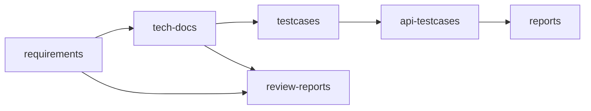

# 项目文档目录说明

本仓库采用「需求 / 技术文档 / 功能测试 / 接口测试」分离的目录结构，便于按迭代与类型管理文档。本文档为**团队入口**：先看本节目录表与推荐阅读顺序，细节下钻各子目录的 `README.md`。

## 推荐阅读顺序

1. **迭代约定**：新需求统一落在同名迭代目录（如 `2026Q2_SP1/`），见下文「使用约定」。
2. **需求溯源**：业务说明以 [`requirements/`](requirements/) 下对应迭代的 Markdown 为准（可由 Jira 同步）。
3. **功能 vs 自动化**：[`testcases/`](testcases/) 为功能测试用例；[`api-testcases/`](api-testcases/) 为接口自动化。**正式验收单轨为 Apifox CLI**（`api_tests/apifox-cli/` + `.\scripts\ApifoxRepoFirst.ps1`）；pytest 已冻结待退役。二者与功能用例平级、勿混放。
4. **本地报告**：[`reports/`](reports/) / [`apifox-reports/`](apifox-reports/) 为本机生成结果（gitignore），**勿提交**。
5. **密钥与多环境**：勿提交根目录 `.env` 与 `env/.env.*` 实值；仅维护示例文件。详见 [`env/README.md`](env/README.md) 与根目录 [`.env.example`](.env.example)。

## 协作与目录关系（概览）

## 目录结构

### 业务文档与测试

| 路径 | 用途 | 是否提交仓库 | 典型维护角色 |
|------|------|--------------|--------------|
| [**requirements/**](requirements/) | 需求文档，按迭代分子目录 | 是 | 产品 / 测试 / 研发 |
| [**tech-docs/**](tech-docs/) | 技术方案、接口设计、DB 变更等；含 `shared/` 跨迭代共用 | 是 | 研发 |
| [**testcases/**](testcases/) | 功能测试用例；脑图源文件可放在迭代下 `xmind/`，表格等放 `assets/` | 是 | 测试 |
| [**api-testcases/**](api-testcases/) | 接口自动化代码与套件说明，按迭代与 `shared/` 组织 | 是 | 测试 / 研发 |
| [**review-reports/**](review-reports/) | 需求评审、技术评审过程稿与结论（Markdown） | 是 | 测试 / 研发 |

### 工程配置、环境与本地产出

| 路径 | 用途 | 是否提交仓库 | 典型维护角色 |
|------|------|--------------|--------------|
| [**env/**](env/) | 多环境 profile：`env/.env.<profile>` 存放真实凭据（被忽略）；示例见目录内 `README` 与根 `.env.example` | 仅示例 | 每人本机 |
| [**reports/**](reports/) | Allure 原始结果、静态报告等 | 否（见 `.gitignore`） | 本机生成 |
| [**tools/**](tools/) | 同步、转换、报告等脚本 | 是 | 按需维护 |
| 根目录 [**.env**](.env) / [**.env.example**](.env.example) | MCP、脚本等共用的环境变量模板与本地配置 | 仅 `.env.example` | 每人本机 |

### 编辑器与 AI（非业务源码）

| 路径 | 用途 | 是否提交仓库 | 说明 |
|------|------|--------------|------|
| [**.vscode/**](.vscode/) | 工作区任务（如 Jira 同步、PAPI-2548 Allure 一键流程） | 视团队约定 | 不含密钥 |
| [**.cursor/**](.cursor/) | Cursor：`mcp.json`、MCP 启动脚本（Apifox / MySQL）、**Skills**（用例规范、Confluence 拉取、接口套件等） | 是 | 路径与令牌勿写死敏感值 |
| [**.cursorignore**](.cursorignore) | 限制 Cursor 索引范围 | 是 | — |

## 使用约定

- **新迭代**：在 `requirements/`、`tech-docs/`、`testcases/`、`api-testcases/` 下各建**同名**迭代目录（如 `2026Q1_SP4/`）。
- **跨迭代复用**：技术文档与接口用例可放在 `tech-docs/shared/`、`api-testcases/shared/`。
- **需求引用**：编写用例或方案时引用 `requirements/<迭代>/xxx.md`，便于与 Jira 工单对照。

## 子文档索引（纵深说明）

| 主题 | 文档 |
|------|------|
| 业务知识库（能力地图 / 契约 / 追溯 / 影响速查） | [knowledge/README.md](knowledge/README.md) |
| 需求文档总览与迭代索引 | [requirements/README.md](requirements/README.md) |
| 脚本工具总览 | [tools/README.md](tools/README.md) |
| 功能用例目录约定 | [testcases/README.md](testcases/README.md) |
| 技术文档目录约定 | [tech-docs/README.md](tech-docs/README.md) |
| 接口自动化目录与 Cursor Skill | [api-testcases/README.md](api-testcases/README.md) |
| 接口自动化单轨（Apifox CLI） | [api-testcases/api_tests/README.md](api-testcases/api_tests/README.md)、[apifox-cli README](api-testcases/api_tests/apifox-cli/README.md) |
| PAPI-2548 历史金样例（pytest，只读参考） | [api-testcases/2026Q2_SP1/README.md](api-testcases/2026Q2_SP1/README.md) |
| 评审产出说明 | [review-reports/README.md](review-reports/README.md) |
| 多环境与 `env/` | [env/README.md](env/README.md) |

## 当前已整理内容

- **requirements/2026Q1_SP3/**：会籍权益分级、可用资源列表、entitlement 等需求文档已迁入。
- **testcases/2026Q1_SP3/**：迭代目录与 xmind 子目录已创建；根目录下的测试用例与 xlsx 若未被占用，可手动移至此处与 `testcases/assets/`。
- **tech-docs/**、**api-testcases/**：目录与占位 README 已创建，可按需新增文档与用例。
