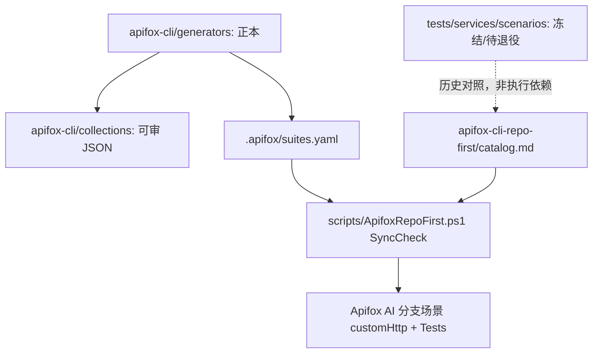

# 接口自动化框架演进说明

## 目标

`api-testcases/api_tests` 是稳定框架目录，目标是把接口自动化沉淀为长期资产，而不是跟随迭代复制套件。

**自 2026-08 起采用单轨：Apifox CLI · Repo-first。**  
新需求、改断言、换测与验收只走「仓库生成器 → SyncCheck → Apifox 场景」；**禁止**再新增 `tests/**/test_*.py` 作为第二套执行真相。既有 pytest 代码视为冻结资产，对照表见 [`pytest-retirement-map.md`](pytest-retirement-map.md)，确认 CLI 覆盖后再删除。

## 单轨分层关系



## 命名策略

- 目录按接口资源或业务能力命名；PAPI 编号保留在场景名、marker 历史、Allure（若仍跑旧用例）与用例表。
- 新增能力优先扩展既有生成器或新增 `GeneratePostmanCollection*.py` + `suites.yaml` 资产 key。
- 不因迭代变化复制整套自动化目录。

## 验收入口（唯一）

```powershell
.\scripts\ApifoxRepoFirst.ps1 -Action SyncCheck -Asset <asset_key>
```

资产表：[`.cursor/skills/apifox-cli-repo-first/catalog.md`](../../../.cursor/skills/apifox-cli-repo-first/catalog.md)。

## 迁移兼容

- `api-testcases/2026Q2_SP1`：历史金样例，只读参考。
- `suites.yaml` 中的 `pytest_e2e` / `scenario_orchestrator`：**仅历史备注**，脚本不读、不作执行依赖。
- 旧目录名 `postman/` 已更名为 `apifox-cli/`（Collection 格式仍为 Postman v2.1）。
