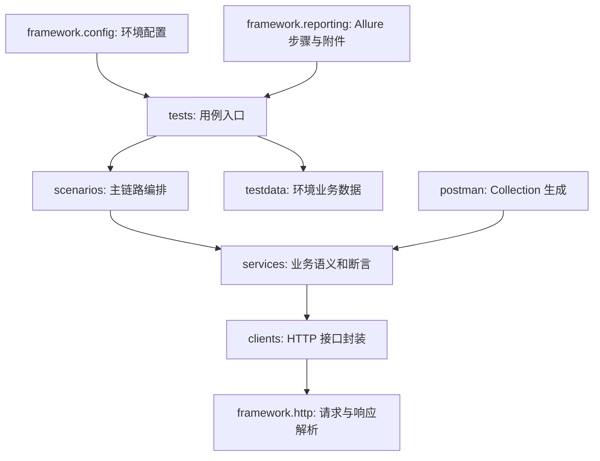

# 接口自动化框架演进说明

## 目标

`api-testcases/api_tests` 是稳定框架目录，目标是把接口自动化沉淀为长期资产，而不是跟随迭代复制套件。迭代、Jira、PAPI 编号用于追踪，不再决定目录边界。

当前协作约定：后续新需求、大改、公共断言、回归分层和 Postman 生成器默认维护在 `api-testcases/api_tests`；`api-testcases/2026Q2_SP1` 只作为历史金样例与迁移参考保留。

## 分层关系

## 命名策略

- 目录按接口资源或业务能力命名，例如 `memberships`、`entitlements`、`membership_extensions`、`cross_module_entitlements`。
- PAPI 编号保留在 `pytest.mark.papiXXXX`、Allure feature/story、测试用例表和文档链接中。
- 同一接口跨迭代新增字段、分支或错误码时，优先扩展既有 `services`、`scenarios` 和对应分类用例。
- 不因迭代变化复制 `framework`、`clients` 或整套测试目录。

## 回归分层

| 分层 | 建议内容 |
|------|----------|
| `contract` | 响应信封、字段结构、枚举、Python 与 Postman 语义对齐 |
| `smoke` | 最小主流程与健康检查 |
| `regression` | 历史缺陷、兼容性、边界回归 |
| `features` | 新需求、主链路、doc gap 覆盖 |

## 迁移兼容

旧目录 `api-testcases/2026Q2_SP1` 暂不删除，作为迁移期兼容入口。新增与大改优先进入 `api-testcases/api_tests`。当 CI、Postman 生成和文档全部切到稳定目录后，再评估是否移除旧迭代目录。

迁移期若必须修复 `2026Q2_SP1`，需要同时判断该修复是否属于长期接口能力；若属于，应优先落在 `api_tests`，再视情况回补旧目录。
