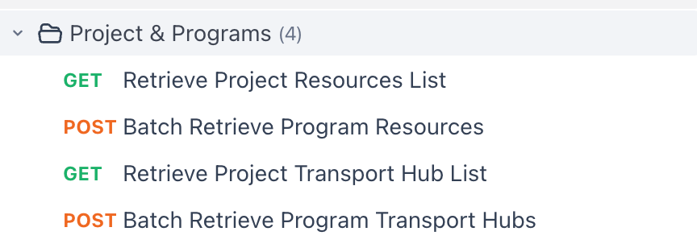

# 【Aero Blue】批量获取项目可用资源/站点数据

**JIRA**: [PAPI-2553](https://dragonpass.atlassian.net/browse/PAPI-2553)

---

## 1. 背景（Background）

当前平台存在以下问题：

- 资源（Resource）约 1000 个，Program 约 900 个

- Program 与 Resource 为**多对多关系**

- 客户在查询 Program 下可用资源时，需要：
    - 遍历所有资源进行匹配
    - 或多次调用接口

👉 导致：

- 查询复杂度高（O(N×M)）

- API 调用次数过多

- 延迟和系统压力不可控

---

## 2. 目标（Goals）

### 🎯 核心目标

1. 将查询复杂度从 **O(N×M)** 降至 **O(1) / O(N)**

2. 提供清晰的 Program ↔ Resource 查询能力

3. 支持高并发 & 可缓存

4. 兼容现有 Resource API（不破坏）

---

## 3. 非目标（Non-Goals）

- 不改造现有 `/resources/{resourceId}` 数据结构

- 不在 Resource 中嵌入所有 Program 信息

- 不支持超大批量（如 900 program 一次查询）

---

## 6. API 设计（Core APIs）

### 6.1 获取资源详情（已有）

```
GET /api/v2/resources/{resourceId}

```

👉 返回资源主数据，不改

---

### 6.2 查询某个项目下，所有的可用资源

```
GET /api/v2/projects/{projectId}/resources?module=1
```

#### Query Params（必选）

| 参数 | 说明 |
|------|------|
| module | 强制限制，过滤品类（lounge/dining等），只能1个 |
| projectId | 租户id |
| pageSize | 页大小，默认100 |
| pageNumber | 页码，默认1 |
| language | 默认en-US |

---

#### Response

以apifox为准



#### 错误提示语

| 500.900.001 | 无法获取项目的资源列表 | Sorry, we’re unable to retrieve the resource list at the moment. Please try again later. |
|------|------|------|

---

### 6.3 Batch 查询（待定）

```
POST /api/v2/programs/resources/batch

```

#### Request

```
{
      "programIds": ["P1", "P2"],
      "module": 1
}
```

- 不存在的programID直接跳过，不返回

- 不在这个租户下的直接跳过，不返回

#### Response

以apifox为准


#### 限制（必须）

| 项目 | 限制 |
|------|------|
| programIds 数量 | ≤ 20 |
| 品类 | 限制单品类查询 |

#### 错误提示语

| 500.900.002 | 无法获取到可用列表 | Sorry, we’re unable to retrieve the eligible resource list at the moment. Please try again later. |
|------|------|------|
| 500.900.003 | 传入的module多于1个 | Only one module can be queried at a time. |

#### 机场2个接口

与资源逻辑类似，提示语：

| 500.900.004 | 无法获取项目的机场列表 | Sorry, we’re unable to retrieve the transport hub list at the moment. Please try again later. |
|------|------|------|
| 500.900.005 | 无法获取到可用列表 | Sorry, we’re unable to retrieve the eligible transport hub list at the moment. Please try again later. |
