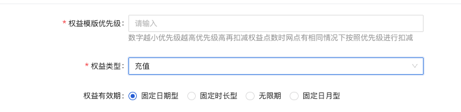
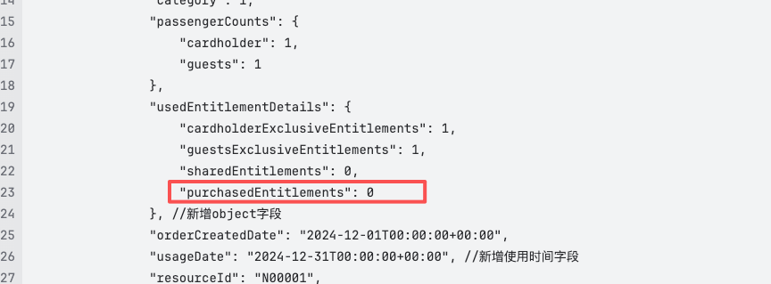
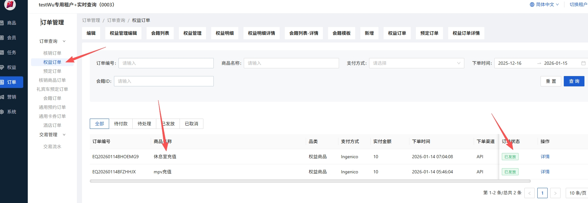
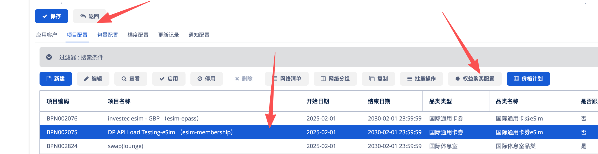
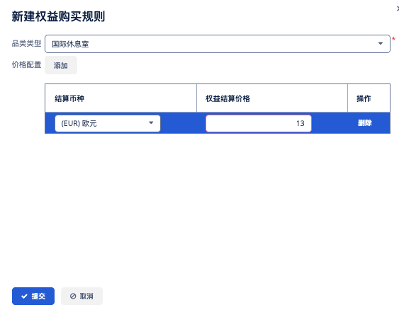

# 【Migration】Enable Topup Entitlement on Membersship solution｜Membership新增充点/多等级权益支持【V2】

**JIRA**: [PAPI-2182](https://dragonpass.atlassian.net/browse/PAPI-2182)

---

**仅支持lounge/setmeal/FT/eSIM/Fitness 5个品类**

### 一、会籍注册 Membership Registration

/v2/memberships

- 新增purchasedEntitlements字段

- membership创建时，不会自动新增一条【充值】权益明细，是api虚拟展示的字段，值为0

```
"entitlements": {
    "moduleExclusiveEntitlements": [
        {
            "module": 1,
            "details": {
                "cardholderExclusiveEntitlements": 1,
                "guestsExclusiveEntitlements": 1,
                "sharedEntitlements": 0,
                "purchasedEntitlements": 0, //新增买点字段
                "allowedGuestsPerUsage": 1,
                "maxGuestsNextUse": 1
            }
        }
    ]
}
```

### 二、权益查询 Entitlement Query

/v2/entitlements/search

- 充值过才会有充值的权益明细

- 新增purchasedEntitlements字段

- 买点都是共享点，因此在计算maxGuestsNextUse时需要加上买点作为共享点来计算



```
"entitlements": {
    "moduleExclusiveEntitlements": [
        {
            "module": 1,
            "details": {
                "cardholderExclusiveEntitlements": 1,
                "guestsExclusiveEntitlements": 1,
                "sharedEntitlements": 0,
                "purchasedEntitlements": 0, //新增买点字段
                "allowedGuestsPerUsage": 1,
                "maxGuestsNextUse": 1
            }
        }
    ]
}
```

### 三、编辑权益接口 Entitlement Update

/v2/entitlements/update

新增purchasedQuantity字段，选填，代表买点

```
{
    "membershipId": "8888000066668888",
    "module": 1,
    "usageRestriction": 1,
    "quantity": 1,
    "purchasedQuantity": 2         // 新增，修改买点
}
```

- 买点永远是共享的，不受usageRestriction控制

- 没配充值模板（充值商品）不能编辑买点，需要给错误码

- 买点和权益点只能分开更新，不能同时更新，同时更新要给错误码；usageRestriction修改为非必填

- 没配充值模板就是不支持买点，不返回purchasedEntitlements。

- 买点都是共享点，因此在计算maxGuestsNextUse时需要加上买点作为共享点来计算

- 买点也可以加减，加上限限制为999（非法字符），减不能减到负数（500.030.012）

- quantity 只针对大客户点，purchasedQuantity只针对充值点

- Purchase entitlements are always shared and not controlled by usageRestriction field.

- If there is no recharge template configured, purchase entitlements cannot be edited, and an error code must be provided.

- Purchase entitlements and agent entitlement can only be updated separately, not simultaneously; simultaneous updates must provide an error code.

- If there is no recharge template configured, it means purchase entitlements are not supported, and purchasedEntitlements will not be returned.

- Purchase entitlements are all shared points, so when calculating maxGuestsNextUse, purchase points need to be added as shared points for the calculation.

- Purchase entitlements can also be increased or decreased, with an upper limit of 999 (invalid characters), and cannot be decreased to a negative number (500.030.012).

返回 Response：

```
"entitlements": {
    "moduleExclusiveEntitlements": [
        {
            "module": 1,
            "details": {
                "cardholderExclusiveEntitlements": 1,
                "guestsExclusiveEntitlements": 1,
                "sharedEntitlements": 0,
                "purchasedEntitlements": 0, //新增买点字段
                "allowedGuestsPerUsage": 1,
                "maxGuestsNextUse": 1
            }
        }
    ]
}
```

| 500.030.024 | 没有权益明细（不支持买点） | Operation not allowed. Editing this type of entitlement is not supported based on the program settings. |
|------|------|------|
| 500.030.025 | 买点和权益点只能分开更新，不能同时更新 | Operation not allowed. Different types of entitlements must be updated separately. |
| 500.030.012 | 更新的权益不足 | Insufficient entitlement balance. The requested deduction exceeds the available entitlement. |
| 500.030.005 | 无法更新权益（兜底） | Sorry, we’re unable to update the entitlements at the moment. Please try again later. |

### 四、升降级 Change Membership Program （**这个部分先不做**）

/v2/memberships/programChange

- 不管是权益策略1还是权益策略2，如果有买点，那都是直接带到新等级，没有重发这一说

- 如果有买点，目标等级也需要有买点模板，否则禁止迁移

- 当前重发权益接口不支持买点，**这个部分先不做**，等saas做完再做

- Whether it's Strategy 1 or Strategy 2, if there is a purchased entitlement, it will be directly update to the new tier.

- If there is a purchased entitlement, the target level must also have a  recharge template configured; otherwise, migration is not allowed.

### 五、迁移新增的内部订单列表接口+现有会籍使用订单详情接口

`/v2/internal/orders/memberships`

`/v2/orders/memberships/details`




### 六、充值流程-A

收到更新买点权益请求时，先判断会籍下是否有充值类型的权益明细

- 如果有，直接更新明细

- 如果没有，使用`cn.com.dragonpass.business.saas.equity.api.IEquityMemberApi#add`发放明细，同时加点

### 六、充值流程-B（先保留，不启用）

充值需要通过充值商品实现，配合权益订单流

- 支付方式【项目支付】

- 每次加买点都需要新增充值订单

- 减买点直接更新明细



币种取值逻辑：

销售协议-项目配置，对应项目下选配【权益购买配置】



对应品类，取对应品类的值和金额



### 七、下单相关流程

检查可用性和下单时，当前逻辑会判断点数是否足够，新增充值点后，充值点当作权益共享点计算即可

影响接口：

下单

- /v2/orders/***/memberships/prebooking * 4

- /v2/orders/esims/memberships/topup

check可用性

- [/resources/prebookings/availability](https://apifox.dragonpass.com/apidoc/docs-site/6000000/3507440e0)

- /v2/resources/options/prebookings/availability

### 八、下单预览接口

`/v2/orders/lounges/memberships/prebooking/preview`

`/v2/orders/fastTrack/memberships/prebooking/preview`

入参逻辑不变，根据入参的点数信息，saas进行扣点判断，基于saas返回将结果填入usedEntitlementDetails中。

新增purchasedEntitlements字段

```
{
    "code": 0,
    "data": {
        "module": 1,
        "category": 2,
        "membershipId": "8888000066668888",
        "extra": {
            "prebookingDate": "2025-10-01T10:30",
            "usedEntitlementDetails": {
                "cardholderExclusiveEntitlements": 1,
                "guestsExclusiveEntitlements": 0,
                "sharedEntitlements": 0,
                "purchasedEntitlements": 0 //新增买点字段
            },
            "cashPaymentApplied": false,
            "resourceId": "N00001",
            "resourceName": "DragonPass Lounge"
        }
    }

```
