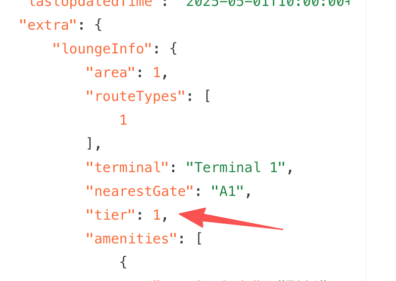
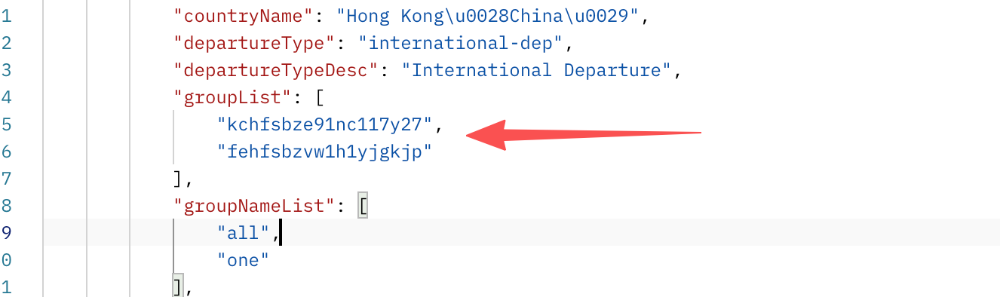

# 【Premium Lounges】Enable Tier Entitlement on Membership solution｜Membership新增多等级权益支持【V2】

**JIRA**: [PAPI-2214](https://dragonpass.atlassian.net/browse/PAPI-2214)

---

### 一、会籍注册

/v2/memberships

**1.1 新增scopeType字段**

- 表示这个品类的权益是否支持分等级，根据saas权益模板中，所选择的分组，去boss找到对应分组的label字段，根据这个字段来判断等级。如果会籍模板下，同一个品类只要有权益勾了tier，即使勾的同一个，那就是支持分等级。

- 对应boss需求：

scopeType
1 = GLOBAL        // 不区分等级，权益可用于该 module 下的所有资源（旧）
2 = TIERED        // 资源按等级分组，权益使用受等级限制（新）

**maxGuestsNextUse**

**allowedGuestsPerUsage**

**其他4个字段**

无权益分组（1）

正常计算

正常显示

正常返回

有网络分组（2）

通过saas权益里的关联的网络分组id，去boss找label

返回null

返回null

求和返回，表示总持卡人专属点数/总共享点数等。

```
"entitlements": {
    "moduleExclusiveEntitlements": [
        {
            "module": 1,
            "scopeType": 1, //新增范围类型字段
            "details": {
                "cardholderExclusiveEntitlements": 1,
                "guestsExclusiveEntitlements": 1,
                "sharedEntitlements": 0,
                "purchasedEntitlements": 0,
                "allowedGuestsPerUsage": 1,
                "maxGuestsNextUse": 1
            }
        }
    ]
}
```

### 二、权益查询接口

/v2/entitlements/search

这个接口对于分等级的客户来说，只返回各同类型权益明细的总和，各等级明细权益需要去/v2/entitlements/details查看

**2.1 新增scopeType字段**

- 表示这个品类的权益是否支持分等级，根据saas权益模板中的tier字段来判断。如果会籍模板下，同一个品类有多个权益，其中某一个关联了有label的分组，那就是支持分等级。

- 对应boss需求：

```
"entitlements": {
    "moduleExclusiveEntitlements": [
        {
            "module": 1,
            "scopeType": 1, //新增范围类型字段
            "details": {
                "cardholderExclusiveEntitlements": 1,
                "guestsExclusiveEntitlements": 1,
                "sharedEntitlements": 0,
                "purchasedEntitlements": 0,
                "allowedGuestsPerUsage": 1,
                "maxGuestsNextUse": 1
            }
        }
    ]
}
```

**maxGuestsNextUse**

**allowedGuestsPerUsage**

**其他4个字段**

无权益分组（1）

正常计算

正常显示

正常返回

有网络分组（2）

通过saas权益里的关联的网络分组id，去boss找label

返回null

返回null

求和返回，表示总持卡人专属点数/总共享点数等。

### **三、权益明细接口**

/v2/entitlements/details

- 只允许逐个品类查询

- 若没有的品类则返回提示语

```
{
    "membershipId": "8888000066668888",
    "module": 1 
}
```

通用返回结构（无论是否分级）

2个scopeType都能使用这个接口

```
{
  "membershipId": "8888000066668888",
  "module": 1,
  "scopeType": 2,
  "entitlements": {
    ...
  }
}
```

场景 A：**无分级权益（scopeType =1 GLOBAL）**

和 search 接口返回逻辑完全一致，只是改为数组 @haohua.yin 殷浩华

```
{
  "membershipId": "8888000066668888",
  "module": 1,
  "scopeType": 1,
  "entitlements": [
    {
      "details": {
        "cardholderExclusiveEntitlements": 2,
        "guestsExclusiveEntitlements": 1,
        "sharedEntitlements": 0,
        "purchasedEntitlements": 3,
        "allowedGuestsPerUsage": 1,
        "maxGuestsNextUse": 1
      }
    }
  ]
}

```

场景 B：**分级权益（scopeType =2 TIERED）**

按tier返回

```
{
  "membershipId": "8888000066668888",
  "module": 1,
  "scopeType": 2,
  "entitlements": [
      {
        "tier": 1,
        "details": {
          "cardholderExclusiveEntitlements": 1,
          "guestsExclusiveEntitlements": 0,
          "sharedEntitlements": 0,
          "purchasedEntitlements": 0,
          "allowedGuestsPerUsage": 1,
          "maxGuestsNextUse": 1
        }
      },
      {
        "tier": 2,
        "details": {
          "cardholderExclusiveEntitlements": 2,
          "guestsExclusiveEntitlements": 1,
          "sharedEntitlements": 1,
          "purchasedEntitlements": 0,
          "allowedGuestsPerUsage": 2,
          "maxGuestsNextUse": 2
        }
      }
    ]
}
```

500.030.029

请求的 module不存在

The specified module does not exist for this membership.

500.030.007

无法获取权益明细（兜底）

Sorry, we’re unable to retrieve the membership entitlements at the moment. The requested module may not be available under this membership. Please try again later.

### 四、编辑权益接口

/v2/entitlements/update

新增tier字段，选填，控制修改哪个等级的字段。

- 只有存在分级权益的情况下，才能tier用此字段。若不存在分级权益又给了这个字段，返回提示语 500.030.026

- 若存在分级权益，但没给tier字段，返回提示语 500.030.027

- 操作不存在的tier也返回提示语 500.030.028

- 如果没配tier1（默认兜底），又来操作tier1，那就提示 500.030.028

- 对应tier需要存在对应的权益模板（买点、大客户等）才能操作，否则返回500.030.028

- 返回与search接口返回一致，除了新增scopeType外不变，返回的是所有tier总数

```
{
    "membershipId": "8888000066668888",
    "module": 1,
    "tier": 3, //新增，指定修改第几级的权益
    "usageRestriction": 1,
    "quantity": 1,
    "purchasedQuantity": 2
}
```

500.030.026

若不存在分级权益又给了tier这个字段，返回提示语

Operation not allowed. Tiered entitlements are not enabled.

500.030.027

当前权益已启用分级配置，请指定要操作的 tier。

Tiered entitlements are enabled. Please specify the tier to be updated.

500.030.028

操作不存在的tier

The specified tier does not exist.

### 五、资源查询（改为读取真的字段）

对应boss需求：

资源数据来源于boss项目和价格清单，即使权益进行了分组，总资源范围是不变的，但权益分组会影响资源中的tier字段

- 如果不加Tier查询，就是查BPN项目级数据

- 如果加Tier查询，就要拿网络分组id+项目id做查询

涉及接口：

[**https://developer-sandbox.dragonpass.com/api/v2/resources**](https://developer-sandbox.dragonpass.com/api/v2/resources)



这个字段之前是写死为1的，现在需要改为读取boss网络分组的tier。

1. 先查项目下的网络分组

curl --location 'localhost:8767/es/salesCenter/project/getNetworkGroup' \
--header 'Content-Type: application/json' \
--data '{
    "projectId": "4ch7pifmw1s4n6exk4"
}'
得到：

注意区分lounge和setmeal（通过请求区分）

```
"networkGroupList": [
        {
            "code": "1",
            "id": "3dhb6kc7n1ga5uh5cg",
            "name": "setmeal",
            "label": "1"
        },
        {
            "code": "2",
            "id": "yfhcpz6ev1eibd5rir",
            "name": "lounge"
            "label": "1"
        }
    ]
```

2. 原来获取清单/es/salesCenter/project/network/findNetworksByPage时，资源就有返回在哪个group，如果在多个group，下面的数组就会返回多个值得。结合第一步得到的tier来来进行判断。
     ```
"groupList": [
    "yfhcpz6ev1eibd5rir"
],
```

3. 等级从小到大，如果某个资源同时在N个等级，默认显示最小等级。



### 

### 六、告警

- 如果某个资源同时在N个分组，触发告警，The following resources are assigned to multiple Tier groups. Please check: “N01“,”N02”

- 如果一个项目下，任意一个资源有等级了，但有某些资源不存在某个等级分组，也触发告警
