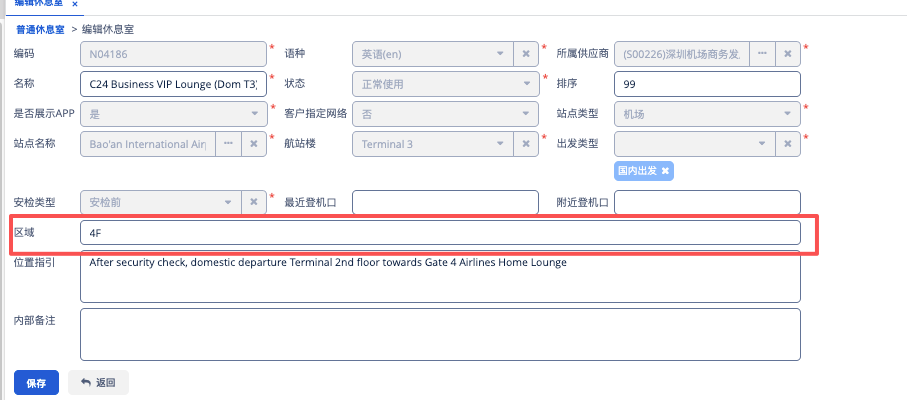

# 【Migration】Add Region fields on resource details endpoint｜新增region字段（内部）

**JIRA**: [PAPI-2341](https://dragonpass.atlassian.net/browse/PAPI-2341)

---

仅休息室品类，resource details，新增_region字段

只有特定租户返回这个字段



```
"extra": {
            "loungeInfo": {
                "area": 1,
                "routeTypes": [
                    1
                ],
                "terminal": "Terminal 1",
                "nearestGate": "A1",
                "tier": 1,
                "amenities": [
                    {
                        "amenityCode": "T001",
                        "amenityName": "Wifi",
                        "amenityIcon": "https://image.dragonpass.com/uploadFile/images/amenities/test.png"
                    }
                ],
                "_region":"string"
            }
        }
```
