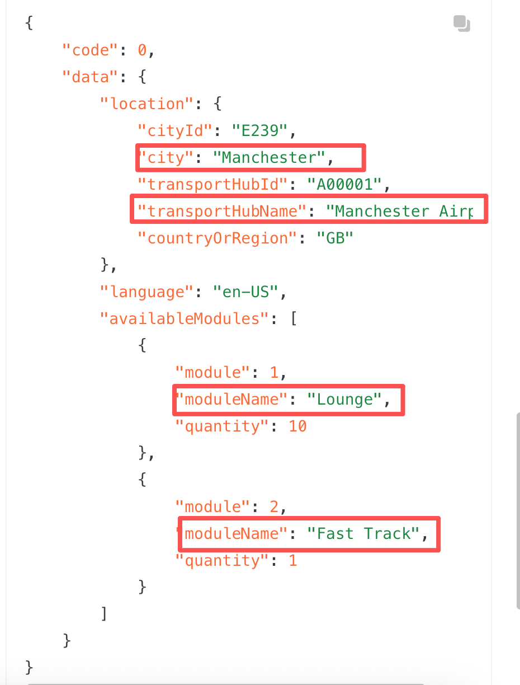

# 优化/search/modules逻辑

**JIRA**: [PAPI-2373](https://dragonpass.atlassian.net/browse/PAPI-2373)

---

多语种字段不影响数据权限，只影响以下这些返回的内容的翻译。统计资源数量时，还是用英语统计的（最完整）。

- 对于city和transportHubName，按搜索语种去取值，如果拿不到就用英文兜底

- 对于module name，记载ES中的固定翻译表（另行提供）

