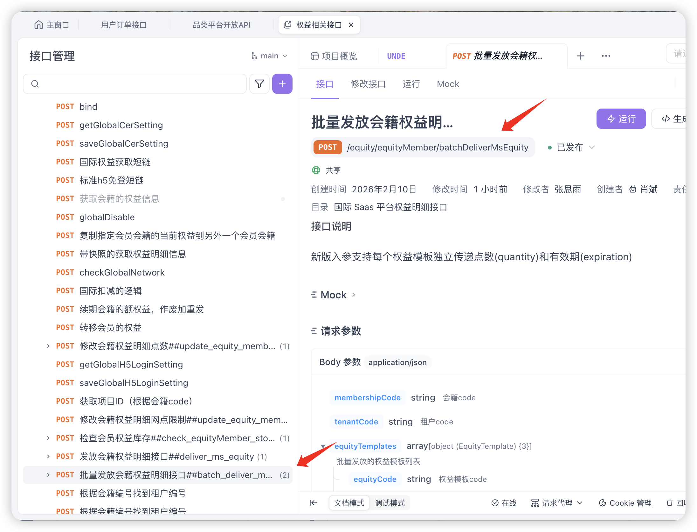

# 【Migration】Add Entitlement Strategy X for Change Membership Program API | 新增升降级权益策略3

**JIRA**: [PAPI-2194](https://dragonpass.atlassian.net/browse/PAPI-2194)

---

**新增权益迁移策略X，仅针对权益，枚举设置为3，****该枚举只有指定租户可以使用-Revolut**

**当前的升降级步骤：**

1. 激活新等级会籍/新等级开卡 - **不变，目标等级没卡就要新开卡**

2. 作废目标等级权益，按旧等级中的会籍权益明细，重发目标等级会籍的权益 - **变**

3. 清零旧等级中权益明细 - **之前的作法是作废旧权益，saas的接口新增了参数，是将旧明细余额变为0，而不是直接作废，我们对应修改为变为0**

4. 冻结旧等级 - **不变**

**第2步中的详细逻辑**

**2.1 多等级tier权益**

先建立program A B不同等级权益的对应关系，原program中对应tier的权益组合，要对应program迁移到新tier的组合中。

program A中的tier1的充实/大客户持卡人/大客户携伴/大客户共享，要对应迁移到program B中的tier1的充实/大客户持卡人/大客户携伴/大客户共享

**2.2 权益模板判断**

补一下权益模板映射关系

| **Tier** | **权益** | **Program A 剩余权益** | **Program B 权益模板配置** | **后续操作** |
|------|------|------|------|------|
| Tier 1 | 权益点-持卡人 | 1 | 存在权益模板 | 要存在权益模板，直接调用 SaaS 接口发放权益明细 |
| Tier 1 | 权益点-携伴 | 1 | 存在权益模板 | 要存在权益模板，直接调用 SaaS 接口发放权益明细 |
| Tier 1 | 权益点-共享 | 1 | 存在权益模板 | 要存在权益模板，直接调用 SaaS 接口发放权益明细 |
| Tier 1 | 买点-共享 | 1 | 存在权益模板 | 要存在权益模板，直接调用 SaaS 接口发放权益明细 |
| Tier 2 | 权益点-持卡人 | 1 | 存在权益模板 | 因为有不存在权益模板的场景，迁移失败 |
| Tier 2 | 权益点-携伴 | 1 | 不存在权益模板 | 不存在权益模板，迁移失败 |
| Tier 2 | 权益点-共享 | 1 | 不存在权益模板 | 不存在权益模板，迁移失败 |
| Tier 2 | 买点-共享 | 1 | 存在权益模板 | 因为有不存在权益模板的场景，迁移失败 |
| 无 | SWAP-权益点-持卡人 | 1 | 存在一样 swap 配置的权益模板 | 因为有不存在权益模板的场景，迁移失败 |
| 无 | SWAP-权益点-携伴 | 1 | 存在一样 swap 配置的权益模板 | 因为有不存在权益模板的场景，迁移失败 |
| 无 | SWAP-权益点-共享 | 1 | 存在不一样 swap 配置的权益模板 | 不存在权益模板，迁移失败 |
| 无 | 买点-共享 | 1 | 存在不一样 swap 配置的权益模板 | 不存在权益模板，迁移失败 |

**2.2.1 共享权益和充值权益（买点）**

有多少点就迁移多少点，按原program权益余额重发到目标program中

充值权益指：权益类型为充值的权益明细，若目标program没有权益明细则需要创建权益明细，若有就直接更新

共享权益指：权益类型为大客户，且打开了权益是否共享的权益明细

*逻辑上，目标与原等级都不应该存在无限的共享权益，若有，报错

补个提示语

| 错误码 | 中文提示 | 英文提示 |
|------|------|------|
| 500.030.029 | 存在异常权益，无法进行迁移 | Abnormal entitlements detected. Operation cannot be performed. |

**2.2.2 持卡人/携伴专属权益**

| **场景** | **持卡人/携伴点逻辑** **Program A（当前剩余点） ➡️ Program B（权益模板配置）** | **ProgramB 迁移后权益** |
|------|------|------|
| A | 无限点（-1） ➡️ 有限点（权益模板配置为3） | 0 |
| B | 无限点（-1） ➡️ 无限点（权益模板配置为-1） | -1 |
| C | 有限点（3） ➡️ 无限点（权益模板配置为-1） | -1 |
| D | 有限点（1）➡️ 有限点（权益模板配置为3） | 1 |

**对应SAAS接口：**

可以批量操作

## 当前3种策略的汇总

### 大客户权益

| Strategy | 场景 | 是否创建会籍 | 是否清空目标 Program 中的旧权益 | 权益发放方式 |
|------|------|------|------|------|
| **Strategy 1 – Reissue by Template** | 目标 Program 无会籍 | 创建新会籍 | N/A | 按目标 Program 的 **entitlement template** 发放 |
| **Strategy 1 – Reissue by Template** | 目标 Program 有会籍（Suspended） | 不创建 | 是 | 清空旧权益后，按 **entitlement template** 重新发放 |
| **Strategy 2 – Keep Existing Entitlements** | 目标 Program 有会籍 | 不创建（重新激活） | 否 | 保持现有权益不变 |
| **Strategy 3 – Reissue by Custom Rules** | 目标 Program 无会籍 | 创建新会籍 | 是 | 按 **特定业务规则** 发放权益（非 template） |
| **Strategy 3 – Reissue by Custom Rules** | 目标 Program 有会籍 | 不创建（重新激活） | 是 | 清空旧权益后按 **特定业务规则** 发放 |

### 充值权益

| 规则 | 描述 |
|------|------|
| 是否清空旧权益 | 每次 Tier 升降级都会清空原等级和目标等级的充值权益 |
| 余额处理 | 原等级中充值权益余额的需要迁移到目标等级对应的充值权益 |
| 匹配规则 | 必须按以下属性 **一一对应**：Tier / Swap / Module |
| 迁移方式 | 原权益余额 → 发放到目标等级对应的充值权益 |

| 原等级充值权益 | 目标等级需要存在的充值权益 | 处理方式 |
|------|------|------|
| Tier1 – Lounge Recharge | Tier1 – Lounge Recharge | 余额迁移 |
| Swap134 – Recharge | Swap134 – Recharge | 余额迁移 |
