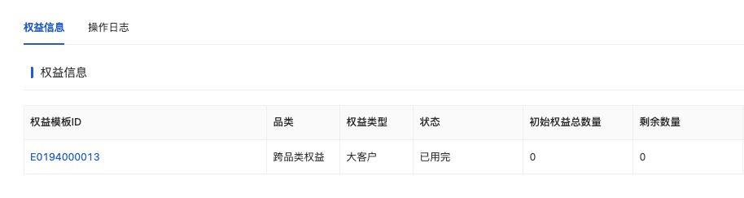
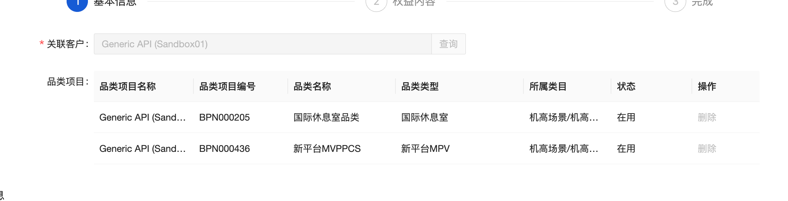
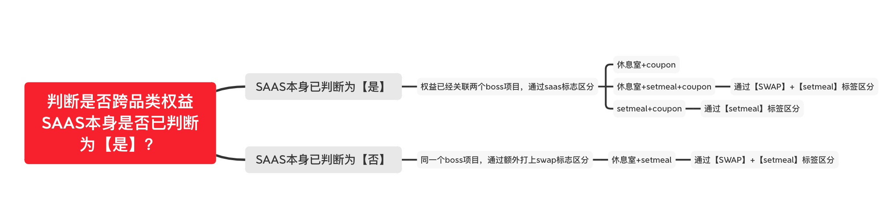
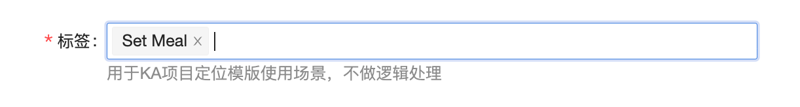
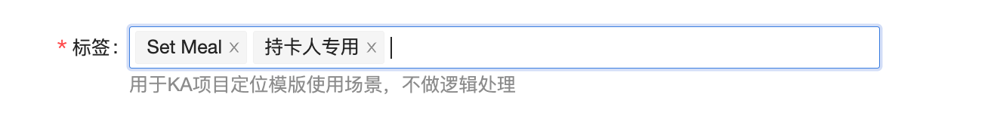

# SWAP entitlement - phase 1

来源：<https://dragonpass.atlassian.net/wiki/spaces/DGSN/pages/1000898583/SWAP+entitlement+-+phase+1>

---

## 一、E-pass目前在E-pass上只支持lounge/setmeal/coupon（1，3，4）的swap entitlement。

暂不支持其他品类的swap

1.1 /v2/orders/{module}/ePasses将 {module} 设为multiModule代表多品类可用

/v2/orders/multiModule/ePasses

用&quot;module&quot;: 0代表多品类epass，实际使用modules数组来控制品类，这个数组只有在moudel为0的时候生效。如果判断为swap，则moudle只允许输入0.


```json
{
    "module": 0,//新增枚举
    "clientUserId": "3EF5D065-76F8-4D3E-801A-B329D15F461A",
    "extra": {
        "firstName": "DragonPass",
        "lastName": "DragonPass",
        "activationDate": "2028-10-31T23:59:59+00:00",
        "expirationDate": "2028-12-31T23:59:59+00:00",
        "availableUsages": 1,
        "allowedResources": {
            "resourceIds": []
        }
    }
}
```
swap的Epass，支持指定跨品类的resoureIds

swap和单品类权益需要分为2个不同的program组，swap的program组仅支持发放swap，不兼容单品类

在SAAS配置中，swap的program需要额外配置一个新的会籍商品-会籍模板租，会籍模版下最多只会有2条权益明细：

休息室权益+MPV，已经覆盖了4种场景：

组合

 | 管理项目

 | ResoureIds

 | Remark

 | 
休息室 + Setmeal

 | 一条【国际休息室】品类项目

 | 可以指定N+Rcode

 | 权益模板关联【国际休息室】品类项目，勾选SWAP+Setmeal标签，

【BOSS】网络范围配Setmeal+休息室

 | 
Setmeal + Coupon

 | 一条【国际休息室】品类项目

一条【MPV】品类项目

 | 可以指定Rcode

 | 权益模板关联【国际休息室】品类项目，勾选Set Meal标签，不勾选SWAP标签

【BOSS】网络范围只配Setmeal

 | 
休息室 + Coupon

 | 一条【国际休息室】品类项目

一条【MPV】品类项目

 | 可以指定N+Rcode

 | 权益模板关联【国际休息室】品类项目，无需勾选标签

【BOSS】网络范围只配休息室

 | 
休息室 + Setmeal + Coupon

 | 一条【国际休息室】品类项目

一条【MPV】品类项目

 | 可以指定N+Rcode

 | 权益模板关联【国际休息室】品类项目勾选，SWAP+Setmeal标签

【BOSS】网络范围配Setmeal+休息室

 | 
如果只有Setmeal的权益，现在是给【国际休息室】品类的权益打一个Set Meal的标

后面如果是休息室+Setmeal SWAP这种场景，一个项目支持2个品类，计划是打一个SWAP的标，告诉api这个条权益是休息室和setmeal共享的，相应地，在查询资源、展示订单时，都要根据实际使用的网点，来展示Module和Ncode/Rcode

返回


```json
{
  "code": 0,
  "data": {
    "status": 2,
    "module": 0,
    "category": 1,
    "clientUserId": "3EF5D065-76F8-4D3E-801A-B329D15F461A",
    "orderId": "DP00000000000001",
    "orderCreatedDate": "2024-12-31T00:00:00+00:00",
    "orderCancelledDate": null,
    "extra": {
      "ePassId": "1788000066668888",
      "ePassStatus": 0,
      "firstName": "DragonPass",
      "lastName": "DragonPass",
      "activationDate": "2028-10-31T23:59:59+00:00",
      "expirationDate": "2028-12-31T23:59:59+00:00",
      "availableUsages": 1,
      "usedUsages": 0,
      "allowedModules": [
            1,
            3
        ],//展示可用的module，只有在module=0时会返回
      "allowedResources": {
        "resourceIds": []
      }
    }
  }
}
```
category： 如果swap中有lounge则为3、如果没有lounge，则为1，单品类保持历史逻辑

moudle：判断为swap只能输入0，判断为单品类只允许输入对应品类得moudle值

### 1.2 /v2/orders/ePasses/search
```json
{
  "code": 0,
  "data": {
    "status": 2,
    "module": 0, //新增枚举
    "category": 1,
    "clientUserId": "3EF5D065-76F8-4D3E-801A-B329D15F461A",
    "orderId": "DP00000000000001",
    "orderCreatedDate": "2024-12-31T00:00:00+00:00",
    "orderCancelledDate": null,
    "extra": {
      "ePassId": "1788000066668888",
      "ePassStatus": 1,
      "firstName": "DragonPass",
      "lastName": "DragonPass",
      "activationDate": "2028-10-31T23:59:59+00:00",
      "expirationDate": "2028-12-31T23:59:59+00:00",
      "availableUsages": 0,
      "usedUsages": 1,
      "allowedModules": [
            1,
            3
        ],//展示可用的module，只有在module=0时会返回
      "allowedResources": {
        "resourceIds": [
          "N00001"
        ]
      }
    }
  }
}
```
### 1.3 /v2/orders/ePasses展示逻辑不变，核销什么网点，就对应展示什么module和Ncode/Rcode

### 1.3 /v2/orders/ePasses/details展示逻辑不变，核销什么网点，就对应展示什么module和Ncode/Rcode

### 1.4 资源相关接口对于swap entitlement到会籍模板（program），同时支持对应品类的资源检索，包括：

/v2/resources

/v2/resources/{resourceId}

/v2/resources/updates 回去跑一下日志，如果最近30天无人用，我们就下架好了

/v2/transportHubs

/v2/transportHubs/{transportHubId}

/v2/search/modules

/v2/search

### 1.5 预订单创建与取消下单前权益计算

目前saas没有接口计算某个品类现在一共还有多少权益，需要根据权益明细来计算

统计会籍下可用权益（初始/剩余）时，应该只统计待使用和已用完2个状态，不统计已作废/冻结/已过期的

订单取消

取消的话权益直接回退到对应明细，saas负责，我们不用管

### 1.6 错误提示语500.000.020

 | 只有单品类权益，但是去下了跨品类的权益。不支持swap entitlement

 | Sorry, we&rsquo;re unable to process your order at the moment. Please try again later or contact DragonPass support team.

 | 
500.xxx.010（中间就按品类来）
其实就是单品类接口的兜底提示语

 | 跨品类会籍商品，在单品类epass接口，尝试创建单品类权益

/lounges/ePasses

/fastTrack/ePasses

&hellip;.

 | Sorry, we&rsquo;re unable to process your order at the moment. Please try again later or contact DragonPass support team.

 | 
500.000.020

 | 单品类会籍商品,在以下路径尝试创建跨品类权益

/crossModule/ePasses

 | Sorry, we&rsquo;re unable to process your order at the moment. Please try again later or contact DragonPass support team.

 | 
500.xxx.010

 | 只要是跨品类，在对应品类的bundle接口不能下对应的品类的bundle单

/v2/orders/{module}/ePasses/bundle

 | Sorry, we&rsquo;re unable to process your order at the moment. Please try again later or contact DragonPass support team.

 | 
500.000.013

 |   尝试下单该epass不可用的网点

 | Sorry, this resource is not accessible with your program.   

 | 
500.000.014

 |    clientUserId重复

 | Sorry, this clientUserId already exists.   

 | 
500.000.015

 |    epass过期时间不能早于激活时间

 | Sorry, the expiration date cannot be earlier   than the activation date.

 | 
500.000.016

 | epass激活时间早于会籍模板生效时间

 | Sorry, the activation date is earlier than   the allowed start date.

 | 
500.000.017

 | resourceId中传了非这个接口对应品类的其他资源，例如创建lounge   Epass，传了Ccode

 | The 'resourceId' array contains resources   that are not associated with the expected module. Please verify and ensure the resource IDs match the correct module.

 | 
500.000.018

 | resourceId中传了超过30个资源code

 | The 'resourceId' array exceeds the maximum limit of 30 resource IDs. Please reduce the number of resource IDs and try again.   

 | 
## 二、Membership 先不看2.1 /v2/entitlements/search

顶级结构


```json
{
  "code": 0,
  "data": {
    "entitlements": {
      "moduleExclusiveEntitlements": [], //单品类权益列表
      "crossModuleEntitlements": [], //跨品类权益列表，只有存在swap的话才会出现这个object
      "enabledTypes": [1,2] //启用的权益类型
    }
  }
}
```

```json
"crossModuleEntitlements": [
  {
    "applicableModules": [1, 2, 3], // 跨休息室、快速安检、Set Meal
    "entitlementPoolId": "aaaa1234" //权益明细编码
    "details": {
      "cardholderExclusiveEntitlements": 2,
      "guestsExclusiveEntitlements": 1,
      "sharedEntitlements": 3
    }
  }
]
```
enabledTypes

枚举

 |  | 
moduleExclusive

 | 存在单品类权益

 | 
crossModule

 | 存在swap权益

 | 
### 2.2 /v2/entitlements/update

原来的入参，还是保留只更新moduleExclusiveEntitlements，返回也不变。


```json
{
  "membershipId": "8888000066668888",
  "quantity": 1,
  "module": 1,
  "usageRestriction": 1
}
```
如果要操作swap权益，则需要指定权益明细编码才能编辑


```json
{
  "membershipId": "8888000066668888",
  "quantity": 1,
  "module": 0,
  "entitlementPoolId": "aaaa1234", //需要指定权益明细编码才能编辑
  "usageRestriction": 1
}
```

```json
{
    "code": 0,
    "data": {
        "membershipId": "8888000066668888",
        "entitlements": {
            "moduleExclusiveEntitlements": [...],
            "crossModuleEntitlements": [], //跨品类权益列表，只有存在swap的话才会出现这个object
            "enabledTypes": [1,2] //启用的权益类型  
        }
    }
}
```
