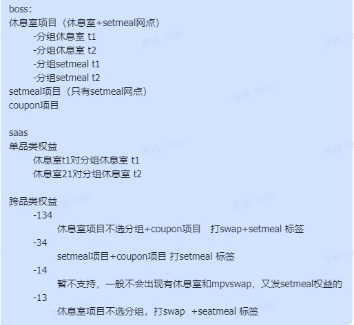
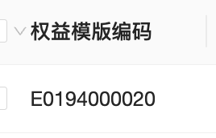
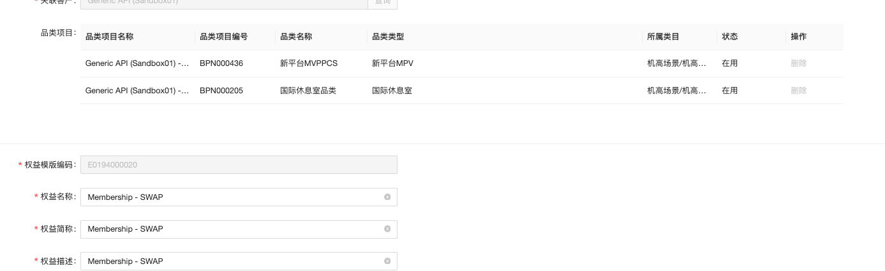

# SWAP entitlement - phase 2

来源：<https://dragonpass.atlassian.net/wiki/spaces/DGSN/pages/1582891116/SWAP+entitlement+-+phase+2>

---

## 一、定义- 跨品类权益不支持tier entitlement


- 只支持lounge/setmeal/coupon（1，3，4）的swap entitlement


二、Membership 接口2.1 /v2/entitlements/search 和 /v2/memberships

顶级结构


```json
{
  "code": 0,
  "data": {
    "entitlements": {
      "moduleExclusiveEntitlements": [], //单品类权益列表
      "crossModuleEntitlements": [], //跨品类权益列表，只有存在swap的话才会出现这个object
      "enabledTypes": [1,2] //启用的权益类型
    }
  }
}
```

```json
"crossModuleEntitlements": [
  {
    "applicableModules": [1,3], // 跨休息室、Set Meal
    "entitlementPoolId": "aaaa1" //权益模板编码
    "details": {
      "cardholderExclusiveEntitlements": 2,
      "guestsExclusiveEntitlements": 1,
      "sharedEntitlements": 3
    }
  },
  {
    "applicableModules": [1,3,4], // 跨休息室、Set Meal、MPV
    "entitlementPoolId": "aaaa2" //权益模板编码
    "details": {
      "cardholderExclusiveEntitlements": 2,
      "guestsExclusiveEntitlements": 1,
      "sharedEntitlements": 3
    }
  }
]
```
enabledTypes

枚举

 |  |  | 
1

 | moduleExclusive

 | 存在单品类权益

 | 
2

 | crossModule

 | 存在swap权益

 | 
### 2.2 /v2/entitlements/update

保持不变，该接口不支持更新跨品类权益，本身是拦截了module=0的

此外，如果传入module=1，还需要过滤掉打了swap标签的setmeal+lounge混合权益


```json
{
"membershipId": "8888000066668888",

//由代码判断权益池
"module": 1,
"tier": 3, //新增，指定修改第几级的权益

//更新的数值部份  
    "usageRestriction": 1,
    "quantity": 1,
    "purchasedQuantity": 2,
}
```
### 2.3 新增接口 POST /v2/entitlements/{entitlementPoolId}/update

传 entitlementPoolId &rarr; 直接更新

- entitlementPoolId只能多品类用，如果传了单品类的entitlementPoolId需要拦截


500.030.031

 | 该接口不支持更新 module exclusive entitlement

 | This API does not support updating module-exclusive entitlements.

 | 
500.030.024

 | 没有权益明细

 | Operation not allowed. Editing this type of entitlement is not supported based on the program settings.

 | 
&rarr; 查 membership
&rarr; 根据 entitlementPoolId + 更新的权益的值
&rarr; 找到对应 entitlementPoolId
&rarr; 更新 pool


```json
{
"membershipId": "8888000066668888",

//直接给更新的数值部份  
    "usageRestriction": 1,
    "quantity": 1,
    "purchasedQuantity": 2,
}
```
### 2.4 返回

不管是操作了moduleExclusiveEntitlements还是crossModuleEntitlements，返回中都要返回最新的完整权益状态


```json
{
    "code": 0,
    "data": {
        "membershipId": "8888000066668888",
        "entitlements": {
            "moduleExclusiveEntitlements": [...],
            "crossModuleEntitlements": [], //跨品类权益列表，只有存在swap的话才会出现这个object
            "enabledTypes": [1,2] //启用的权益类型，只有存在swap的话才会出现这个object
        }
    }
}
```
### 2.2 /v2/entitlements/details

swap是没有tierer的，所以这个接口查不到swap的权益details。

如果只有swap，这个接口里传哪个swap里的哪个module都返回错误提示语500.030.030

500.030.030

 | 该接口不支持查询cross module entitlement

 | This API does not support querying cross-module entitlements.

 | 
如果既有swap又有单品类权益，那么这个接口只能查到单品类权益

## 三、资源接口复用E-pass相关资源配置逻辑

对于swap entitlement到会籍模板（program），同时支持对应品类的资源检索，包括：

/v2/resources

/v2/resources/{resourceId}

/v2/transportHubs

/v2/transportHubs/{transportHubId}

/v2/search/modules

/v2/search

## 四、下单preview和下单前权益计算

preview和下单，需要根据权益明细来计算

统计会籍下可用权益（初始/剩余）时，应该只统计待使用和已用完2个状态，不统计已作废/冻结/已过期的

增加跨品类权益权益后，统计总数要考虑单品类+跨品类

- 假设休息室1个点，休息室+setmeal1个点，那么最多下休息室预订单就是2个人


- 假设休息室1个点，mpv+setmeal1个点，那么最多下休息室预订单就是1个人


影响接口：

/v2/orders/{module}/memberships/prebooking

/v2/orders/{modules}/memberships/prebooking/preview

&nbsp;

订单取消

取消的话权益直接回退到对应明细，saas负责，我们不用管
