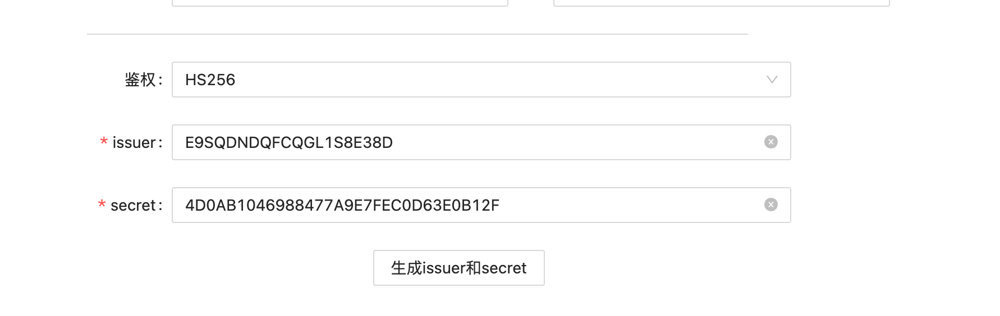
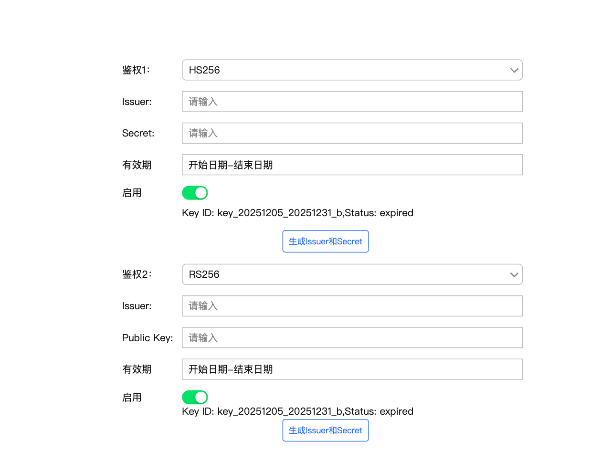

# SAAS 权限组支持双key切换

**JIRA**: [PAPI-2653](https://dragonpass.atlassian.net/browse/PAPI-2653)

---

背景：现在auth的token只支持配置1个，且没有有效期管理

**需求**

- 参考 callback 的配置方式，支持 双 key 配置机制。

- 对于存量 token：
    - 默认全部为启用状态
    - 默认有效期为 2023-01-01 至 2099-01-01

- 新增双 key 配置能力：
    - 支持同时配置 两个 key
    - 一个权限组支持 HS256 与 RS256 算法

- 每个 key 需支持独立配置：
    - 有效期
    - 启用 / 禁用状态

- 需要支持新增keyId（kid）字段，格式：Key ID: key_{租户id}_{有效期}_{有效期}_a/b（第几组的key），历史数据需要自动生成

- 有效期以UTC+0判断

- 同时生效时，则2个鉴权组同时有权操作这个token组

**鉴权流程**

1. JWT进来

2. 解开token，找到issuer和keyid（如有）

3. 如果有keyid，则用keyid找到匹配secret或key进行验签名

4. 如果没有keyid，则用issuer匹配secret或key进行验签名

5. 如果鉴权时发现有效期小于1个月，需要触发告警

