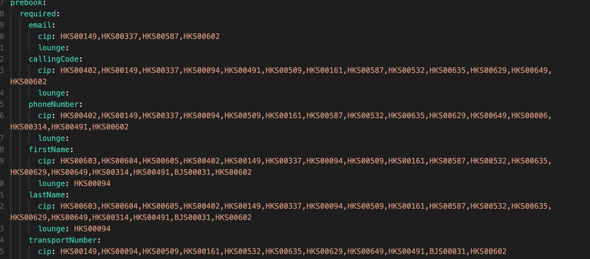
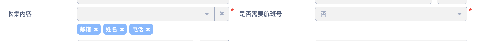

# 休息室/FT预订单下单pii信息收集逻辑从nacos供应商编码改为读boss

**JIRA**: [PAPI-2722](https://dragonpass.atlassian.net/browse/PAPI-2722)

---

现在是通过nacos的供应商编码区分的

改为从boss接口返回数据来区分：

**Lounge**

- 姓名

**FT**

- 参考这2个配置

