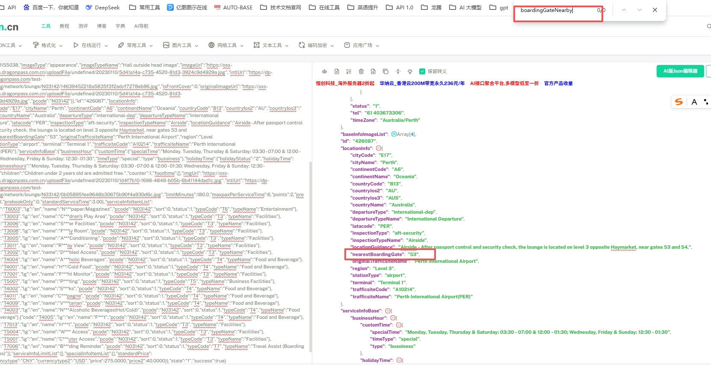

# 修正休息室品类，resource details里nearestGate的取值逻辑

**JIRA**: [PAPI-2833](https://dragonpass.atlassian.net/browse/PAPI-2833)

---

修正取值逻辑，以前取的是`boardingGateNearby`

修正为nearestBoardingGate

若nearestBoardingGate为null，尝试取`boardingGateNearby`，都为null就是null

