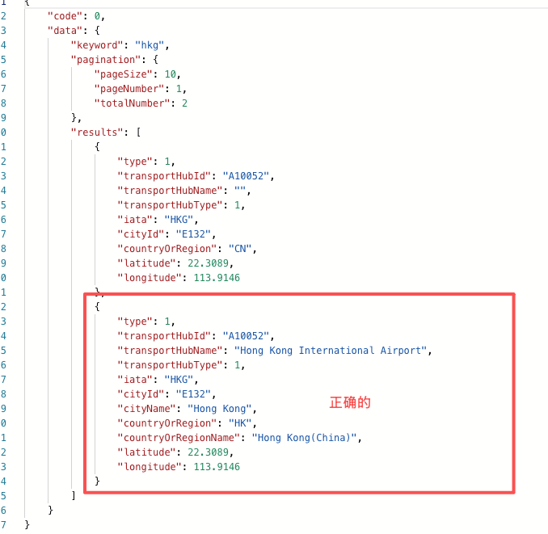

# 优化zh-CN和zh-HK下的港澳台机场数据冗余问题

**JIRA**: [PAPI-2501](https://dragonpass.atlassian.net/browse/PAPI-2501)

---

历史问题

基础数据中，CN语种下港澳台机场关联的地区是CN，非CN语种下关联的是HK/MO/TW等，导致我们归集数据时，会出现2条机场数据，在search接口会返回如下：

新增兼容逻辑，优化此问题：

针对港澳台的机场，如果同一个站点，cn和hk语种下拉取到的countryOrRegion数据不一致，舍弃掉cn数据

{
 "HK": ["HKG"],
 "MO": ["MFM"],
 "TW": ["TPE", "KHH", "TSA", "RMQ", "TNN", "HUN", "TTT", "KNH", "LZN"]
}
