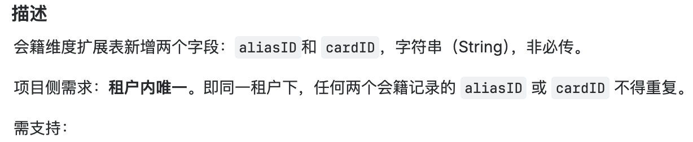

# 【Aero Blue】修改注册新增字段到saas真实字段、支持clientUserId重复注册

**JIRA**: [PAPI-2568](https://dragonpass.atlassian.net/browse/PAPI-2568)

---

**一、修改注册新增字段到saas真实字段**

找宇详，把值放进去，支持查询/修改

**二、新增租户级配置支持clientUserId重复注册**

现在先放在nacos，支持同一个clientUserId在同个program下多次注册会籍

只放开visa 租户先 0426

后续需要改为读取saas配置
