# 分级告警

来源：<https://dragonpass.atlassian.net/wiki/spaces/DGSN/pages/1905852483>

---

## 一、E-pass注册+查询场景以注册量进行分级，重点在注册及查询接口

### 1.1 分级指标等级

 | 日注册量（以前7日均值统计）

 | 客户

 | 
Tier 1（核心）

 | &ge;500/day

 | Gulfstream、MAYA Bank、SAILY、TravelMart

 | 
Tier 2（标准）

 | 50~499/day

 | GreyWall、GET YOUR GUIDE、Wise、Ita&uacute;、N26、VivoFacil、LoungePair

 | 
Tier 3（长尾）

 | &lt;50/day

 | Grandoria、Make my trip、EPSILON、Tripadd、LoungePair B2B、Lyntel

 | 
### 1.2 涉及接口 1.2.1   下单接口    https://developer-sandbox.dragonpass.com/api/v2/orders/{module}/ePasses

接口

 | 平均耗时

 | 链接

 | 截图

 | 
/api/v2/orders/fastTrack/ePasses

 |  850ms

 | https://instana.io/s/VtwGrDgATGOhcujQE5NO5A

 | 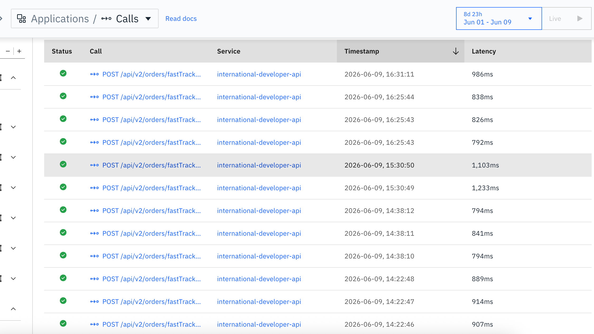 | 
/api/v2/orders/lounges/ePasses

 |  853ms

 | https://instana.io/s/GnwN8LWMSoWfjfKH9nrN_Q

 | 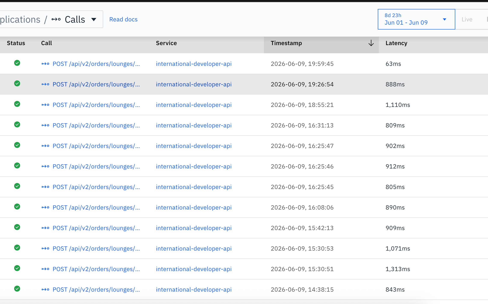 | 
### 1.2.2  订单查询接口  https://developer-sandbox.dragonpass.com/api/v2/orders/ePasses/search

接口

 | 平均耗时

 | 链接

 | 截图

 | 
/api/v2/orders/ePasses/search

 |  67ms

 | https://instana.io/s/0NLew4fCSp23yVbzo08pzw

 | 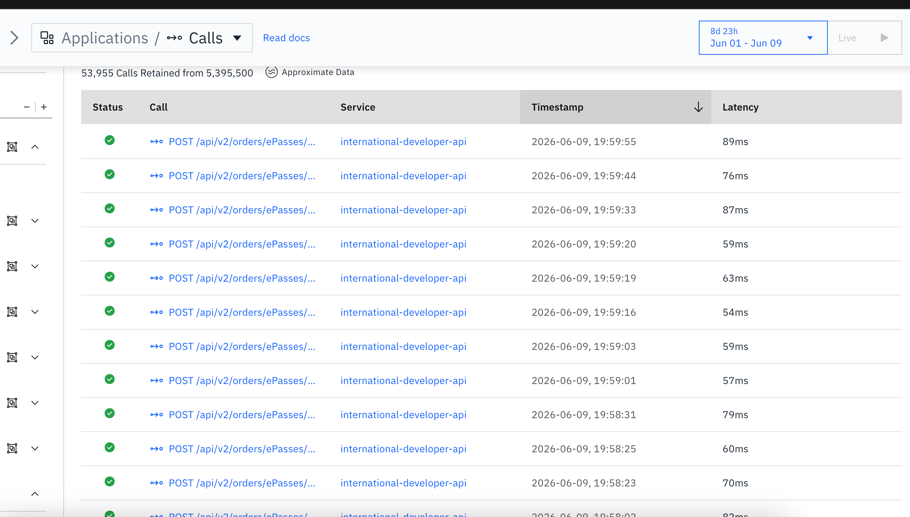 | 
### 1.2.3   https://developer-sandbox.dragonpass.com/api/v2/orders

接口

 | 平均耗时

 | 链接

 | 截图

 | 
/api/v2/orders

 |  130ms

 | https://instana.io/s/3n6pp43YSZm_2B6qEaLK3A

 | 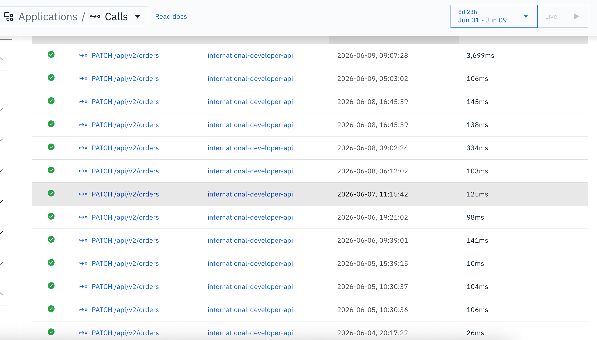 | 
### 1.3 全局监控指标

 | 阈值

 | 
全局注册成功率

 | &lt;99%

 | 
全局5xx

 | &gt;2%

 | 
### 1.4 Tier 1指标

 | 告警值

 | 
告警窗口

 | 5分钟

 | 
成功率SLO

 | 小于99.5%

 | 
失败次数

 | 5分钟 &ge; 10次

 | 
Latency

 | P99 &gt; 2s

 | 
无流量

 | 10分钟无请求

 | 
告警级别

 | P1

 | 
### 1.5 Tier 2指标

 | 建议

 | 
告警窗口

 | 10分钟

 | 
成功率SLO

 | 小于99%

 | 
失败次数

 | 10分钟 &ge;10次

 | 
Latency

 | P99 &gt; 2s

 | 
告警级别

 | P3

 | 
### 1.6 Tier 3指标

 | 建议

 | 
成功率SLO

 | -

 | 
告警窗口

 | 1小时

 | 
失败次数

 | 1小时 &ge;5次

 | 
告警级别

 | P4

 | 
## 二、E-pass 资源查询+订单相关场景以使用量进行客户分级，重点在资源+订单相关接口

### 2.1 分级指标- 预订单利润大概是walkin的3倍

- 链路与客户要求更复杂，更高用户价值，也是重点发展业务

- walkin业务较简单

评分公式：walkin前7日日均使用量x1+预订单前7日日均使用量x5

等级

 | 按加权评分来

 | 客户

 | 
Tier 1（核心）

 | score &ge; 500

 | Gulfstream、TravelMart

 | 
Tier 2（标准）

 | 100 &lt;= score &lt; 500

 | GET YOUR GUIDE、GreyWall、Wise、MAYA Bank

 | 
Tier 3（长尾）

 | score &lt; 100

 | 其他

 | 
### 2.2 涉及接口资源类

https://developer-sandbox.dragonpass.com/api/v2/resources

https://developer-sandbox.dragonpass.com/api/v2/resources/{resourceId}

https://developer-sandbox.dragonpass.com/api/v2/resources/prebookings/availability

https://developer-sandbox.dragonpass.com/api/v2/search

接口

 | 平均耗时

 | 链接

 | 截图

 | 
/api/v2/resources

 | 191 ms

 | https://instana.io/s/xypJiYa_Rbewh8h69IcCWQ

 | 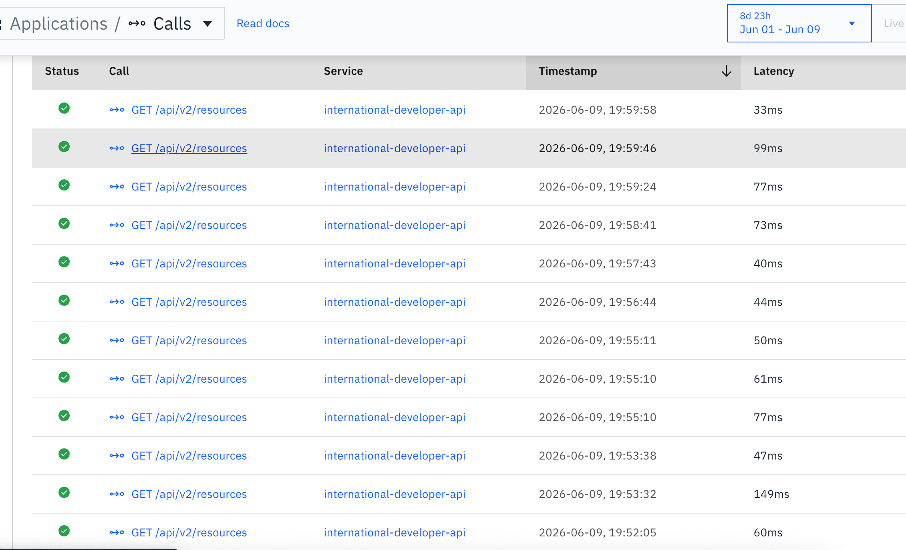 | 
/api/v2/resources/{resourceId}

 | 996ms  单个案例

 | https://instana.io/s/H-L3KTdeSYu66tjgaRkWZA

 | 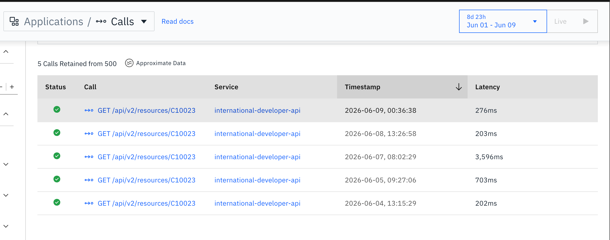 | 
/api/v2/resources/prebookings/availability

 | 8ms

 | https://instana.io/s/OW31lmmCRyiEaDx3TrnGAg

 | 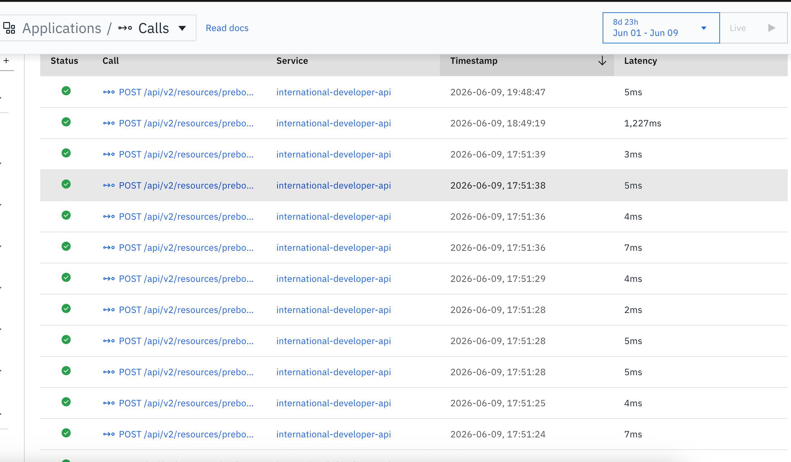 | 
/api/v2/search

 | 36ms

 | https://instana.io/s/VUgThfECTG2LRfx2eF1rXA

 | 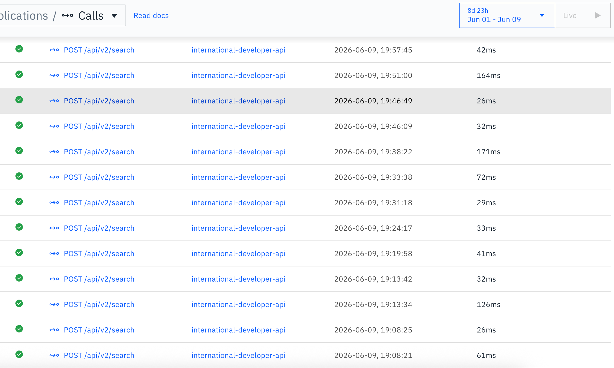 | 
订单查询类

https://developer-sandbox.dragonpass.com/api/v2/orders/ePasses

https://developer-sandbox.dragonpass.com/api/v2/orders/ePasses/details

接口

 | 平均耗时

 | 链接

 | 截图

 | 
/api/v2/orders/ePasses

 | 19ms

 | https://instana.io/s/aAn73AdXRqaf6APSs6Nz3A

 | 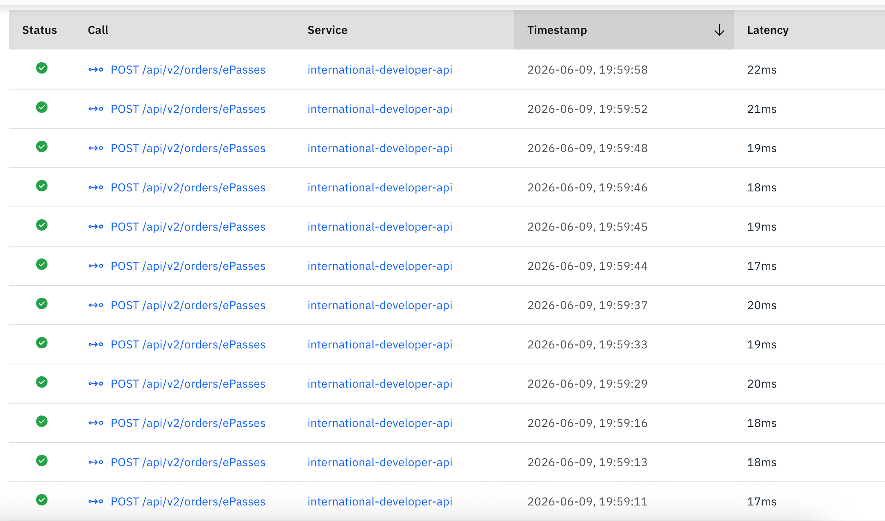 | 
/api/v2/orders/ePasses/details

 | 45ms

 | https://instana.io/s/Sbaje9ZDTPCX1AFCWU5-1A

 | 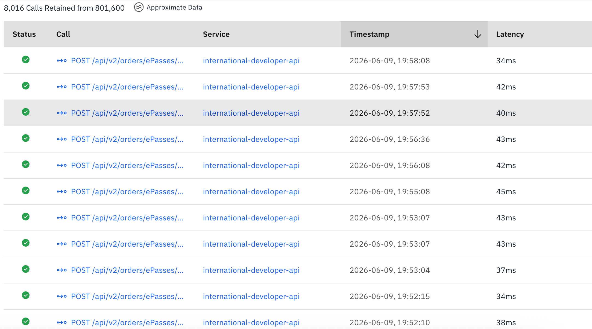 | 
订单创建+取消类

https://developer-sandbox.dragonpass.com/api/v2/orders

https://developer-sandbox.dragonpass.com/api/v2/orders/{module}/ePasses/prebooking

https://developer-sandbox.dragonpass.com/api/v2/orders/{module}/ePasses/bundle

接口

 | 平均耗时

 | 链接

 | 截图

 | 
/api/v2/orders

 | 排除单个异常 128ms  

包含异常值 425.75ms

 | https://instana.io/s/3n6pp43YSZm_2B6qEaLK3A

 | 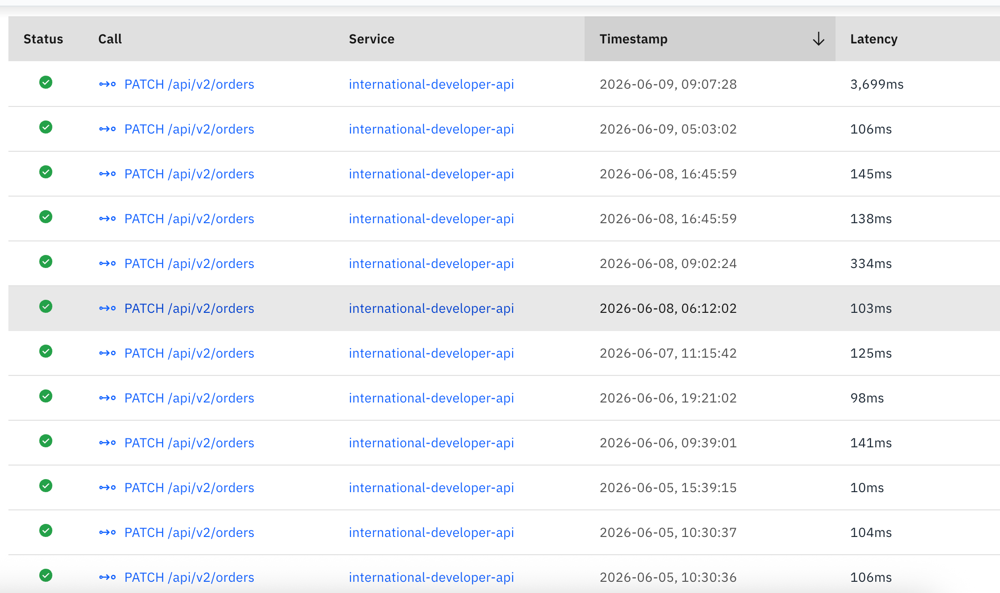 | 
/v2/orders/fastTrack/ePasses/prebooking

 | 6ms

 | https://instana.io/s/zpuIbiURTVq8E6e0WJ9bAw

 | 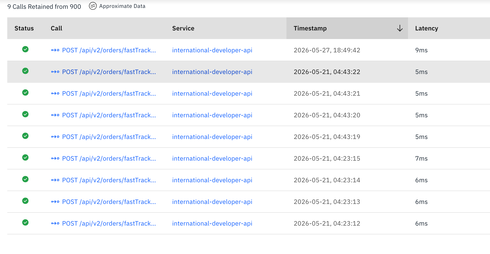 | 
/v2/orders/lounges/ePasses/prebooking

 | 1,636.5 ms  

 | https://instana.io/s/fLGQ1x-2R2Kd3EHXeJCp_g

 | 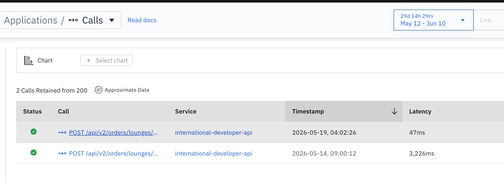 | 
/v2/orders/lounges/ePasses/bundle

 | 2,669 ms

 | https://instana.io/s/_D0tXyb5ROGK8w03Uev-mg

 | 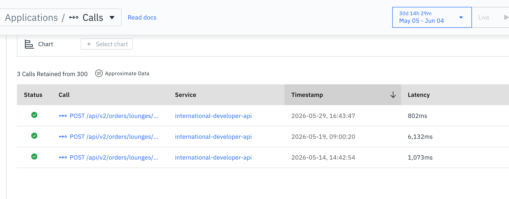 | 
/v2/orders/fastTrack/ePasses/bundle

 | 4744.5 ms

 | https://instana.io/s/3Mzo4uRQSdq6CqGuL7KQ5g

 | 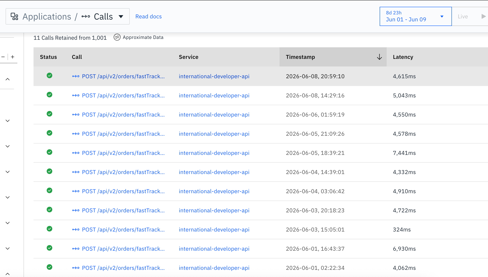 |
