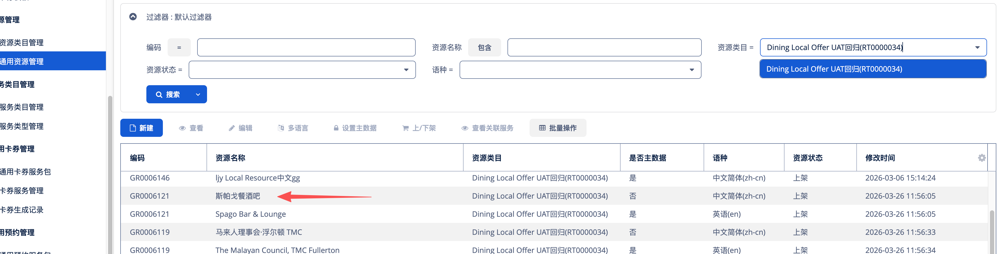
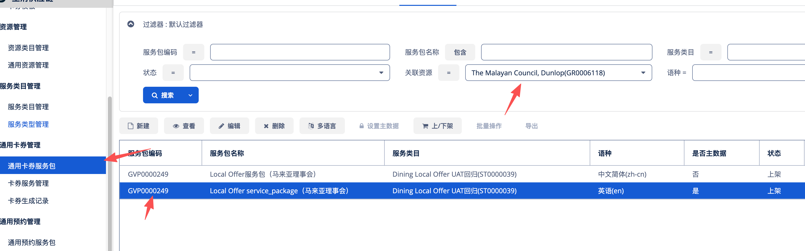
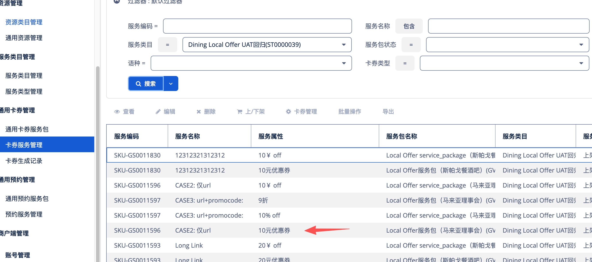
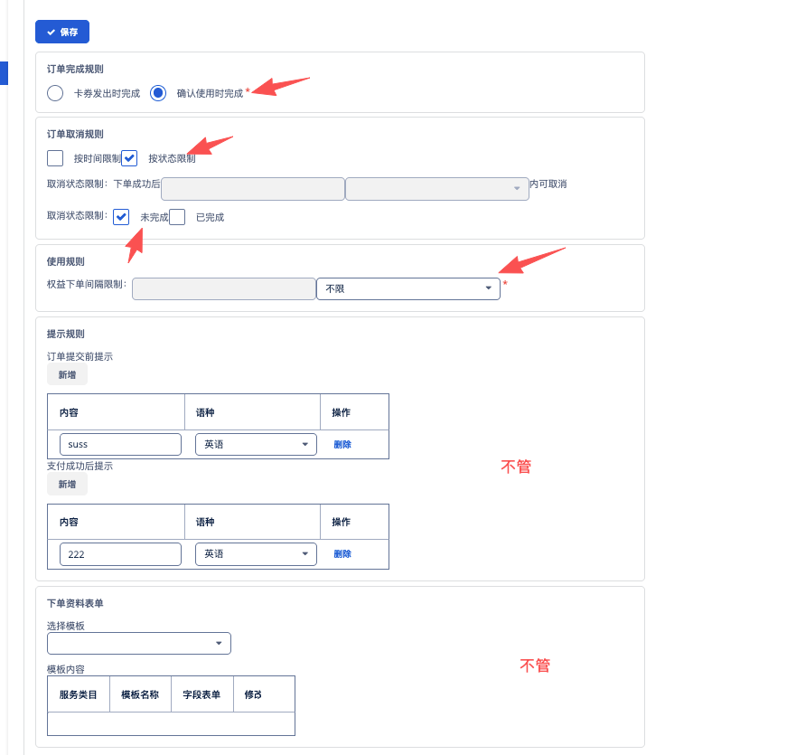
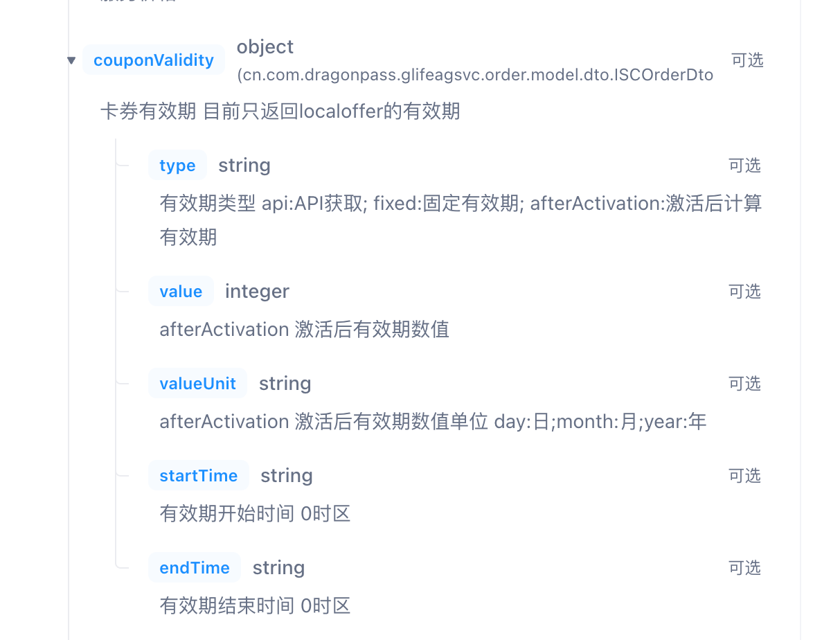
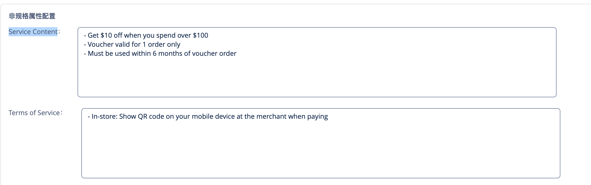

# Q2 - Local Offer

来源：<https://dragonpass.atlassian.net/wiki/spaces/DGSN/pages/1748566182/Q2+-+Local+Offer>

---

## 一、概述1.1 基础信息UAT可以用上面这个项目

Local Offer类似美团优惠券，是生消通用卡券下单一个子品类，与eSIM类似。具体层级为：

Resource（网点，如线下的某家餐厅）&mdash;&mdash;》OptionList（可用卡券列表）&mdash;&mdash;》Option（最终的一张券）

Resource，GR开头的编码，在BOSS通用资源管理中

OptionList（可用卡券列表），在BOSS通用卡券服务包管理中，与Resource关联

Option，SKU开头的编码，在BOSS卡券服务管理中，和通用卡券服务包关联

项目默认配置

SAAS也是配置核销商品（通用卡卷）

2. 产品需求- module值=11


- Local Offer 需要在E-pass和Membership中上线


- Membership暂时不支持SWAP/Tier entitlement，没有网络分组


- Local Offer 是预约流程，不支持walkin，暂时没有品类特定接口


- 相关资源数据需要加入聚合搜索，以城市/国家/经纬度等纬度，没有站点


## 二、接口2.1 资源查询相关接口

 | 接口

 | 需求

 | 
/v2/resources 

 | 资源列表

 | 改造

 | 
/v2/resources/{resourceId}

 | 资源详情

 | 改造

 | 
/v2/resources/localOffers/{resourceId}/options

 | option列表

 | 新增

 | 
/v2/resources/localOffers/{resourceId}/options/{optionId}

 | option详情

 | 新增

 | 
### 2.1.1 资源详情BOSS接口，https://apifox.dragonpass.com.cn/apidoc/shared/3a30abae-9c72-42e9-af25-bf2f6b34dce7/3533902e0 

/api/order/ISCOrder/findResourceDetail


```json
/v2/resources/{resourceId}
```

```json
{
    "code": 0,
    "data": {
        "language": "en-US",
        "module": 11,
        "resourceId": "GR0006118",
        "resourceName": "The Malayan Council, Dunlop",
        "locationInfo": {...}, 
        "businessHours": {...}, 
        "prebookingPolicy": {
            "isBookable": true, //写死
            "isCancelable": true, //写死
            "advanceBookingHour": null, //BOSS资源层无此配置，API项目写死
            "advanceCancellationHours": null, //BOSS资源层无此配置，API项目写死
            "maxPassengerPerOrder": 1 //BOSS无此配置，API项目写死为1
        },
        "serviceTerms": {
            "childPolicies": null, //写死
            "serviceNotices": "string"//对应BOSS页面的Terms，目前boss不返回，写死为文案
        },
        "imagesList": [
            {
                "url": "https://image.dragonpass.com/uploadFile/images/test.png",
                "order": 1
            }
        ],
        "lastUpdatedTime": "2025-05-01T10:00:00+00:00",
        "extra": {
            "localOfferInfo": {
                "contact": "+12 1234 1234", //电话
                "description":"string", //BOSS的Resource Description：
                "amenities": [
                    {
                        "amenityCode": "T001",
                        "amenityName": "Wifi"
                    }
                ]
            }
        }
    }
}
```
错误码500.020.006

 | 无法获取到资源详情

 | Sorry, we&rsquo;re unable to retrieve the resource details at the moment. Please try again later.

 | 
500.020.007

 | 查询的资源id该program不可用

 | Sorry, this resource is not accessible with your program.

 | 
serviceNotices对应BOSS页面的Terms，目前boss不返回，写死为文案：

The order can be cancelled at any time before the service is completed.

2.1.2 资源列表BOSS接口，https://apifox.dragonpass.com.cn/apidoc/shared/3a30abae-9c72-42e9-af25-bf2f6b34dce7/3533899e0 

/api/order/ISCOrder/findResourcePage

通过module=11进行筛选，不支持在站点transportHub下筛选


```json
/v2/resources
```

```json
{
    "code": 0,
    "data": {
        "pagination": {
            "pageSize": 10,
            "pageNumber": 1,
            "totalNumber": 1
        },
        "language": "en-US",
        "lifestyleResources": [
            {
                "module": 11,
                "resourceId": "GR0006118",
                "resourceName": "The Malayan Council, Dunlop",
                "locationInfo": {...}
                "image": "https://image.dragonpass.com/uploadFile/images/cover.png",
                "extra": {
                    "localOfferInfo": null
            }
        ]
    }
}
```
错误码500.020.003

 | 查询的站点id该program不可用

 | Sorry, this transport hub is not accessible with your program.

 | 
500.020.004

 | 无法获取到产品列表

 | Sorry, we&rsquo;re unable to retrieve the resource list at the moment. Please try again later.

 | 
500.020.012

 | 限制只能查询1个模块

 | Only one module can be queried at a time.

 | 
500.020.013

 | 查询了不能使用的语种

 | Requested language is not available for your program.

 | 
500.020.014

 | 查询了非机高场景下的模块

 | The requested module is not within TransportHub. Please remove transporthubId and try again.

 | 
### 2.1.3 option列表BOSS接口，https://apifox.dragonpass.com.cn/apidoc/shared/3a30abae-9c72-42e9-af25-bf2f6b34dce7/3533903e0 

/api/order/ISCOrder/findServicePage


```json
/v2/resources/localOffers/{resourceId}/options
```

```json
{
    "code": 0,
    "data": {
        "resourceId": "GR0006118",
        "resourceName": "The Malayan Council, Dunlop",
        "optionList": [
            {
                "optionId": "serviceCode",
                "optionName": "serviceName",
                "marketingTag": [1,2],
                "validity": {
                    "type": 1,
                    "startTime": "2026-04-01T00:00:00+00:00",
                    "endTime": "2026-04-01T00:00:00+00:00"
                }
                //或者是
                 "validity": {
                    "type": 2,
                    "value": 30,
                    "unit": "DAY" //DAY,MONTH,YEAR
                }
  }
            }
        ]
    }
}
```
voucherType enumenum

 | 展示方式

 | BOSS类型

 | 
1

 | string，转二维码

 | 卡密

 | 
4

 | string，直接展示

 | 兑换码

 | 
5

 | string，是个url直接展示

 | 链接

 | 
tag原始表达

 | 推荐枚举值

 | 说明

 | 
Buy X get Y

 | 1

 | 买赠

 | 
Discount

 | 2

 | 百分比折扣

 | 
Value off

 | 3

 | 立减金额

 | 
Set meal

 | 4

 | 套餐/打包

 | 
没勾的，或者以后boss新增了一些

 | 5

 | 兜底到5

 | 
validity表示option对应的券的有效期，对应boss以下object

Type分为3种

Type

 | BOSS

 | 
1

 | Fixed

 | 
2

 | After Activation

 | 
3

 | Dynamic

 | 
错误码500.020.016

 | 无法获取到option list

 | Sorry, we&rsquo;re unable to retrieve the list at the moment. Please try again later.

 | 
500.020.007

 | 查询的资源id该program不可用

 | Sorry, this resource is not accessible with your program.

 | 
### 2.1.4 option详情
```json
/v2/resources/localOffers/{resourceId}/options/{optionId}
```

```json
{
    "code": 0,
    "data": {
        "optionId": "serviceCode",
        "optionName": "serviceName",
        "marketingTag": [
                    "2"
                ],
                "validity": {
                    "type": 1,
                    "startTime": "2026-04-01T00:00:00+00:00",
                    "endTime": "2027-04-01T00:00:00+00:00"
                },
        "serviceNotices":"string", //不是资源层的serviceNotices,是option的Terms of Service
        "description":"string" //不是资源层的description，是option的Service Content   
    }
}
```
注意description和serviceNotices是来自卡券SKU的非规格属性配置

错误码500.020.011

 | 无法获取到option details

 | Sorry, we&rsquo;re unable to retrieve the details at the moment. Please check if the optionId is correct or try again later.

 | 
500.020.007

 | 查询的资源id该program不可用

 | Sorry, this resource is not accessible with your program.

 | 
### 2.2 聚合搜索相关2.2.1 品类名称翻译映射表

### 2.2.2 数据拉取可以从之前生消的已有接口直接拉取

### 2.2 订单相关 E-pass接口

 | 接口

 | 需求

 | 
/v2/orders/localOffers/ePasses

 | 创建E-pass

 | 支持创建local offer epass

 | 
/v2/orders/ePasses/search

 | 查询E-pass详情

 | 支持查询local offer epass

 | 
/v2/orders/localOffers/ePasses/prebooking

 | 创建E-pass local offer订单

 | 新增

 | 
/v2/orders/localOffers/ePasses/bundle

 | 创建E-pass bundle订单

 | 新增

 | 
/v2/orders/ePasses

 | 查询订单列表，支持lo订单

 | 支持查询

 | 
/v2/orders/ePasses/details

 | 查询订单详情，支持lo订单

 | 支持查询

 | 
/v2/resources/options/prebookings/availability

 | 查询option可用性，支持lo品类

 | 支持查询

 | 
### 2.2.1 创建E-pass与查询详情新增module枚举值11=local offer

复用原有的epass查询接口及相关逻辑，不支持在allowedResources中限制iatacode，只支持限制资源id与国家


```json
{
    "module": 11,
    "clientUserId": "3EF5D065-76F8-4D3E-801A-B329D15F461A",
    "extra": {
        "firstName": "DragonPass",
        "lastName": "DragonPass",
        "activationDate": "2028-10-31T23:59:59+00:00",
        "expirationDate": "2028-12-31T23:59:59+00:00",
        "availableUsages": 1,
        "allowedResources": {
            "resourceIds": [...],
            "countryOrRegion": [...]
        }//只支持限制资源id与国家
    }
}
```

```json
{
  "orderId": "MS00000000000001"
}
```

```json
{
    "code": 0,
    "data": {
        "status": 1,
        "module": 11, 
        "category": 2, //都是预定=2
        "clientUserId": "3EF5D065-76F8-4D3E-801A-B329D15F461A",
        "orderId": "DP00000000000001",
        "orderCreatedDate": "2024-12-31T00:00:00+00:00",
        "orderCancelledDate": "",
        "extra": {
            "ePassId": "1788000066668888",
            "ePassStatus": 1,
            "firstName": "DragonPass",
            "lastName": "DragonPass",
            "activationDate": "2028-10-31T23:59:59+00:00",
            "expirationDate": "2028-12-31T23:59:59+00:00",
            "availableUsages": 1,
            "usedUsages": 0,
            "allowedResources": {
                "resourceIds": []
            }
        }
    }
}
```
500.000.017

 | resourceId中传了非这个接口对应品类的其他资源，例如创建ft Epass，传了Ncode

 | The 'resourceId' array contains resources that are not associated with the expected module. Please verify and ensure the resource IDs match the correct module.

 | 
500.000.017

 | resourceId中传了超过30个资源code

 | The 'resourceId' array exceeds the maximum limit of 30 resource IDs. Please reduce the number of resource IDs and try again.

 | 
500.000.017

 | 尝试下单该epass不可用的网点

 | Sorry, this resource is not accessible with your program.

 | 
500.110.004

 | 订单号不存在

 | The specified order ID does not exist. Please verify the order ID and try again.

 | 
500.110.005

 | 订单号不属于当前program

 | The specified order ID does not belong to the current program.

 | 
500.110.009

 | 获取订单详情失败

 | Sorry, we&rsquo;re unable to retrieve the order details at the moment. Please try again later.

 | 
500.110.010

 | 下单失败（内部原因）

 | Sorry, we&rsquo;re unable to process your order at the moment. Please try again later.

 | 
500.110.011

 | clientUserId重复

 | Sorry, this clientUserId already exists.

 | 
500.110.015

 | epass 限制条件只能使用1个

 | Only 1 restriction condition can be applied in the allowedResources field of the E-pass.

 | 
500.110.026

 | 该品类不支持以iatacode作为限制条件

 | This module does not support using IATA Code as a restriction.

 | 
### 2.2.2 创建E-pass local offer订单，创建bundle订单
```json
{
    "module": 11, 
    "ePassId": "1788000066668888", //二选一
    "clientUserId": "3EF5D065-76F8-4D3E-801A-B329D15F461A", //二选一
    "extra": {
        "prebookingToken": "85c69b8e790befc7e94870ec269c3f1d"
    }
}
```

```json
{
    "code": 0,
    "data": {
        "status": 1,
        "module": 11,
        "category": 2,
        "ePassId": "1788000066668888",
        "orderId": "DP00000000000001",
        "orderCreatedDate": "2024-12-31T00:00:00+00:00",
        "orderCancelledDate": null,
        "extra": {
            "clientUserId": "3EF5D065-76F8-4D3E-801A-B329D15F461A",
            "prebookingDate": "2025-10-01T10:30",
            "usageDate": null,
            "usedUsages": 1,
            "resourceId": "GR0006118",
            "resourceName": "The Malayan Council, Dunlop",
            "vouchersList": [
                {
                    "voucher": "668800008888",
                    "voucherType": 1
                }
            ],
            "localOfferOptions": {
                "optionId": "LO00001",
                "optionName": "5% discount",
                "redemptionUrl": "https://dp.com/001",
                "voucherValidUntil": "2027-04-01T00:00:00+00:00"
            }
        }
    }
}
```
voucherType enumenum

 | 展示方式

 | BOSS类型

 | 
1

 | string，转二维码

 | 卡密（有可能要通过网页使用）

 | 
4

 | string，直接展示

 | 兑换码（有可能要通过网页使用）

 | 
5

 | string，是个url直接展示

 | 链接

 | 
redemptionUrl卡密和兑换码返回时，有可能会同时返回一个url，就需要塞到redemptionUrl字段，代表这个卡密和兑换码需要通过网站才能使用，不是直接现场展示或兑换

错误码500.110.027

 | bookingToken过期

 | Sorry, the prebookingToken has expired. Please request a new token to proceed.

 | 
500.110.010

 | 下单失败（内部原因）

 | Sorry, we&rsquo;re unable to process your order at the moment. Please try again later.

 | 
500.110.028

 | bookingToken无效

 | Invalid prebookingToken

 | 
500.110.029

 | Epass可用点数不足

 | Sorry, the Epass usage is insufficient.

 | 
500.110.019

 | 尝试下单该epass不可用的网点

 | Sorry, this resource is not accessible with your E-pass.

 | 
500.110.020

 | E-pass不属于当前program

 | The specified E-pass does not belong to the current program.

 | 
### 2.2.3 订单列表与订单详情订单详情返回与创建订单的返回完全一致，通过订单号查单

订单列表


```json
{
    "ePassId": "8888000066668888",
    "module": 1,//新增支持11查询
    "pageSize": 10,
    "pageNumber": 1
}
```

```json
{
        "orderId": "DP00000000000002",
        "status": 1,
        "usedUsages": 2,
        "module": 11, //module=11
        "category": 2,
        "orderCreatedDate": "2024-12-31T00:00:00+00:00",
        "resourceId": "GR0006118",
        "resourceName": "The Malayan Council, Dunlop",
        "image": "https://image.dragonpass.com/uploadFile/images/cover.png",
        "extra": {
          "transportHubName": null, //无
          "transportHubId": null, //无
          "optionId": "LO00001",
          "optionName": "5% discount",
          "city": "Manchester",
          "countryOrRegion": "GB"
        }
      }
```
错误码500.000.005

 | 无法获取到订单列表

 | Sorry, we&rsquo;re unable to retrieve the order list at the moment. Please try again later.

 | 
500.110.004

 | 订单号不存在

 | The specified order ID does not exist. Please verify the order ID and try again.

 | 
500.110.005

 | 订单号不属于当前program

 | The specified order ID does not belong to the current program.

 | 
500.110.009

 | 获取订单详情失败

 | Sorry, we&rsquo;re unable to retrieve the order details at the moment. Please try again later.

 | 
### 2.2.4 查询可用性无特殊，向boss查询option可用性返回即可，禁止查当前时间之前的日期

/api/order/ISCOrder/inventoryVerification

不支持查询资源层的可用性

500.020.009

 | 内部原因无法确认可用性

 | Sorry, we are currently unable to confirm whether this resource is available for prebooking during this timeslot. Please try again.

 | 
500.020.007

 | 查询的资源id该program不可用

 | Sorry, this resource is not accessible with your program.

 | 
500.110.021

 | membership不属于当前program

 | The specified membership does not belong to the current program.

 | 
500.110.020

 | E-pass不属于当前program

 | The specified E-pass does not belong to the current program.

 | 
### 2.2.5 取消接口500.110.030

 | 其他不符合取消政策

 | Sorry, according to the prebooking policies, this order is no longer eligible for cancellation.

 | 
### 2.3 订单相关 Membership接口

 | 接口

 | 需求

 | 
/v2/entitlements/update

 | 权益更新

 | 支持编辑LO权益

 | 
/v2/entitlements/search

 | 权限概览（不支持tier，不支持swap）

 | 支持查看LO权益

 | 
/v2/entitlements/details

 | 权益明细（不支持tier，不支持swap）

 | 支持查看LO权益

 | 
/v2/memberships

 | 注册时支持发放LO权益

 | 注册时支持发放LO权益

 | 
/v2/orders/localOffers/memberships/prebooking

 | 创建LO订单

 | 下单

 | 
/v2/orders/memberships

 | 查询membership订单列表

 | 支持查看LO订单

 | 
/v2/orders/memberships/details

 | 查询membership订单详情

 | 支持查看LO订单

 | 
### 2.3.1 权益更新/权限概览/权限明细/注册接口新增权益支持，支持module=11

LO只支持共享权益+充值权益，不配持卡人/携伴专属权益

无携伴规则，限制1单1人次


```json
{
    "code": 0,
    "data": {
        "membershipId": "8888000066668888",
        "entitlements": {
            "moduleExclusiveEntitlements": [
                {
                    "module": 11,
                    "details": {
                        "cardholderExclusiveEntitlements": 0,
                        "guestsExclusiveEntitlements": 0,
                        "sharedEntitlements": 100,
                        "purchasedEntitlements": 100,
                        "allowedGuestsPerUsage": 0, //注意下，写死
                        "maxGuestsNextUse": 0, //注意下，自动算的
                    }
                }
            ]
        }
    }
}
```
### 2.3.2 订单列表获取订单，LO品类只返回resource/option信息


```json
{
    "membershipId": "8888000066668888",
    "module": 1,//新增支持11查询
    "pageSize": 10,
    "pageNumber": 1
}
```

```json
{
    "orderId": "DP00000000000002",
    "status": 1,
    "module": 11,
    "category": 2,
    "passengerCounts": {
        "cardholder": 1,
        "guests": 0
    },
    "orderCreatedDate": "2024-12-31T00:00:00+00:00",
    "resourceId": "GR0006118",
    "resourceName": "The Malayan Council, Dunlop",
    "image": "https://image.dragonpass.com/uploadFile/images/cover.png",
    "extra": {
        "transportHubName": null,
        "transportHubId": null,
        "optionId": "LO00001",
        "optionName": "5% discount",
        "city": "Manchester", //LO是有的
        "countryOrRegion": "GB" //LO是有的
    }
}
```
错误码500.000.005

 | 无法获取到订单列表

 | Sorry, we&rsquo;re unable to retrieve the order list at the moment. Please try again later.

 | 
### 2.3.2 创建LO订单/订单详情暂时不需要考虑boss的权益下单限制，目前都配无限


```json
{
    "module": 11,
    "membershipId": "8888000066668888",
    "extra": {
        "prebookingToken": "85c69b8e790befc7e94870ec269c3f1d",
        "cashPaymentApplied": false,
        "toUseEntitlementCount": 1
    }
}
```

```json
{
    "orderId": "DP00000000000001"
}
```

```json
{
    "code": 0,
    "data": {
        "status": 1,
        "module": 11,
        "category": 2,
        "membershipId": "8888000066668888",
        "orderId": "DP00000000000001",
        "orderCreatedDate": "2024-12-31T00:00:00+00:00",
        "orderCancelledDate": null,
        "extra": {
            "prebookingDate": "2025-10-01T10:30",
            "usageDate": null,
            "usedEntitlementDetails": {
                "cardholderExclusiveEntitlements": 0,
                "guestsExclusiveEntitlements": 0,
                "sharedEntitlements": 1,
                "purchasedEntitlements": 0
            },
            "resourceId": "GR0006118",
            "resourceName": "The Malayan Council, Dunlop",
            "vouchersList": [
                {
                    "voucher": "668800008888",
                    "voucherType": 1 //根据boss返回给saas的来判断
                }
            ],
            "prebookingRequiredInfo": {
                "firstName": "DragonPass",
                "lastName": "DragonPass",
                "email": "developer@dragonpass.com",
                "phoneNumber": "8081966002",
                "callingCode": "44",
                "transportNumber": "EK0001"
            },
            "localOfferOptions": {
                "optionId": "LO00001",
                "optionName": "5% discount",
                "redemptionUrl": "https://dp.com/001",
                "voucherValidUntil": "2027-04-01T00:00:00+00:00"
            }
        }
    }
}
```
validity表示option对应的券的有效期，对应boss以下object

Type分为3种

Type

 | BOSS

 | 
1

 | Fixed

 | 
2

 | After Activation

 | 
3

 | Dynamic

 | 

```json
"validity": {
    "type": 1,
    "startTime": "2026-04-01T00:00:00+00:00",
    "endTime": "2026-04-01T00:00:00+00:00"
}
//或者是
"validity": {
    "type": 2,
    "value": 30,
    "unit": "DAY" //DAY,MONTH,YEAR
}
//或者是
"validity": {
    "type": 3,
    "endTime": "2026-04-01T00:00:00+00:00"
} //下单后才有值
```
错误码500.110.010

 | 下单失败（内部原因）

 | Sorry, we&rsquo;re unable to process your order at the moment. Please try again later.

 | 
500.110.027

 | bookingToken过期

 | Sorry, the prebookingToken has expired. Please request a new token to proceed.

 | 
500.110.028

 | bookingToken无效

 | Invalid prebookingToken

 | 
500.110.017

 | 会籍权益不足，无法下单

 | Sorry, order creation failed. Insufficient membership entitlements.

 | 
500.110.031

 | 尝试下单该membership不可用的网点

 | Sorry, this resource is not accessible with your membership.

 | 
500.110.034

 | toUseEntitlementCount 指定权益数多于订单人数

 | The specified entitlement count (toUseEntitlementCount) is greater than the number of passengers in the order.

 | 
500.110.032

 | membership不属于当前program

 | The specified membership does not belong to the current program.

 | 
500.110.033

 | toUseEntitlementCount 指定权益数少于订单人数

 | The number of specified entitlements (toUseEntitlementCount) must not be less than the total number of passengers included in the order.

 | 
### 2.3.3 取消接口500.110.030

 | 其他不符合取消政策

 | Sorry, according to the prebooking policies, this order is no longer eligible for cancellation.

 | 
### 2.4 价格与可用性相关价格只支持在https://developer-sandbox.dragonpass.com/api/v2/resources/options/prices中进行查询

结构保持不变，本次发布带上PAPI-2346de7aed67-63d8-3a91-aff7-ab8b7cec1d19System Jira 

LO 目前只支持settlement客户价，不支持用户价selling

LO无预约费

可用性：在网络清单内，priceList中的price不为空，status为1 启用

告警：为0的时候需要触发告警，price为0的时候触发告警

特殊注意，local offer下，同一个option，在不同的resource下价格可能是不一样的

例如肯德基套餐，在市区的价格和机场的价格是不一样的，所以缓存价格的时候要注意这一点


```json
{
    "errorCode": "ok",
    "msg": "操作成功",
    "result": {
        "list": [
            {
                "hasLgNetworkData": true,
                "id": "c3hfu49m71enxmgjww_1767949580550",
                "networkCode": "SKU-GS0011578",
                "networkId": "1767949580550",
                "networkName": "10元优惠券-兑换码",
                "networkResourceCode": "GR0006119",
                "networkResourceName": "马来人理事会·浮尔顿 TMC",
                "networkStatus": "1",
                "networkStatusName": "enable",
                "priceList": [
                    {
                        "price": 6.0,
                        "priceType": "one-price"
                    }
                ],
                "priceWay": "singlePrice",
                "productId": "c3hfu49m71enxmgjww",
                "projectPrice": 0,
                "resourceType": "common",
                "servicePackageCode": "GVP0000276",
                "servicePackageName": "V1.3分销兑换码",
                "serviceTypeName": "Dining Local Offer UAT回归",
                "status": 1,
                "statusName": "Live"
            },
            {
                "coinType": "USD",
                "hasLgNetworkData": true,
                "id": "c3hfu49m71enxmgjww_1767949580550",
                "networkCode": "SKU-GS0011578",
                "networkId": "1767949580550",
                "networkName": "10元优惠券-兑换码",
                "networkResourceCode": "GR0006121",
                "networkResourceName": "斯帕戈餐酒吧",
                "networkStatus": "1",
                "networkStatusName": "enable",
                "priceList": [
                    {
                        "price": 10.0,
                        "priceType": "one-price"
                    }
                ],
                "priceWay": "singlePrice",
                "productId": "c3hfu49m71enxmgjww",
                "projectPrice": 0,
                "resourceType": "common",
                "servicePackageCode": "GVP0000276",
                "servicePackageName": "V1.3分销兑换码",
                "serviceTypeName": "Dining Local Offer UAT回归",
                "status": 1,
                "statusName": "Live"
            }
        ],
        "page": {
            "page": 1,
            "pageSize": 10,
            "total": 2,
            "totalNum": 2,
            "totalPage": 1
        }
    },
    "state": "1"
}bash-5.2# 
```
