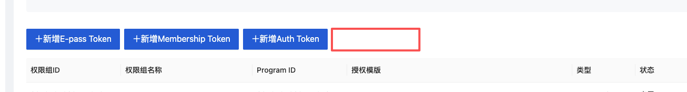
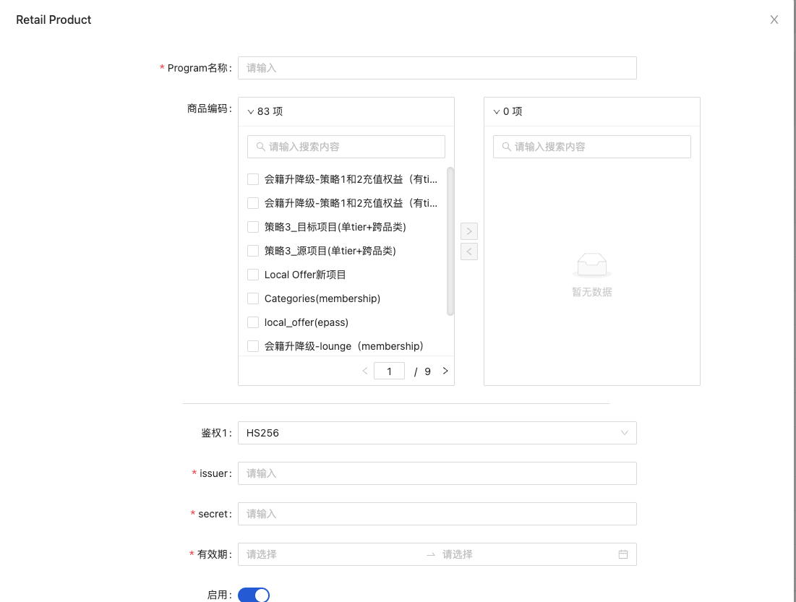
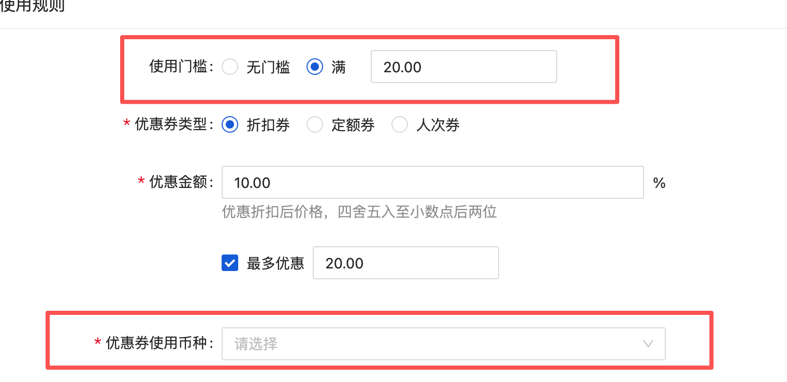
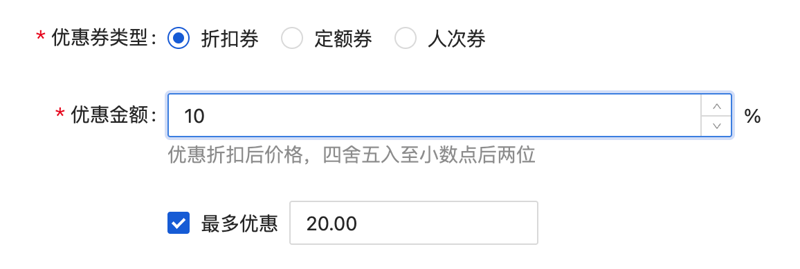
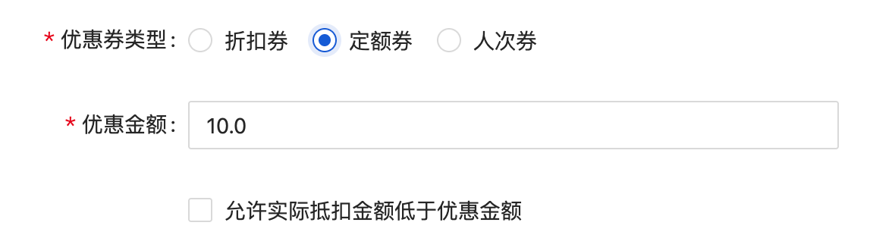
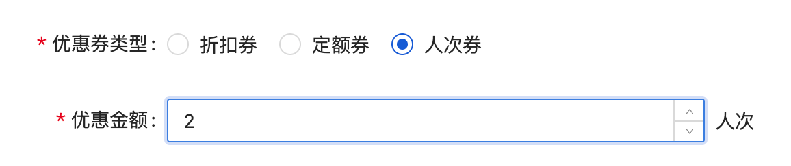

# PRD：首次会籍商品购买（API）

来源：<https://dragonpass.atlassian.net/wiki/spaces/DGSN/pages/1978761247/PRD+API>

---

## 1. 背景

当前 API 平台支持通过预注册方式发放会籍，但部分客户存在直接售卖 DragonPass 会籍商品的需求。

在该模式下，最终用户尚未拥有 DPID，业务方需通过 API 完成首次购买流程，包括订单创建、支付、支付结果确认以及会籍发放。

本文定义首次会籍商品购买相关 API 能力及业务流程。

## 2. 目标

支持合作伙伴通过 API 完成以下流程：

- 创建首次会籍购买订单；
- 获取支付链接，引导用户完成支付；
- 查询支付链接；
- 接收支付结果/订单结果回调；
- 查询订单（获取用户 DPID 及对应激活码）。

## 3. 适用范围

### 支持场景

- 用户购买 DragonPass 会籍商品；
- 用户尚未拥有 DPID；
- 由合作伙伴发起支付流程；
- DragonPass 提供收银台能力。

## 4. 业务流程

### 4.1 首次购买流程

```text
Partner
    │
    │ Create Order
    ▼
DragonPass
    │
    │ Return Pending Order
    ▼
Partner
    │
    │ Get Payment Link
    ▼
DragonPass
    │
    │ Return Cashier URL
    ▼
End User
    │
    │ Complete Payment
    ▼
Payment Provider
    │
    │ Notify DP
    ▼
DragonPass
    │
    ├─ Generate DPID
    ├─ Generate Activation Code
    │
    ▼
Partner
    │
    ├─ Receive Payment/Order Callback
    └─ Query Membership
```

### 4.2 业务逻辑

鉴权逻辑与改造

新增 Retail Product 鉴权（类似 Epass），一个 programId，可以操作多个不同的 Retail 商品的购买订单/资源查询，本期只做会籍商品。





不同的是，Retail Program 创建的会籍商品中的会籍，写入的是会籍模板的 programId，不是 Retail ProgramID。假设会籍模板 program 是 B，RetailProgram 是 A：

- 查询会籍购买订单，可用 A
- 查询会籍，操作会籍，更新会籍需要用 B

## 5. 功能需求

### 0 预览购买订单

就是算价，输入优惠券，如果优惠券无效/错误，跟未输入是一个逻辑，找原价商品购买。

判断链路，先去看优惠券是否有效，

【券有效，但不可用】若有效，且类型是周期优惠券，根据这个券对应的商品 id，去 saas 算价接口算价

- 算价时，若券不符合规则，valid 也要设为 false
- 但是 details/validity 是有内容的

【券无效（类型是 123），不存在】

- 直接用 program 的第一个商品 id 调用 saas 算价接口
- valid 也要设为 false
- details/validity 都是 null

查询优惠券信息：`/api/tenant/coupon/coupon/get`

saas 算价接口：https://apifox.dragonpass.com.cn/apidoc/shared/afaa64b8-a358-4746-a0a9-00398e4712ee/api-3558983

```json
{
    "appId": 1,
    "couponCode": "MEMBERSHIP_PRO_1Y",
    "autoRenewal": true, //根据true false来决定saas接口是开启订阅还是不开启purchaseType
    "profile": {
    "email": "niko@example.com",  //可选
    "clientUserId": "USER001"  //可选
  }
}
```

```json
{
    "code": 0,
    "data": {
        "coupon": {
            "valid": false,
            "details": {
                "couponType": 4, //couponType
                "description": "The first month's membership fee is waived.", //couponName
                "currency": "USD", //currency
                "discount": null //本期null掉
            }
        },
        "extra": {
            "appId": 1,
            "couponCode": "MEMBERSHIP_PRO_1Y",
            "autoRenewal": true,
            "profile": {
                "email": "developer@dragonpass.com"
            }
        },
        "payment": {
            "paymentStatus": "PENDING_PAYMENT",
            "currency": "USD",
            "timeline": {
                "paidAt": "2028-10-31T23:59:59+00:00",
                "refundedAt": "2028-10-31T23:59:59+00:00"
            },
            "price": {
                "originalAmount": 50.5, //originalTotalAmount
                "deductionAmount": 20.25, //discountFee
                "payableAmount": 20.25 //totalAmount
            },
            "charges": [
                {
                    "type": "MONTHLY_MEMBERSHIP_FEE",
                    "details": [
                        {
                            "paxType": "CARDHOLDER",
                            "quantity": 1,
                            "unitPrice": 50.5, //originalTotalAmount
                            "amount": 50.5 //quantity x unitPrice
                        }
                    ]
                }
            ],
            "deductions": []
        }
    }
}
```

#### 错误码

| 错误码 | 说明 | 英文提示 |
| --- | --- | --- |
| 500.020.030 | 预览订单失败 | Unable to preview the order at the moment. Please try again later. |
| 500.020.032 | 已存在生效的会籍订阅=1032 | An active membership subscription already exists for this program. |
| 500.020.033 | 不支持启用自动续期=1030 | Auto-renewal is not supported for this program. |

### 1 创建购买订单

合作伙伴创建会籍购买订单。

https://apifox.dragonpass.com.cn/apidoc/shared/afaa64b8-a358-4746-a0a9-00398e4712ee/api-3558984

查询优惠券信息：`/api/tenant/coupon/coupon/get`

优惠券的判断/使用逻辑和预览是一样的

#### 输入

- 会籍商品信息
  - 通过 couponcode 来找商品
  - 或通过商品 id 来找商品
  - 或通过 programid 来找商品（）
- 用户必须信息
  - 邮箱
- 用户基础信息（可选）
  - firstName
  - lastName
  - email
  - phone
- 是否启用自动续期 autoRenewal

```text
POST /v2/orders/memberships/purchase
```

```json
{
  "appId": 1 //必传字段，表示注册到哪个app，现在只有1=GA
  "couponCode": "MEMBERSHIP_PRO_1Y",  //可选
  "autoRenewal": true,
  "profile": {
    "email": "niko@example.com",  //必传
    "clientUserId": "USER001",  //可选
    "firstName": "Niko", //可选
    "lastName": "Lee", //可选
    "callingCode": "86", //可选
    "phoneNumber": "13800000000" //可选
  }
}
```

#### 输出

- orderId
- status
  - pendingPayment 如果需要支付
  - 如果打开了，renew 0 元也是要支付的，会走到 0 元验证
  - 如果不打开，0 元就不用付了直接 confirmed
- paymentStatus
  - PENDING_PAYMENT 如果需要支付
  - NO_PAYMENT_REQUIRED 如果不需要支付

```json
{
    "code": 0,
    "data": {
        "status": 1,
        "orderId": "DP00000000000001",
        "orderCreatedDate": "2024-12-31T00:00:00+00:00",
        "orderCancelledDate": null,
        "extra": {
            "programId": "1876920048220766208",
            "membershipId": null,
            "activationCode": null,
            "appId": 1, //必传字段，表示注册到哪个app，现在只有1=GA
            "couponCode": "MEMBERSHIP_PRO_1Y", //可选
            "autoRenewal": true,
            "profile": {
                "email": "niko@example.com", //必传
                "firstName": "Niko", //可选
                "lastName": "Lee", //可选
                "callingCode": "86", //可选
                "phoneNumber": "13800000000" //可选
            }
        }
        "payment": {
            "paymentStatus": "PENDING_PAYMENT", //preview时返回null
            "currency": "USD",
            "timeline": {
                "paidAt": "null",
                "refundedAt": null
            },
            "price": {
                "originalAmount": 120, //originalTotalAmount
                "deductionAmount": 40, //equityDiscountFee
                "payableAmount": 80 //totalAmount
            },
            "charges": [
                {
                    "type": "MEMBERSHIP_FEE", //会籍费
                    "details": [
                        {
                            "paxType": "CARDHOLDER", //只有CARDHOLDER
                            "quantity": 1, //数量，
                            "unitPrice": 50, //单价，saas返回
                            "amount": 50 //总价
                        }
                    ]
                }
            ], //表示应收的部分
            "deductions": null //实际没有抵扣
        }
    }
}
```

#### 错误码

| 错误码 | 说明 | 英文提示 |
| --- | --- | --- |
| 500.000.702 | 不符合优惠券使用条件 | The coupon is not applicable to this order. |
| 500.020.031 | 创建会籍购买订单失败=其他 | Sorry, we're unable to process your order at the moment. Please try again later or contact DragonPass support team. |
| 500.020.032 | 已存在生效的会籍订阅=1032 | An active membership subscription already exists for this program. |
| 500.020.033 | 不支持启用自动续期=1030 | Auto-renewal is not supported for this program. |

#### 业务规则

- 若商品未启用自动续期，则不能要求开启自动续期
- 商品价格以 SAAS 实时配置不能为 null
- 会籍模板要启用预制会籍（saas 负责）

### 2 获取支付链接

参考 lounge 和 FT 的订单流里面的支付链接接口。

同一个订单号，重复获取，如果支付连接仍然有效，就返回同一个。

```text
POST /v2/orders/payments
```

```json
{
  "orderId": "DP00000000000001",
  "ePassId": "DP00000000000001", //或membershipId
  "paymentMethod": "H5_CASHIER", //or COF
  "returnUrl": "https://example.com/payment/return",
  "cancelUrl": "https://example.com/payment/cancel"
}
```

```json
{
  "orderId": "DP00000000000001",
  "status": 9,
  "paymentStatus": "PENDING_PAYMENT",
  "paymentAction": {
    "type": "REDIRECT",
    "url": "https://cashier.example.com/pay/xxx" //SAAS返回的收银台链接
    "validUntil": 是个时间戳
  }
}
```

### 3 查询优惠券可用性（这期先不做）

合作伙伴查询某个优惠券是是否可用，及相关优惠信息。

#### 输入

- couponCode

```text
POST /api/v2/coupons/validate
```

```json
{
  "couponCode": "MEMBERSHIP_PRO_1Y"
}
```

#### 输出

```json
{
    "code": 0,
    "data": {
        "valid": true,
        "couponCode": "SUMMER2026",
        "couponType": 1,
        "description": "10% off, up to USD 20",
        "productId": [
            "MS0000001"
        ],
        "details": {
            "currency": "USD", //币种
            "eligibility": {
                "minAmount": 100
            },//使用门槛有无门槛和满减
            "discount": {
                "percentage": 10,
                "maxAmount": 20
            } //优惠信息
        }
    },
    "validity": {
        "type": 1, //或 2=无限期
        "validUntil": "2026-12-31T23:59:59+00:00"，//无限期返回为null
    }
}
```

#### 业务规则

- 只返回有效或无效，及信息

#### 字段规则

eligibility 和 currency



couponType

| enum | couponType | 说明 |
| --- | --- | --- |
| 1 | PERCENTAGE_DISCOUNT | 折扣券 |
| 2 | FIXED_AMOUNT | 定额券 |
| 3 | QUANTITY | 数量券（抵扣人次/数量） |
| 4 | FREE_TRIAL | 周期优惠（针对会籍购买商品） |

折扣券



```json
"discount": {
                "percentage": 10, //10%折扣
                "maxAmount": 20 //最多优惠20usd
            }
```

定额券



```json
"discount": {
                "maxAmount": 10 //最多优惠10usd
            }
```

数量券



```json
"discount": {
                "quantity": 2 //最多优惠2人次
            }
```

周期优惠券

```json
"discount": {
                "quantity": 2 //最多优惠2个周期
            }
```

### 4 订单状态回调

DragonPass 将订单结果主动通知合作伙伴。

`membershipPurchase.statusChanged`

只会有 pendingPayment=9 -> confirmed=1 / failed=10

```json
{
  "eventType": "membershipPurchase.statusChanged",
  "orderId": "MO00000000000001",
  "previousStatus": 9,
  "currentStatus": 1,
  "statusChangedDate": "2026-07-07T10:00:00+00:00",
  "remarks": null
}
```

### 6 查询订单

合作伙伴查询最终发放结果。

这个接口不能用来查 Epass 订单。

#### 输入

- orderId

```text
POST /api/v2/orders/memberships/purchase/details
```

```json
{
  "orderId": "MS00000000000001"
}
```

#### 输出

```json
{
    "code": 0,
    "data": {
        "status": 1,
        "orderId": "MS00000000000001",
        "orderCreatedDate": "2024-12-31T00:00:00+00:00",
        "orderCancelledDate": null,
        "extra": {
            "programId": "1876920048220766208",
            
                "activation": {
                    "type": 1, //1=会籍+激活码，2=兑换码
                    "membershipId": "8888000066668888",
                    "activationCode": "8888"
                    或者
                    "redemptionCode": "ABCD123456"               
                },
            "appId": 1, //必传字段，表示注册到哪个app，现在只有1=GA
            "couponCode": "MEMBERSHIP_PRO_1Y", //可选
            "autoRenewal": true,
            "profile": {
                "email": "niko@example.com", //必传
                "clientUserId": "3EF5D065-76F8-4D3E-801A-B329D15F461A"
            }
        },
        "payment": {...
        }
    }
}
```

#### activationStatus

| 状态 | 含义 |
| --- | --- |
| Activated | 已激活 |
| PendingActivation | 待激活 |
| Failed | 发放失败 |

#### 错误码

| 错误码 | 说明 | 英文提示 |
| --- | --- | --- |
| 500.020.032 | 无法查询到会籍购买订单详情 | Sorry, we're unable to retrieve the order details at the moment. Please try again later. |
