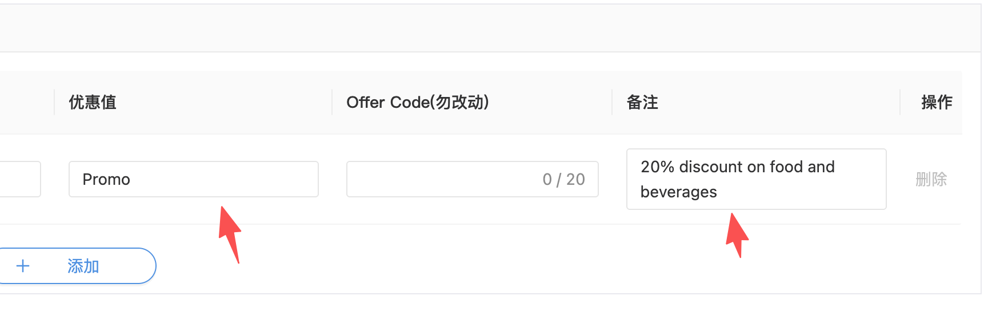
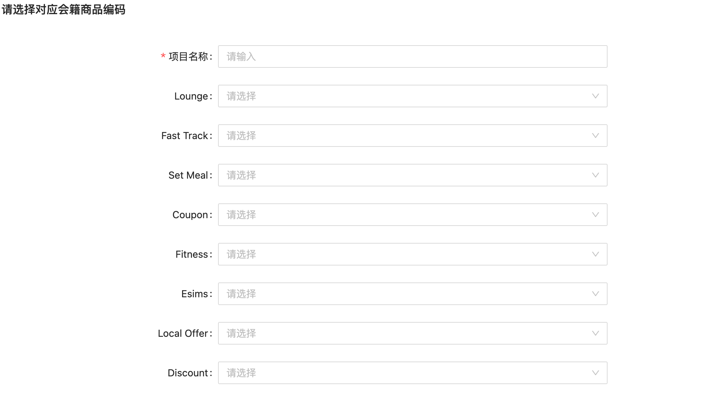

# Dining Discount API

来源：<https://dragonpass.atlassian.net/wiki/spaces/DGSN/pages/2147156290/Dining+Discount+API>

---

## 一、定义

机场餐厅折扣，挂靠在餐厅下，与setmeal、coupon是同级的，module代码=5，一个餐厅可能同时存在345三个品类。

以前餐厅折扣无法核销，纯展示二维码就可以使用，这个Q开始在SAAS做核销订单流（walkin），使用方式和134是一样的，不需要提前预约，展码即可使用。

## 二、范围

- 在当前E-pass、membership方案中支持Dining Discount 品类的资源展示、订单展示、权益管理、会籍注册
- SWAP entitlement支持Dining Discount 品类
- 聚合搜索、回调支持Dining Discount 品类

## 三、需求

### 3.1 资源

资源详情接口，除了5单独的资源展示，dining discount的信息也要展示在6餐厅的资源详情中，

资源列表搜索6时，如果某个餐厅有dining discount，也要出现在列表中

#### 3.1.1 /v2/resources

支持 module=5的过滤，限制条件与其他品类一致

注意，discount品类不需要基于是否有结算价格判断网络范围，直接通过网络清单判断即可

```json
{
    "module": 5,
    "resourceId": "R03458",
    "resourceName": "Leon",
    "locationInfo": {
        "city": "London",
        "countryOrRegion": "GB",
        "continent": "Europe",
        "transportHubId": "A10047",
        "transportHubName": "Heathrow Airport",
        "iata": "LHR",
        "location": "Airside - After passport control and security check, Terminal 2, International Departures, Ground Floor, Gate A16 \r\n\r\n",
        "timezone": "Europe/London",
        "coordinates": "51.4710212,-0.4866428"
    },
    "image": "https://image.m.dragonpass.com/uploadFile/manual/20260121/e0b7c563-185c-4d91-92af-79fa8d5173db.jpg",
    "extra": {
        "diningInfo": {
            "area": 1,
            "routeTypes": [
                1
            ],
            "terminal": "Terminal 2",
            "nearestGate": "Gate A16",
            "diningOptions": [
                {
                    "module": 5,
                    "optionName": "10% discount", //取优惠值
                    "description": "10% discount", //取备注，没有就取优惠值
                    "value": null, // 5的时候是null，和3一样
                    "currency": null // 5的时候是null，和3一样
                } //注意，一个餐厅下优惠可能会有2个，promo+discount
            ],
            "tier": 1
        }
    }
}
```


| 错误码 | 说明 | 英文提示 |
| --- | --- | --- |
| 500.020.004 | 无法获取到产品列表 | Sorry, we're unable to retrieve the resource list at the moment. Please try again later. |
| 500.020.013 | 查询了不能使用的语种 | Requested language is not available for your program. |
| 500.020.018 | 不符合搜索条件要求，请重试 | The search criteria are invalid. Please try again. |

#### 3.1.2 /v2/resources/{resourceId}

搜索5的时候，结构同上

搜索6的时候，diningOptions下新增同上的module=5的object

| 错误码 | 说明 | 英文提示 |
| --- | --- | --- |
| 500.020.006 | 无法获取到资源详情 | Sorry, we're unable to retrieve the resource details at the moment. Please try again later. |
| 500.020.007 | 查询的资源id该program不可用 | Sorry, this resource is not accessible with your program. |

#### 3.1.3 /v2/resources/prices/

支持通过module=5查询价格，ES查询是不会返回价格，因此，默认basePrice都是返回0，不是null，注意，因为代表不收钱。但prebookingFee是null，没有预约。

```text
curl --location 'localhost:8767/es/salesCenter/project/network/findNetworksByPage' \
--header 'Content-Type: application/json' \
--data '{
    "lg": "en",
    "language": "en",
    "priceConfigFlag": "1",
    "projectId": "hnhkgx6ec3uxrdn4wi",
    "showPreVerConfig": true,
    "page": 1,
    "pageSize": 10
}'
```

#### 3.1.4 /v2/search

索引入库

#### 3.1.5 /v2/search/modules

统计数量，注意是基于资源数量统计，翻译自己ai一下

### 3.2 订单

#### 3.2.1 /v2/orders/{module}/ePasses

- 支持以discounts为路径名发放dining discount E-pass
- 返回module=5
- allowedResources中
- resourceIds只能是有discount的rcode
- iata/国家都支持指定，按原有逻辑
- 其他参数为E-pass通用逻辑，本迭代不做swap先

| 错误码 | 说明 | 英文提示 |
| --- | --- | --- |
| 500.063.001 | resourceId中传了非这个接口对应品类的其他资源，例如创建lounge Epass，传了Ccode | The 'resourceId' array contains resources that are not associated with the expected module. Please verify and ensure the resource IDs match the correct module. |
| 500.063.002 | resourceId中传了超过10个资源code | The 'resourceId' array exceeds the maximum limit of 10 resource IDs. Please reduce the number of resource IDs and try again. |
| 500.063.010 | 下单失败 | Sorry, we're unable to process your order at the moment. Please try again later or contact DragonPass support team. |

#### 3.2.2 /v2/orders/ePasses

老格式，无特殊

```json
{
    "orderId": "DP00000000000001",
    "status": 1,
    "usedUsages": 1,
    "module": 5,
    "category": 1, //注意是1，walkin
    "orderCreatedDate": "2024-12-01T00:00:00+00:00",
    "resourceId": "R00001",
    "resourceName": "DragonPass Dining Restaurant",
    "image": "https://image.dragonpass.com/uploadFile/images/cover.png",
    "extra": {
        "optionId": null, // discount null
        "optionName": null, // discount null
        "transportHubName": "Manchester Airport",
        "transportHubId": "A00001",
        "city": "Manchester",
        "countryOrRegion": "GB"
    }
}
```
查不到订单列表是通用提示语

#### 3.2.3 /v2/orders/ePasses/details

老格式，无特殊

```json
{
    "code": 0,
    "data": {
        "status": 2,
        "module": 5,
        "category": 1,
        "orderId": "SL20260812UD0PW3I",
        "orderCreatedDate": "2026-08-12T03:23:34+00:00",
        "orderCancelledDate": null,
        "extra": {
            "clientUserId": "3EF5D065-76F8-4D15F461A",
            "usageDate": "2026-08-12T11:23:29",
            "usedUsages": 1,
            "resourceId": "R00001",
            "resourceName": "DragonPass Dining Restaurant",
            "iata": "SIN",
            "transportHubName": "Changi Airport",
            "terminal": "Terminal 4",
            "city": "Singapore",
            "countryOrRegion": "SG"
        },
        "payment": null,
        "ePassId": "8576478461654705"
    }
}
```

| 错误码 | 说明 | 英文提示 |
| --- | --- | --- |
| 500.000.006 | 获取订单详情失败 | Sorry, we're unable to retrieve the order details at the moment. Please try again later. |

#### 3.2.4 /v2/orders/memberships

老格式，无特殊

```json
{
    "orderId": "DP00000000000001",
    "status": 1,
    "module": 5,
    "category": 1,
    "passengerCounts": {
        "cardholder": 1,
        "guests": 1
    }, //注意是实际核销人数
    "orderCreatedDate": "2024-12-01T00:00:00+00:00",
    "resourceId": "R00001",
    "resourceName": "DragonPass Dining Restaurant",
    "image": "https://image.dragonpass.com/uploadFile/images/cover.png",
    "extra": {
        "optionId": null,
        "optionName": null,
        "transportHubId": "A00001",
        "transportHubName": "Manchester Airport",
        "city": "Manchester",
        "countryOrRegion": "GB"
    }
}
```
查不到订单列表是通用提示语

#### 3.2.5 /v2/orders/memberships/details

老格式，无特殊

```json
{
    "code": 0,
    "data": {
        "status": 2,
        "module": 1,
        "category": 1,
        "membershipId": "8888000066668888",
        "orderId": "DP00000000000001",
        "orderCreatedDate": "2024-12-31T00:00:00+00:00",
        "orderCancelledDate": null,
        "extra": {
            "usageDate": "2024-12-31T00:00:00",
            "usedEntitlementDetails": {
                "cardholderExclusiveEntitlements": 1,
                "guestsExclusiveEntitlements": 1,
                "sharedEntitlements": 0
            },
            "passengerCounts": {
                "cardholder": 1,
                "guests": 1
            },
            "resourceId": "R00001",
            "resourceName": "DragonPass Dining Restaurant",
            "iata": "MAN",
            "transportHubName": "Manchester Airport",
            "terminal": "Terminal 1",
            "city": "Manchester",
            "countryOrRegion": "GB"
        }
    }
}
```
查不到详情是通用提示语

#### 3.2.6 membership相关接口

注册会籍时发出预设的权益

支持更新权益（大客户+充值）

支持查询到权益余额

都是通用提示语

### 3.4 配套部分

#### 3.4.1 Callback

walkin.redemption 支持dining discount的回调

格式不变

#### 3.4.2 Simulation

待定

#### 3.4.3 Saas相关配置

项目配置里，Epass勾选会籍商品新增Dining Discount


