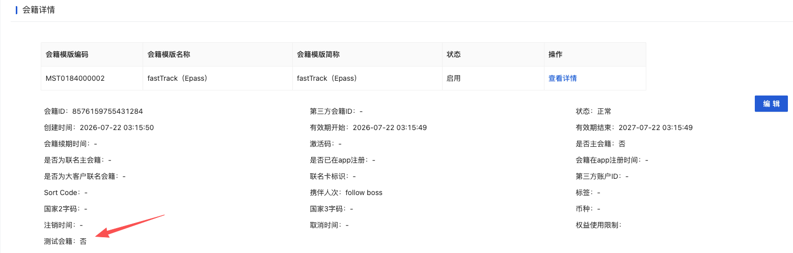

# Adding testFlag for internal testing membership/Epass｜新增内部测试会籍标签

**JIRA**: [PAPI-2998](https://dragonpass.atlassian.net/browse/PAPI-2998)

---

通过 Jira 事务管理员自动创建

新增字段 `testFlag`，调用 saas 接口创建会籍业务时，需要对应增加测试会籍字段

```json
"_testFlag": "AT"
```

```text
https://developer-sandbox.dragonpass.com/api/v2/orders/{module}/ePasses
https://developer-sandbox.dragonpass.com/api/v2/memberships
https://developer-sandbox.dragonpass.com/api/v2/orders/{module}/ePasses/bundle
```


