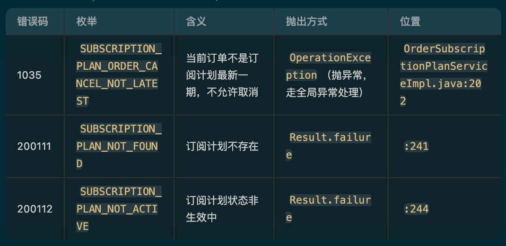
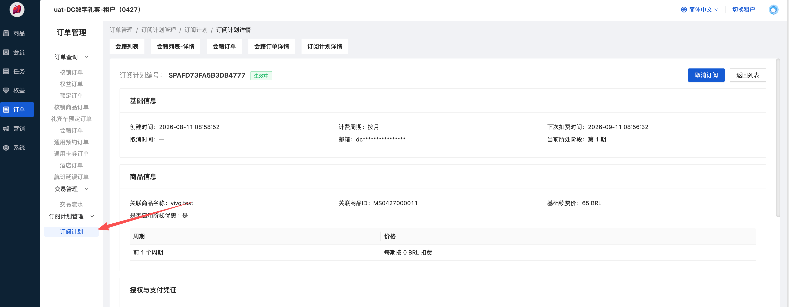

# Cancellation Endpoint - Membership Purchase｜会籍购买新增取消接口

**JIRA**: [PAPI-3056](https://dragonpass.atlassian.net/browse/PAPI-3056)

---

注意，这个接口的鉴权：

**需要使用对应会籍模板的 programid 来执行鉴权，不是使用 retail 商品的 programid**

## 业务链路

先用 dpid 查订阅计划，用最新一期的 id 去取消订阅计划，调 2 个接口：

- [Apifox api-3559522](https://apifox.dragonpass.com.cn/apidoc/shared/1f168202-c5e0-4ab5-b6af-105cd3ad3361/api-3559522)
- [Apifox api-3559523](https://apifox.dragonpass.com.cn/apidoc/shared/1f168202-c5e0-4ab5-b6af-105cd3ad3361/api-3559523)

请求示例：

```json
{
    "membershipId": "8888000066668888",
    "email": "developer@dragonpass.com" //用于验证dpid是否属于这个邮箱，防止非法取消
}
```

响应示例：

```json
{
    "code": 0,
    "data": {
        "membershipId": "8888000066668888",
        "status": 1,
        "expirationDate": "2028-12-31T23:59:59+00:00",
        "subscription": {
            "status": 2, // 2=已取消
            "cancelledDate": "2024-12-31T00:00:00+00:00", // saas取消时间
            "nextBillingDate": null // 取消后永远是null
        }
    }
}
```

## 错误码

| 错误码 | 说明 | 英文提示 |
| --- | --- | --- |
| 500.020.034 | 当前会籍无有效订阅计划 | No active subscription plan found for this membership. |
| 500.020.035 | 取消订阅计划失败，兜底错误 | Failed to cancel the subscription plan. Please try again later. |

BOSS 的错误码：

- `1035` / `200112` 对应我们的 034
- 其他对应我们的 035



订阅计划在 saas 哪里：


