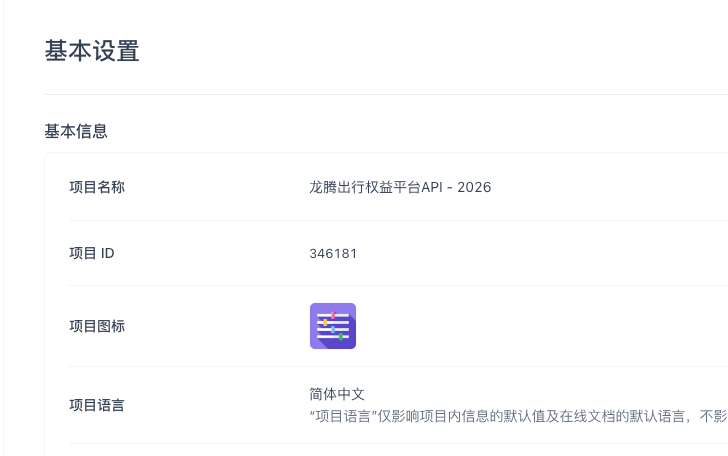

# 1.0 API Rebuild Phase 1 - 权益管理部分

来源：<https://dragonpass.atlassian.net/wiki/spaces/DGSN/pages/1670054171/1.0+API+Rebuild+Phase+1+->

---

## 1. 产品背景

在 DragonPass 1.0 的生态中，权益（Entitlement）是连接「订单使用」的核心载体。  
1.0 没有会籍这个概念。基于原有 1.0 API，目前需要重构权益管理部分接口，主要提供以下功能：

- 提供统一的权益发放与管理能力
- 支持会员 / 非会员两种模式
- 支持精细化权益（持卡人 vs 携伴）

APIFOX 见以下项目：



## 2. 核心概念定义

### 2.1 权益（Entitlement）

代表用户可使用某类服务的“次数/额度”。

### 2.2 权益券（voucherCode）

唯一标识一条权益券号，用于使用服务。

### 2.3 权益模版（Entitlement Template）

定义权益商品（如：休息室商品、FT 商品等）。在这个商品中进行权益数量 / 网点范围等配置管理。

### 2.4 权益分配（Usage Allocation）

又叫权益精细化管理，支持休息室和嘉宾品类，只有在 SAAS 打开开关后才能进行操作。

```json
{
  "cardholderUsages": 1,
  "guestUsages": 1
}
```

用于区分：

- 持卡人专用
- 携伴专用

### 2.5 支持小数权益（0.5）

适用于：

- 高铁休息室

## 3. 功能范围（Scope）

### 3.1 权益发放接口

```text
POST /v3_general_entitlement_issuance
```

能力：

- 支持两种模式：
  - 无会员发放（`clientUserId`），通过第三方用户 id 发放
  - 已有会员发放（`memberId`），通过已经在 DP 生成的会员 id 发放
- 支持自定义有效期
- `clientUserId` 可重复传入，即在同一个用户下多次发放权益
- `clientOrderId` 可选
- 支持权益数量（可为小数）
- 支持权益分配（cardholder / guest）：
  - `cardholderUsages + guestUsages = availableUsages`
  - 又叫权益精细化管理，支持休息室和嘉宾品类，只有在 SAAS 打开开关后才能进行操作

关键规则：

- `clientUserId` 和 `memberId` 二选一
- `availableUsages` 必填
- 支持 `remark` 扩展字段

发放异常：

| 场景 | 错误码 | 说明 |
| --- | --- | --- |
| 重复 `clientOrderId` | 500.031.002 | 同一个第三方订单号不能重复发放权益 |
| 无效 `entitlementTemplateId` | 301.031.003 | 权益编码有误 |
| `usageAllocation` 不等于 total | 500.031.005 | 权益总额不一致 |

### 3.2 权益查询（单条）接口

```text
POST /v3_general_entitlement_query
```

支持按以下条件进行查询：

- `clientOrderId`（如果之前有传入）
- `voucherCode`
- 不支持使用 `clientUserId` 进行查询

返回：

- 权益基本信息
- 剩余可使用次数
- 有效期

查询异常：

| 场景 | 错误码 | 说明 |
| --- | --- | --- |
| 权益券不存在 | 301.031.001 | 权益不存在 |

### 3.3 会员权益列表接口

```text
POST /v3_general_member_entitlement_list
```

能力：

- 分页查询
- 按状态筛选

支持字段：

- `categoryType`（SL / FT / DG / LS）
- `status`
- `validTo`

用于：

- App 展示某个会员下剩余的权益数量

查询异常：

| 场景 | 错误码 | 说明 |
| --- | --- | --- |
| 会员不存在 | 301.010.002 | 会员不存在 |

### 3.4 权益状态管理接口

```text
POST /v3_general_entitlement_status_update
```

支持状态流转：

| 当前状态 | 可变更 |
| --- | --- |
| 正常 | -> 冻结 |
| 冻结 | -> 正常 |
| 非作废（正常 + 冻结） | -> 作废 |

```text
发放 -> 正常 ->（使用中）-> 使用完成
           ↓
         冻结
           ↓
         解冻
           ↓
         作废
```

查询异常：

| 场景 | 错误码 | 说明 |
| --- | --- | --- |
| 状态更新失败 | 500.031.004 | 权益状态变更失败 |

### 3.5 权益编辑接口

```text
POST /v3_general_entitlement_update
```

支持修改：

- 用户姓名
- 有效期
- 权益数量
- `usageAllocation`（如果商品没打开，或品类不支持权益精细化管理则不可修改）

编辑异常：

| 场景 | 错误码 | 说明 |
| --- | --- | --- |
| 权益更新失败 | 500.031.003 | 权益编辑失败 |
| 权益总额不一致 | 500.031.005 | 权益总额不一致 |
| 不支持编辑 `usageAllocation` | 500.031.005 | 该权益不支持编辑 `usageAllocation` |

### 3.6 动态二维码（核销）接口

```text
POST /v3_general_entitlement_qrcode
```

能力：

- 生成短时有效二维码
- 支持 `duration` 控制（默认 60 秒）

适用：

- 休息室（SL）
- 快速安检（FT）

返回：

- `qrCode`
- `validUntil`（时间戳）

二维码生成异常：

| 场景 | 错误码 | 说明 |
| --- | --- | --- |
| 二维码生成失败 | 500.031.006 | 二维码生成失败 |
