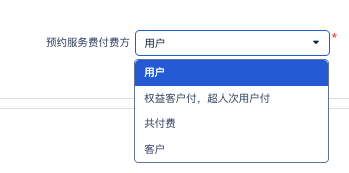

# 【Aero Blue】价格查询接口新增字段支持获取用户价

**JIRA**: [PAPI-2346](https://dragonpass.atlassian.net/browse/PAPI-2346)

---

影响以下接口：

`GET /v2/resources/fitness/{resourceId}/schedule?expand=price`

`POST /v2/resources/prices`

`POST /api/v2/resources/options/prices`

BOSS返回

```
"priceList": [
                {
                    "bookPrice": 95.0,
                    "bookPricePayer": "entitlementToB_PAYGToC",
                    "bookPriceType": "ByPersonTime",
                    "maxPrice": 0.0,
                    "overNumPrice": 99.0,
                    "overNumPricePayer": "user",
                    "overNumPriceType": "fixedPrice",
                    "price": 93.0,
                    "priceDimensional": "DPC000059",
                    "priceType": "fixedPrice",
                    "userBookPrice": 98.0
                }
            ]
```

相关接口的返回中，pricing object格式调整，新增字段，

```
{
    "code": 0,
    "data": {
        "pagination": {
            "pageSize": 10,
            "pageNumber": 1,
            "totalNumber": 1
        },
        "resources": [
            {
                "resourceId": "N00001",
                "resourceName": "Manchester Airport Lounge",
                "currency": "USD",
                "lastUpdatedTime": "2025-05-01T10:00:00+00:00",
                "pricingMode": 1, //计价模式
                "pricing": {
                    // ====== Legacy (兼容用) ======
                    "basePrice": 50.0, //不变
                    "prebookingFee": 5.0, //不变
                    // ====== New pricing model ======
                    "priceDetails": {
                        "basePrice": {
                            "settlement": 50.0,
                            "selling": 55.0
                        },
                        "prebookingFee": {
                            "chargingRule": "MIXED", //有3个，用户支付，客户支付，混合
                            "settlement": 5.0,
                            "selling": 5.0
                        }
                    }
                }
            }
        ]
    }
}
```

对应取值逻辑调整见下

没有值就返回null，不返回0

| **api字段** |  | **场景** | **boss字段** |
|------|------|------|------|
| BasePrice.settlement | 对客价（对客结算，基准费） | SETTLEMENT | price |
| prebookingFee.settlement | 客户预约费（对客结算，预约服务费） | SETTLEMENT | bookPrice |
| BasePrice.selling | 超人次价格（就是对用户价，基准费） | SELLING | overNumPrice |
| prebookingFee.selling | 用户预约费（对用户价，预约服务费） | SELLING | userBookPrice |
| prebookingFee.chargingRule | 预约费付费规则 | - | bookPricePayer |



**映射关系：**

用户 USER_FULL_PAYMENT

权益客户付 MIXED_PAYMENT

共付费 SHARED_PAYMENT

客户 CLIENT_FULL_PAYMENT
