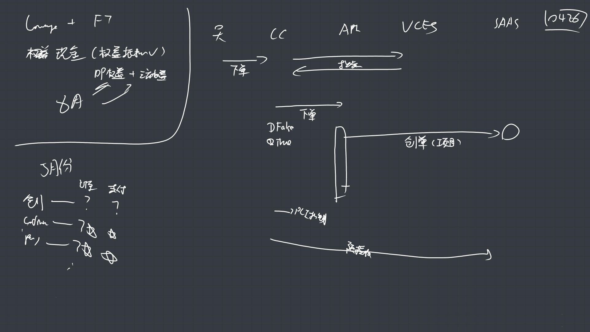

# 【Aero Blue】Lounge+FT订单流支持AB5月版本

**JIRA**: [PAPI-2576](https://dragonpass.atlassian.net/browse/PAPI-2576)

---

### **一、当前背景**

当前API的订单流，如果是项目支付，则直接在create后，执行orderStatusUpdate和confirmOrder，不经过任何实际支付流程，将订单流转到待发放

- create ----> 草稿

- orderStatusUpdate -----> 待处理

- confirmOrder----->待发放

- payFinish---->待使用

在VISA 5月版本，需要针对0426租户特殊写一个逻辑，满足mvp版本功能，后续再改回标准的saas第三方权益订单流。

### 二、需求

2.1 API侧，在取预约商品时过滤掉第三方权益/第三方现金的商品，只取权益/现金商品下单

2.2 在0426租户下，如果下单接口cashPaymentApplied传参为true，且通过检验（真的有金额要付）后，在create后就不再有api项目对saas进行

- orderStatusUpdate

- confirmOrder

改为由visa项目组去向saas发起通知，因为visa在5月版本，需要自行负责pci的收款流程

如果是cashPaymentApplied传参为false，则正常走现有流程。

流程如下：

|  | **纯权益支付** | **纯现金支付** | **权益+现金支付** |
|------|------|------|------|
| API | create 创建订单 | create 创建订单 | create 创建订单 |
| payByEquity 支付权益 | payByEquity 支付权益，订单状态待处理，支付状态待支付 |  |  |
| VISA 预授权阶段 | 无需介入 | pci预授权成功后 `orderStatusUpdate` 更新到`待处理` | pci预授权成功后 `orderStatusUpdate` 更新到`待处理` |
| 更新到`待处理`后，将支付信息放到`confirmOrder`，给saas变成`处理中/待发放` | 更新到`待处理`后，将支付信息放到`confirmOrder`，给saas变成`处理中/待发放` |  |  |
| VISA 确认扣款阶段 | 收到MQ变成待发放后，开始PCI扣款 pci预扣款成功后，调用`payfinish` 更新到`待使用` | 收到MQ变成待发放后，开始PCI扣款 pci预扣款成功后，调用`payfinish` 更新到`待使用` |  |
| 总结 | cashPaymentApplied传参为false 不改原流程 | cashPaymentApplied传参为true 无权益要用 API侧在创建订单后就不再执行业务 | cashPaymentApplied传参为true 有权益要用 API侧在payByEquity 支付权益后就不再执行业务 |
