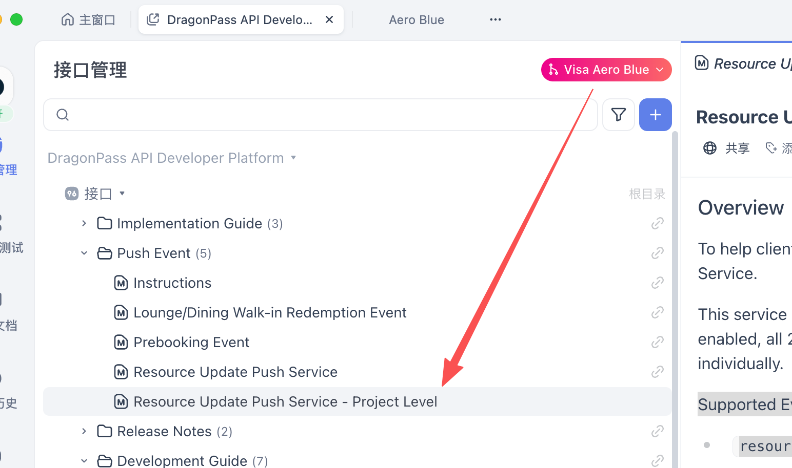

# project level 资源更新和站点更新推送

**JIRA**: [PAPI-2644](https://dragonpass.atlassian.net/browse/PAPI-2644)

---

新增2个 Event Topics

`project.resource.metadata.updated`
`project.transportHub.metadata.updated`

新增租户（项目）纬度的2个推送事件，更新租户下的资源/站点基础数据更新，内容与原有的programId的推送一致，只是将programId换成了projectId，见：

推送的数据内容逻辑，与原来做的`Retrieve Project Resources List`和`Retrieve Project Transport Hub List`接口一致，是对租户内，所有在用的program下的资源，站点数据，更新后去重的一个event通知。

例如N00001作用在800个program，那发生了更新的话，只用推送1次。

同时，Recovery接口也要支持找回这2个event推送的事件
