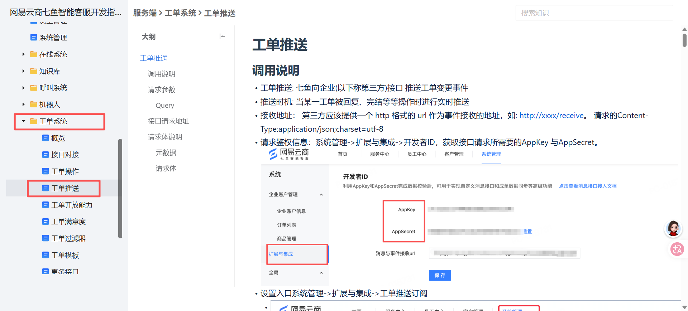
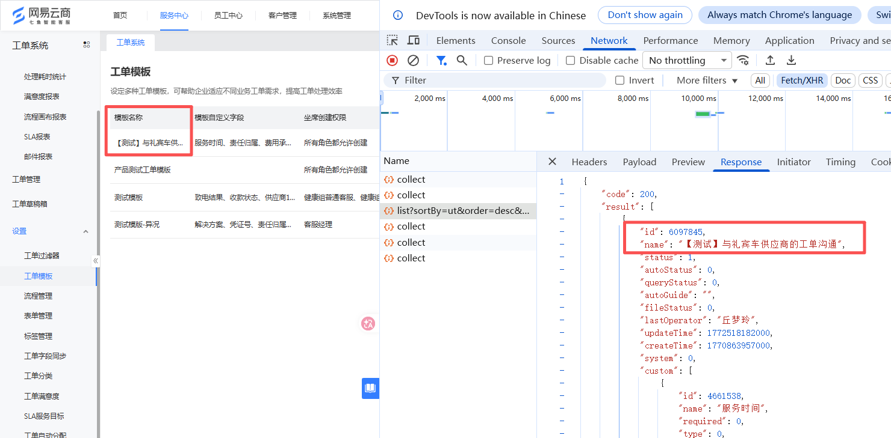
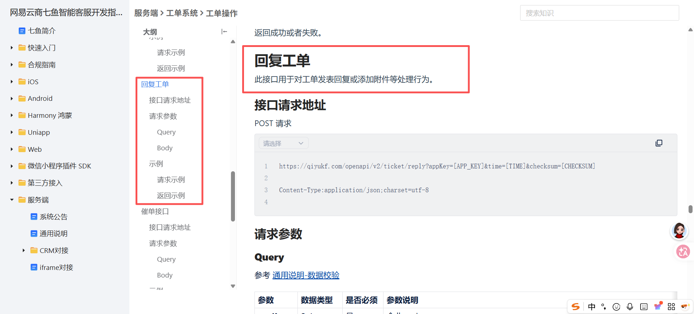
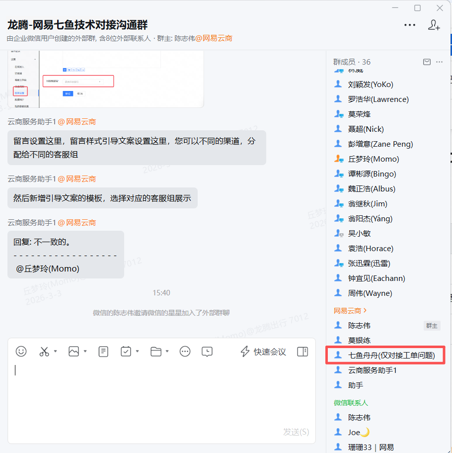
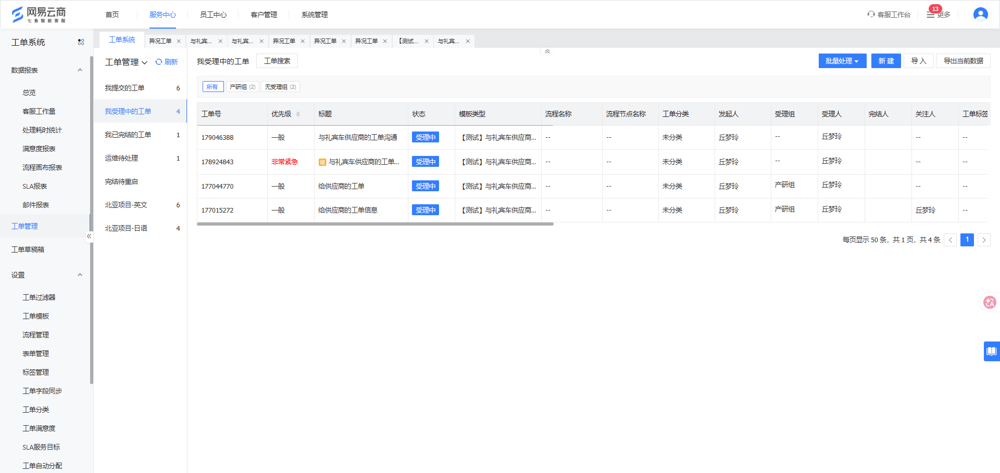
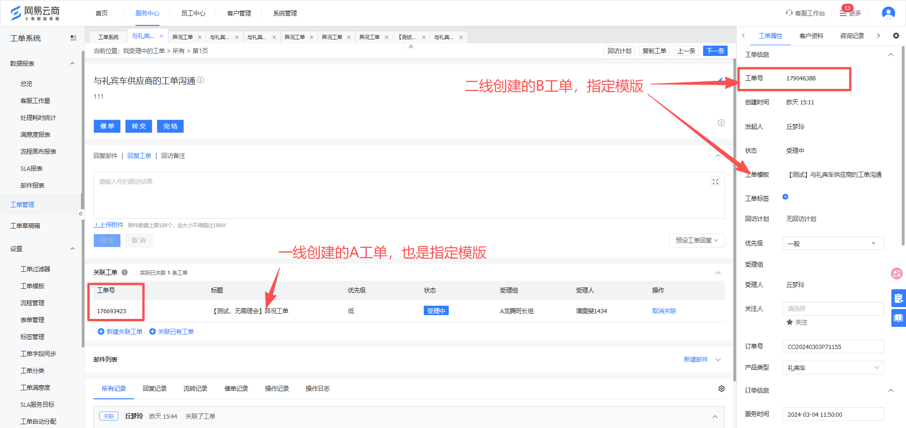

# 【客服工作台 V3.17.0】网易七鱼工单与客服工作台对接

来源：<https://dragonpass.atlassian.net/wiki/spaces/DPP/pages/1577484335/V3.17.0>

---

none

# 1 版本记录Version History

**Module**| **Version**| **类型**| **Description**| **Date**| **Owner**  
---|---|---|---|---|---  
订单中心|  V3.17.0| 需求提出| 1、客服工作台获取网易七鱼的工单推送2、与调度系统对接礼宾车客诉工单|  2026.2.27|  丘梦玲  
  
# 2 需求概述Requirements Overview

## 2.1 背景Background

BRD链接：<https://dragonpass.feishu.cn/docx/ERtjduIzsol9pYxrKPvcnLJOnud>

  * 一线客服收到客户投诉后，需要同步供应商微信群、向供应商发邮件，同时在客服系统登记工单，信息传递链路分散；

  * 供应商完成调查后，既要在微信群回复一线客服，又要单独向客诉部门发送邮件反馈，重复的信息填报与沟通工作占用大量人力成本，且易出现信息传递不一致问题。

  * 客诉处理仅 "创建工单" 环节在网易七鱼系统记录，工单流转、供应商回复、处理结果登记等环节均脱离系统管控，需要客服在手动补充到工单系统；

业务价值：

**指标**| **指标明细**| **数据明细**  
---|---|---  
工单结案时长| 25年数据| 5.66天  
目标提升至| 4.5天（节约1天）  
工时| 25年工单数据| 3000单  
预计节约工时（按每张工单人工操作时长减少10分钟计算）| 3000*10/60 = 500小时  
  
## 2.3 目标Target

支持项目业务发展并提供对应的系统功能支持。

# 3 UML

## 3.1 业务流程图

飞书流程图：<https://dragonpass.feishu.cn/docx/MeKldbzd4oboWwxRc0YcmUMQnMd>

-20260306-070603.png)

## 3.2 订单流

# 4 功能需求描述Functional Requirements Description

## 4.1 功能清单Function List

**功能模块**| **功能描述**  
---|---  
七鱼工单数据库表| 对接七鱼工单推送接口获取客服创建的工单列表  
/| 指定工单模块ID对应的工单，依据订单号对应的供应商，推送到调度系统  
/| 对接调度系统中车队供应商对工单的回复，并同步到七鱼  
/| 工单信息-MQ推送  
  
## 4.2 功能详细说明Function Detail Specification

### 4.2.1 对接七鱼工单推送接口获取客服创建的工单列表

1、七鱼工单推送接口：[https://b.163.com/knowledge/public/WXjbs9n3GC/knowdetail?docId=bIgVxg3VEu&pid=245258](https://b.163.com/knowledge/public/WXjbs9n3GC/knowdetail?docId=bIgVxg3VEu&pid=245258)

2、逻辑：对于客服在网易七鱼中创建的各类工单，均需通过【七鱼工单推送接口】获取到对应的工单保存到客服工作台数据库【按1月工单数量是2885条，2月是2753条】

3、客服侧暂不需要工单列表页面，后续规划：

3.1、将通过订单号/权益码等信息将工单编号关联到对应的订单/权益处,无需客服额外在内部备注中填写工单号。

3.2、礼宾车订单客诉信息：将工单填写的客诉处理结论（客诉编号，责任方，客诉原因等）同步到客服工作台处，无需客诉专员写2遍。【现状：完结工单时写一遍，到客服工作台又写一遍】

### 4.2.2 指定工单模块ID对应的工单，依据订单号对应的供应商，推送到调度系统

1、步骤一：在网易七鱼创建与礼宾车供应商沟通的专属工单。工单模版ID：6097845

\--工单模版字段 客服已确认。

\--工单模版字段中包含必填项：订单号 

2、依据订单号可获取对应的供应商，并且需要将该工单模版ID下创建的工单，推送到调度系统。由调度系统自行分配到对应的供应商账号中。

### 4.2.3 对接调度系统中车队供应商对工单的回复，并同步到七鱼

1、七鱼工单回复接口：[https://b.163.com/knowledge/public/WXjbs9n3GC/knowdetail?docId=bIgOtu3Lfs&pid=245258#531dbf19](https://b.163.com/knowledge/public/WXjbs9n3GC/knowdetail?docId=bIgOtu3Lfs&pid=245258#531dbf19)

2、对接调度系统中车队供应商对工单的回复，并同步到七鱼

3、车队对工单的回复支持：文本内容，图片，视频，语音（待定）

4、工单仅支持由龙腾客服进行完结，调度系统不允许有完结功能。

5、在工单未完结前，工单支持：龙腾客服与车队进行多轮回复。

6、网易七鱼技术支持，可在图二的群中@七鱼舟舟

7、已跟供应链及运营确认，工单完结时，客服仅负责填写客诉责任方及对用户的赔偿方案。 对车队的惩罚内容由运营确认并放到二期完成。

### 4.2.4 工单信息-MQ推送

1、因客服工作台与调度系统是通过MQ消息推送的方式对接，且工单涉及频繁的各类回复，工单催促、工单完结等情况，因为希望两边技术考虑如何避免MQ推送中消息漏消费的场景，比如：A系统有的记录，B系统无。B系统有的记录，A系统无。

2、工单状态：未受理，受理中，已完结，已驳回，已挂起。

3、表数据结构：

3.1、支持显示工单列表

3.2、支持根据点击工单号查看工单详情

3.3、支持查看工单内容，

3.4、支持显示工单的：回复记录、流转记录、催单记录、操作记录、操作日志

3.5、支持对工单进行回复（给调度系统调用）

4、MQ消息推送需包含：

**客服侧对工单的操作：**

创建工单、回复工单、完结工单、转交工单、修改工单、催单、删除工单、工单挂起、工单取消挂起、添加关联工单，查看工单详情

**调度系统对工单的操作：**

回复工单、查看工单详情。

5、字段获取关联工单中相同的字段名称对应的内容

背景：客服在完结A工单时，会填写客诉责任人字段，此时完结B工单时，希望不用重复填写相同字段，因此希望系统能通过关联ID，将A工单对应的客诉责任人字段能同步到B工单处，并推送到调度系统给到车队查看。

# 5 设计稿Design

# 6 非功能需求描述Non-Functional Requirements Description

## 6.1 合规需求

/

## 6.2 性能需求

/

# 7 数据需求 Data Requirements Description

/

# 8 需求评审记录Requirements Review History

**评审时间**| **类型**| **参与人**| **评审结果**  
---|---|---|---  
| |   |   
  
# 9 产品验收记录Product Acceptance Record

**验收时间**| **验收内容**| **验收结果**  
---|---|---  
 |  |    
 |  |    
  
#  10 关联的Jira任务Related Jira Ticket

**任务**| **链接**  
---|---  
 |    
 |    
  
#  11 生产环境发布检查清单Production environment release checklist

**事项**| **状态**  
---|---  
生产环境回归|   
应用市场更新| 不涉及  
操作手册更新|   
上线发布通知|
