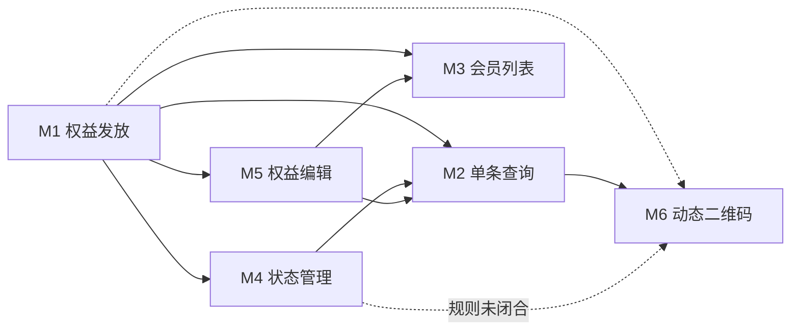

# 1.0 API Rebuild Phase 1 - 权益管理部分 - 模块关系分析

## 关系矩阵

| 源模块 | 目标模块 | 关系类型 | 关系说明 | 风险等级 |
|-------|---------|---------|---------|---------|
| M1 | M2 | 数据依赖 | 发放产生 `voucherCode`、可选 `clientOrderId`，供单条查询 | 中 |
| M1 | M3 | 数据依赖 | 会员路径发放后，列表展示依赖同一会员下的权益数据 | 中 |
| M1 | M4 | 流程依赖 | 须先存在权益记录，才能做状态变更 | 低 |
| M1 | M5 | 流程依赖 | 编辑针对已存在权益；数量/分配与发放规则需一致 | 高 |
| M1 | M6 | 数据依赖 | 二维码应对某张权益/某次使用意图生成，文档未明确入参 | 高 |
| M4 | M2 | 影响传播 | 冻结/作废后，查询返回的剩余次数、状态字段需与规则一致 | 中 |
| M4 | M6 | 规则冲突风险 | 冻结或作废后是否仍允许生成二维码，文档未定义 | 高 |
| M5 | M2 | 影响传播 | 编辑有效期/数量/分配后，查询结果须同步反映 | 中 |
| M5 | M3 | 影响传播 | 列表筛选字段 `validTo`/`status` 与编辑结果需对齐 | 中 |
| M2 | M6 | 流程依赖（隐含） | 典型动线为查权益 → 展码核销，接口契约应对齐 | 中 |

## 依赖关系图（Mermaid）

## 高风险关联点

### 风险点 1: M6 与 M4 的权限/状态规则未闭合

- **涉及模块**：M4, M6
- **风险说明**：文档未说明「冻结」「作废」「已用完」等状态下是否允许生成二维码；易导致核销漏洞或客诉（能展码但不能进场等）。
- **建议**：在「状态管理」或「二维码」章节补充状态前置条件表（允许/拒绝 + 错误码）。

### 风险点 2: M5 与已消耗数据的一致性

- **涉及模块**：M1, M5, M2
- **风险说明**：调低 `availableUsages` 或调整 `usageAllocation` 时，若已存在消费记录，未定义校验规则与错误码，易出现数据不一致或负余额语义。
- **建议**：补充「已用次数 / 已用持卡人次数 / 已用携伴次数」与编辑字段的约束与失败场景。

### 风险点 3: 错误码 500.031.005 语义过载

- **涉及模块**：M1, M5
- **风险说明**：同一错误码同时表示「总额不一致」与「不支持编辑 usageAllocation」，对接方与监控告警难以区分。
- **建议**：拆分为独立错误码，或在需求中明确「同一码 + 不同 message」是否为规范允许做法。

### 风险点 4: 文档与 APIFOX 双源一致性

- **涉及模块**：M1–M6
- **风险说明**：需求正文大量能力依赖「见 APIFOX」，若未约定以哪一侧为准，评审/测试/联调易产生分歧。
- **建议**：在文档首部增加「单一事实来源（SSOT）」说明：字段级以 APIFOX 为准或反之，并约定变更流程。

## 共享实体分析

| 实体名称 | 涉及模块 | 操作类型 |
|---------|---------|---------|
| 权益实例（Entitlement） | M1(创建), M2(读), M3(读列表), M4(更新状态), M5(更新属性), M6(读/核销关联未定义) | 创建 / 读 / 更新 |
| voucherCode | M1(生成), M2(查询键) | 写 / 读 |
| clientOrderId | M1(可选写入), M2(查询键), 防重 | 写 / 读 |
| usageAllocation | M1(写入), M5(条件更新), M2/M3(展示未定义) | 写 / 读 |
| entitlementTemplateId | M1(引用模板), M5(是否可改未说明) | 读 / 未闭合 |
| 会员 memberId | M1, M3 | 读 / 关联 |
