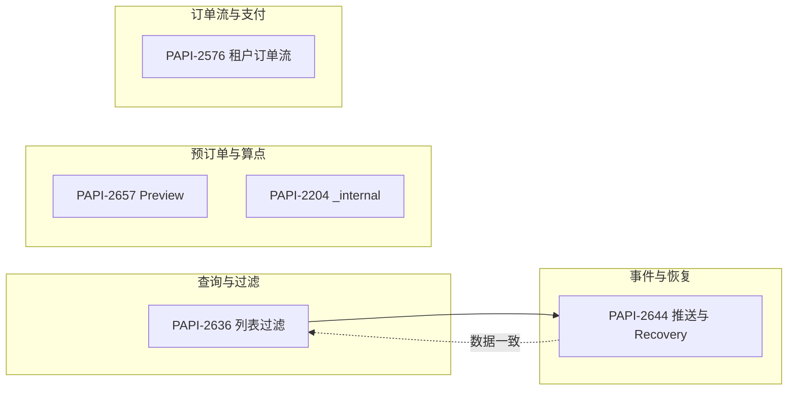

# Aero Blue 需求（本地 `requirements/Aero Blue/`）— 测试分析

## 1. 分析范围与依据

| 需求编号 | 摘要定位 | 本地文档 |
|----------|-----------|----------|
| PAPI-2636 | 项目资源 / Transport Hub 列表按 id 过滤 | [PAPI-2636.md](../requirements/Aero%20Blue/PAPI-2636.md) |
| PAPI-2657 | Preview：`toUseEntitlementDetail` 改为非必传 | [PAPI-2657.md](../requirements/Aero%20Blue/PAPI-2657.md) |
| PAPI-2644 | 项目维度资源/站点元数据更新推送 + Recovery | [PAPI-2644.md](../requirements/Aero%20Blue/PAPI-2644.md) |
| PAPI-2204 | Lounge/FT prebooking `_internal` 与订单详情回显（租户配置） | [PAPI-2204.md](../requirements/Aero%20Blue/PAPI-2204.md) |
| PAPI-2576 | 0426 租户 + `cashPaymentApplied` 与 VISA PCI 订单流 | [PAPI-2576.md](../requirements/Aero%20Blue/PAPI-2576.md) |

说明：上述文档均由 Jira 描述导出，细节以 Jira 与最终实现为准；表格类内容以需求内 HTML 表及配图为准。

---

## 2. 测试域总览

- **功能**：入参校验、默认值与分支、租户开关、返回体结构。
- **集成**：VISA / SaaS / MQ / PCI 相关链路（以 PAPI-2576 为主）。
- **回归**：未配置租户、老客户端不传新字段、原 program 维度推送与现 project 维度并存或迁移策略（需与研发确认）。
- **非功能**：推送「多 program 合并为一次」的去重与幂等；Recovery 与事件内容一致性。

---

## 3. 分需求测试要点

### 3.1 PAPI-2636 — 列表按 id 过滤

| 维度 | 测试关注点 |
|------|------------|
| 参数 | `resourceId`、`transportHubId` 单独与组合（若允许组合需确认；需求写「限制单个 id」） |
| 边界 | 空、非法格式、不存在的 id、跨租户 id |
| 行为 | 过滤后条数、排序是否与无过滤一致、性能（大项目下单次 id） |
| 文档缺口 | 两个接口路径、参数名与位置（query/body）、多 id 是否直接拒绝及错误码 |

**建议优先级**：列表为读接口且约束「单 id」，P1 覆盖主路径 + 非法/不存在 id；P2 覆盖边界与性能抽样。

---

### 3.2 PAPI-2657 — Preview `toUseEntitlementDetail` 非必传

| 场景 | 预期行为（按需求描述归纳） |
|------|---------------------------|
| 传 `toUseEntitlementDetail` | 与现网一致：按指定 CH/Guest 分配点数 |
| 不传 + 传 `toUseEntitlementCount` | 按总量拆分：**1 点优先 CH，剩余给 Guest** |
| 不传且 count 边界 | 0 点、1 点、仅够 CH、仅 Guest 等 |
| 兼容 | 老客户端只传 count、新字段缺失 |

**建议优先级**：P1 不传时的默认拆分规则（含奇数点、最小单位是否为 1）；P2 与下单/实际扣点一致性（若 Preview 与 create 分离，需对齐业务规则）。

**待澄清**：`toUseEntitlementCount` 与明细同时传时以谁为准；错误码与字段校验文案。

---

### 3.3 PAPI-2644 — Project 级推送与 Recovery

| 维度 | 测试关注点 |
|------|------------|
| Topic | `project.resource.metadata.updated`、`project.transportHub.metadata.updated` 是否按约定注册与订阅 |
| 载荷 | 与 `Retrieve Project Resources List` / `Retrieve Project Transport Hub List` 一致；`programId` → `projectId` 替换正确 |
| 去重 | 多 program（如 N00001 作用 800 program）仅 **1 次** 推送 |
| Recovery | 支持找回上述两类事件；顺序、游标、重放不重复消费（依实现） |
| 集成 | 资源/站点更新触发链路、下游消费方兼容性 |

**建议优先级**：P1 Topic 名、payload 结构、单次推送；P2 Recovery 全链路；P3 大租户压力与日志可追溯。

**待澄清**：与旧 program 维度事件是否并存、版本号或时间戳字段。

---

### 3.4 PAPI-2204 — `_internal` 与租户配置

| 维度 | 测试关注点 |
|------|------------|
| Nacos | 仅白名单租户可传 `extra._internal`；未配置租户传参 → **统一兜底错误**（需对齐错误码） |
| 下单 | Lounge / FT 两个 prebooking URL；创建时不校验字段，仅落库 |
| 查询 | `/v2/orders/memberships/details` 回显与 `ord.order feature` 一致；未配置租户 **整个 object 不返回**；已配置无值 → **null** |
| 字段 | `_amount`、`_currency`、`_exchangeRate` 与 SaaS JSON 映射（见需求表） |

**建议优先级**：P1 租户开关开/关 × 传参/不传 × 查询返回；P2 部分字段缺失、类型异常、历史订单兼容。

---

### 3.5 PAPI-2576 — 0426 租户与 `cashPaymentApplied`

| 维度 | 测试关注点 |
|------|------------|
| 租户 | 仅 **0426** 走新逻辑；其他租户完全回归 |
| 商品 | 预约商品过滤：排除「第三方权益/第三方现金」，仅权益/现金类可下单 |
| 参数 | `cashPaymentApplied=true` 且「确有现金应付」校验通过后，create 后 API **不再**调 `orderStatusUpdate` / `confirmOrder`；由 VISA 侧通知 SaaS |
| 分支 | `cashPaymentApplied=false` 走原流程；纯权益 / 纯现金 / 权益+现金 与表格中 API/VISA 分工一致 |
| 回归 | payFinish、MQ「待发放」、PCI 预授权/扣款阶段与状态机 |

**建议优先级**：P1 0426×三支付形态× true/false；P2 非 0426 不受影响；P3 后续切回标准 SaaS 第三方权益订单流的开关或配置（若需求后续迭代）。

**待澄清**：「通过检验（真的有金额要付）」的判定接口与边界；过滤商品的具体判定字段来源。

---

## 4. 横向关联与回归矩阵

| 关联 | 说明 | 建议 |
|------|------|------|
| PAPI-2644 ↔ PAPI-2636 | 推送内容与两个 List 接口一致 | 用同一批造数：更新资源/站点后比对 event payload 与列表接口字段子集 |
| PAPI-2657 ↔ 下单/权益 | Preview 算点规则 | 抽样用 Preview 结果驱动后续 create，核对 CH/Guest 占用 |
| PAPI-2204 ↔ 租户 | Nacos 与返回体 | 与 PAPI-2576 共用租户配置思想时，注意不同需求的租户 id 列表勿混淆 |
| PAPI-2576 ↔ 支付/订单状态 | 状态机与谁调 SaaS | 需 VISA/联调环境或 mock；契约测试优先 |

---

## 5. 信息缺口汇总（建议评审或补需求）

1. **PAPI-2636**：完整 URL、HTTP 方法、参数契约、错误码、是否禁止多 id 及如何报错。  
2. **PAPI-2657**：明细与 count 同时存在时的优先级；边界与错误场景。  
3. **PAPI-2644**：与旧 Topic 关系、payload schema、Recovery API 形态。  
4. **PAPI-2204**：兜底错误码、`_internal` 与 extra 其它字段并存规则。  
5. **PAPI-2576**：商品过滤规则的可测试定义、0426 外灰度策略、联调责任边界。

---

## 6. 建议测试优先级（汇总）

| 优先级 | 建议覆盖 |
|--------|----------|
| **P1** | PAPI-2576 租户与 `cashPaymentApplied` 主分支；PAPI-2204 租户开关与返回；PAPI-2657 不传明细的默认拆分；PAPI-2636 单 id 过滤主路径；PAPI-2644 Topic 与单次推送 |
| **P2** | 各需求边界、非法入参、历史数据、Recovery、与列表/推送数据一致性 |
| **P3** | 大租户性能、日志与监控、文档与错误码一致性 |

---

## 7. 环境与数据前提（测试准备）

- **凭证与租户**：0426（2576）、Nacos 白名单租户（2204）、含多 program 的项目（2644、2636）。  
- **联调**：PAPI-2576 依赖 VISA / PCI / MQ 时可规划 mock 或分段验收。  
- **配图**：PAPI-2576、PAPI-2644 含示意图，用例步骤中可引用本地 `requirements/Aero Blue/images/` 便于评审对齐。

---

*文档版本：基于当前 `requirements/Aero Blue/` 导出稿整理；需求变更时请同步更新本分析与用例。*
