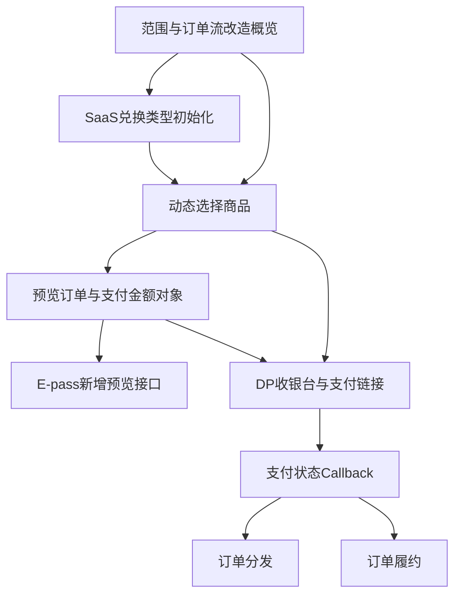

# 订单流支持【真现金支付】【第三方权益】 - 模块关系分析

## 关系矩阵

| 源模块 | 目标模块 | 关系类型 | 关系说明 | 风险等级 |
| --- | --- | --- | --- | --- |
| M1 范围与订单流改造概览 | M3 动态选择商品 | 规则依赖 | M1定义“按API参数动态选择”，M3需要给出可执行决策表。 | 高 |
| M2 SaaS兑换类型初始化 | M3 动态选择商品 | 数据依赖 | 初始化后的商品类型决定后续可选商品池。 | 高 |
| M3 动态选择商品 | M4 预览订单与支付金额对象 | 流程依赖 | 预览订单的权益数量、现金模式、商品类型影响 SaaS权益计算和算价。 | 高 |
| M4 预览订单与支付金额对象 | M5 E-pass新增预览接口 | 数据依赖 | E-pass预览响应需要复用 `payment` object 和金额拆分规则。 | 中 |
| M3 动态选择商品 | M6 DP收银台与支付链接 | 规则依赖 | 是否拉起收银台直接复用 M3 的 DP收款判断。 | 高 |
| M6 DP收银台与支付链接 | M7 支付状态Callback | 流程依赖 | 支付链接产生 PendingPayment 后，必须由回调推进订单支付状态。 | 高 |
| M7 支付状态Callback | 订单分发/履约 | 影响传播 | 支付成功/失败/超时决定订单是否能分发和履约。 | 高 |
| M4 预览订单与支付金额对象 | M6 DP收银台与支付链接 | 数据依赖 | 支付链接应使用预览/创单阶段的 payable amount、currency、orderId 等支付数据。 | 高 |
| M3 动态选择商品 | M2 SaaS兑换类型初始化 | 共享实体 | 两者共同操作商品类型、兑换类型、现金收款模式。 | 中 |

## 依赖关系图

## 高风险关联点

### 风险点 1: `cashPaymentApplied=false` 同时表示纯权益和DP收款

- **涉及模块**：M3、M4、M6
- **风险说明**：文档中 `cashPaymentApplied=false` 可表示“全权益支付或DP收款模式”，如果未定义 `cashier` 是否优先，会导致商品选择、是否算价、是否拉起收银台产生分歧。
- **建议**：补充完整决策表，明确 `cashier` 不传、`paymentMode=DP_COLLECT`、`paymentMode=CLIENT_COLLECT` 与 `cashPaymentApplied` 的优先级和非法组合。

### 风险点 2: 支付状态Callback缺失导致订单闭环不成立

- **涉及模块**：M6、M7、订单分发、订单履约
- **风险说明**：创单后进入 `status=9 PendingPayment`，但文档没有定义支付成功/失败/取消/超时后如何更新订单、如何幂等、如何触发分发和履约。
- **建议**：将 Callback 接口路径、鉴权签名、事件字段、状态映射、重试策略、幂等键、失败处理补齐为独立章节。

### 风险点 3: SaaS算价与API订单金额的一致性未约束

- **涉及模块**：M4、M6
- **风险说明**：API侧“不再自己计算”，但未定义 SaaS 算价接口失败、金额精度、币种、负数抵扣、四舍五入、预览金额与创单金额不一致时的处理。
- **建议**：补充金额映射规则、精度规则、不可变校验和错误处理。

### 风险点 4: 初始化数据改造可能影响存量商品

- **涉及模块**：M2、M3
- **风险说明**：Membership 商品需统一初始化为“客户预收费”，但未说明存量订单、已上线商品、灰度范围、回滚策略。
- **建议**：补充数据迁移范围、执行时点、验证SQL/配置检查、灰度与回滚方案。

## 共享实体分析

| 实体名称 | 涉及模块 | 操作类型 |
| --- | --- | --- |
| 商品类型/兑换类型 | M2、M3 | 初始化、读取、选择 |
| `cashPaymentApplied` | M3、M4、M5、M6 | 请求入参、选择规则、响应回传 |
| `cashier.paymentMode` | M3、M5、M6 | 请求入参、收款模式判断 |
| `toUseUsageCount` | M3、M5 | E-pass权益抵扣数量 |
| `toUseEntitlementCount` | M3、M4 | Membership权益抵扣数量 |
| `payment` object | M4、M5、M6 | SaaS算价返回、预览响应、支付金额来源 |
| `orderId` | M6、M7、订单分发/履约 | 支付链接、回调关联、订单状态推进 |
| 支付状态 | M6、M7、订单分发/履约 | PendingPayment、支付成功、支付失败、取消、超时 |
