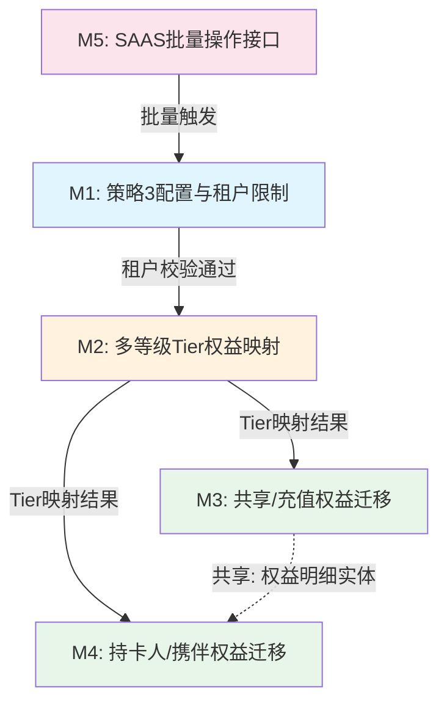

# 新增升降级权益策略3 (PAPI-2194) - 模块关系分析

## 关系矩阵

| 源模块 | 目标模块 | 关系类型 | 关系说明 | 风险等级 |
|-------|---------|---------|---------|---------|
| M1 | M2, M3, M4 | 流程依赖 | M1 确定策略类型和租户校验后，才进入 M2/M3/M4 的权益迁移逻辑 | 低 |
| M2 | M3 | 数据依赖 | M2 完成 Tier 映射后，M3 才能按 Tier 维度迁移共享/充值权益 | 高 |
| M2 | M4 | 数据依赖 | M2 完成 Tier 映射后，M4 才能按 Tier 维度迁移持卡人/携伴权益 | 高 |
| M3 | M4 | 共享实体 | M3 和 M4 操作同一 Tier 下的不同类型权益，共享"权益明细"实体 | 中 |
| M5 | M1 | 流程依赖 | M5 批量接口为入口，每次批量调用内部依次触发 M1→M2→M3/M4 流程 | 高 |
| M5 | M2, M3, M4 | 影响传播 | 批量操作的失败/回滚策略影响 M2/M3/M4 每一步是否需要支持事务 | 高 |

## 依赖关系图（Mermaid）

## 高风险关联点

### 风险点 1: M2 Tier映射是 M3/M4 的前置依赖，但映射规则未明确
- **涉及模块**：M2, M3, M4
- **风险说明**：M2 的 Tier 映射结果直接决定 M3 和 M4 应将权益迁移到哪个目标 Tier。但文档对映射规则仅给出了理想的一一对应示例（tier1→tier1），未明确映射依据（按编号/名称/手动配置）、Tier 数量不匹配时的处理方式。若 M2 映射规则不清，M3/M4 的迁移逻辑无法正确实现。
- **建议**：优先明确 M2 的映射规则，确定 Tier 数量不等时的降级/报错策略，再推导 M3/M4 的处理逻辑。

### 风险点 2: M5 批量操作的事务性影响 M2/M3/M4 的回滚设计
- **涉及模块**：M5, M2, M3, M4
- **风险说明**：M5 支持批量操作，但文档未说明批量中部分失败时的处理策略。由于 M2→M3/M4 是链式依赖（Tier映射→权益迁移），单条记录内部就存在多步骤原子性问题；批量操作进一步放大了这个问题。若不确定事务策略，可能导致数据不一致。
- **建议**：明确单条迁移是否为原子事务；明确批量操作中部分失败的响应结构和回滚策略。

### 风险点 3: M3 和 M4 操作同一权益实体可能冲突
- **涉及模块**：M3, M4
- **风险说明**：M3 处理共享/充值权益，M4 处理持卡人/携伴权益。两者操作同一 Tier 下的权益明细列表。如果权益分类不够清晰（例如"大客户持卡人"既可能被 M3 识别为共享权益，也可能被 M4 识别为持卡人专属权益），可能出现重复处理或遗漏。
- **建议**：明确权益类型的分类判定规则，确保 M3 和 M4 处理的权益集合互斥且完备。

## 共享实体分析

| 实体名称 | 涉及模块 | 操作类型 |
|---------|---------|---------|
| 权益明细（Entitlement Detail） | M2(读), M3(读+写), M4(读+写) | 读取旧权益明细，重发新权益明细 |
| Tier 映射关系 | M2(写), M3(读), M4(读) | M2 建立映射，M3/M4 消费映射结果 |
| 会籍状态（Membership Status） | M1(读+写) | 激活新等级、冻结旧等级（步骤1/4由M1控制） |
| 权益余额（Balance） | M3(读+写), M4(读) | M3 按余额迁移点数，M4 依据有限/无限判断处理 |
