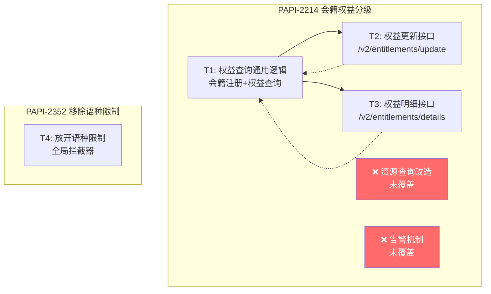

# Q1-SP4 技术方案 - 需求-方案映射分析

## 覆盖度映射矩阵

### PAPI-2214（会籍权益分级 V2）

| 需求点 | 需求描述 | 技术模块 | 覆盖状态 | 备注 |
|--------|---------|---------|---------|------|
| R1 | 会籍注册接口新增 `scopeType` 字段 | T1 | ⚠️ 部分覆盖 | 技术方案仅描述了通用查询逻辑，未明确会籍注册的 `scopeType` 字段处理 |
| R2 | 会籍注册 tier 默认值兜底逻辑（v2 新增） | T1 | ❌ 未覆盖 | 技术方案中未提及 tier 默认值兜底机制 |
| R3 | 权益查询接口新增 `scopeType` 字段 | T1 | ⚠️ 部分覆盖 | 技术方案仅描述了通用查询逻辑，未明确 `scopeType` 字段返回逻辑 |
| R4 | 权益查询 tier 默认值兜底逻辑（v2 新增） | T1 | ❌ 未覆盖 | 技术方案中未提及 tier 默认值兜底机制 |
| R5 | 权益明细接口 - 按品类查询，按 tier 返回 | T3 | ⚠️ 部分覆盖 | 仅提供时序图，无文字说明接口逻辑 |
| R6 | 权益明细接口 - scopeType=1 和 scopeType=2 两种场景 | T3 | ❌ 未覆盖 | 技术方案中未区分两种场景的处理 |
| R7 | 权益明细 tier 默认值兜底逻辑（v2 新增） | T3 | ❌ 未覆盖 | 技术方案中未提及 |
| R8 | 权益明细接口错误码（500.030.029、500.030.007） | T3 | ❌ 未覆盖 | 技术方案中未提及错误码处理 |
| R9 | 编辑权益接口新增 `tier` 字段 | T2 | ⚠️ 部分覆盖 | 时序图可能包含，但文字描述过于简略 |
| R10 | 编辑权益接口验证规则（500.030.026/027/028） | T2 | ❌ 未覆盖 | 技术方案中未提及验证规则和错误码 |
| R11 | tier 默认值兜底对 update 的影响（v2 新增） | T2 | ❌ 未覆盖 | 读写行为差异未在技术方案中说明 |
| R12 | 三种权益类型的入参约束（v2 新增） | T2 | ❌ 未覆盖 | quantity vs purchasedQuantity 约束未提及 |
| R13 | 资源查询接口 `tier` 字段改造 | - | ❌ 未覆盖 | 技术方案完全未涉及资源查询的技术设计 |
| R14 | 告警机制 | - | ❌ 未覆盖 | 技术方案完全未涉及告警机制的技术设计 |

### PAPI-2352（移除语种限制）

| 需求点 | 需求描述 | 技术模块 | 覆盖状态 | 备注 |
|--------|---------|---------|---------|------|
| R15 | 移除接口语种限制 | T4 | ✅ 已覆盖 | 技术方案描述了通过全局拦截器实现 |

---

## 模块依赖关系图

**依赖说明：**
- T1（权益查询通用逻辑）是 T2 和 T3 的基础，三个模块共享 `scopeType` 判断逻辑
- T2（权益更新）依赖 T1 的等级权益过滤结果
- T4（语种限制）与其他模块无耦合，独立变更

---

## 覆盖缺口

### 缺口 1: 资源查询接口 `tier` 字段改造完全未覆盖
- **需求来源**：PAPI-2214 第五章 - 资源查询（改为读取真的字段）
- **缺失内容**：需求要求将 `/v2/resources` 接口的 `tier` 字段从写死为 `1` 改为动态读取 BOSS 网络分组的 tier 值，涉及查询网络分组、匹配 groupList、多分组取最小等级等逻辑。技术方案中完全未提及。
- **风险等级**：🔴 高
- **建议**：技术方案需补充资源查询接口的技术设计，包括：查询网络分组的时序图、tier 值计算逻辑的流程图、多分组取最小等级的处理逻辑

### 缺口 2: 告警机制完全未覆盖
- **需求来源**：PAPI-2214 第六章 - 告警
- **缺失内容**：需求要求实现两种告警：1）资源同时在多个分组时触发告警；2）项目下资源等级不完整时触发告警。技术方案中完全未提及。
- **风险等级**：🟡 中
- **建议**：技术方案需补充告警机制的技术设计，包括告警触发条件、告警渠道、告警数据采集方式

### 缺口 3: v2 tier 默认值兜底机制完全未覆盖
- **需求来源**：会籍权益分级需求文档-v2 第八章 - 同品类权益 tier 默认值兜底机制
- **缺失内容**：v2 需求新增了核心的"读写行为差异"设计——读侧（memberships/search/details）默认归入 tier=1，写侧（update）仅以显式配置为准。此逻辑涉及所有 4 个权益接口，但技术方案中完全未体现。
- **风险等级**：🔴 高
- **建议**：技术方案需在每个相关模块中补充 tier 默认值兜底的处理逻辑，特别是读写行为差异的实现方式

### 缺口 4: 编辑权益接口验证规则和错误码未覆盖
- **需求来源**：PAPI-2214 第四章 - 验证规则
- **缺失内容**：需求明确了 4 种验证规则（500.030.026/027/028）和对应的错误码，但技术方案仅用一句话概括了 update 逻辑
- **风险等级**：🟡 中
- **建议**：技术方案需补充 update 接口的验证规则流程图或伪代码

### 缺口 5: 三种权益类型的入参约束未覆盖
- **需求来源**：会籍权益分级需求文档-v2 4.4 节
- **缺失内容**：非共享权益只能传 `quantity`、买点权益只能传 `purchasedQuantity`，需要与 tier 交叉校验。技术方案未提及。
- **风险等级**：🟡 中
- **建议**：技术方案需补充入参校验逻辑

---

## 高风险点

### 风险点 1: 读写行为不一致的复杂性
- **涉及模块**：T1, T2, T3
- **风险说明**：v2 需求引入了"读侧兜底、写侧严格"的差异化设计。`details` 接口可能展示 `tier=1` 节点（含默认兜底的权益），但 `update` 接口拒绝操作 `tier=1`（若无显式配置）。此设计增加了测试复杂度，技术方案中未体现实现思路。
- **测试关注点**：
  - 需构造"部分权益配置 tier、部分未配置"的场景
  - 需验证 details 展示与 update 操作的行为差异
  - 需验证场景三（所有权益均为默认兜底 tier=1）的 update 拒绝行为

### 风险点 2: 技术方案图片不可访问
- **涉及模块**：T1, T2, T3, T4（全部模块）
- **风险说明**：技术方案中引用了 7 张图片（流程图、时序图、业务图），但图片文件在本地不存在（`images/` 目录为空或不存在）。这些图片是技术方案的核心内容，无法查看导致无法完整评审方案的逻辑正确性。
- **测试关注点**：需确保图片可正常访问后才能完成对流程逻辑的完整评审

### 风险点 3: 通用逻辑变更影响面大
- **涉及模块**：T1
- **风险说明**：T1 描述的是"通用代码逻辑"，同时影响会籍注册和权益查询两个接口。任何通用逻辑的变更都需要在两个接口上分别验证，回归范围较大。
- **测试关注点**：
  - 会籍注册和权益查询两个接口均需测试
  - 需验证 scopeType=1（不分级）场景下旧逻辑不受影响

### 风险点 4: 全局拦截器修改影响范围不明确
- **涉及模块**：T4
- **风险说明**：技术方案描述"在全局拦截器中修改，所以调个别场景回归即可"，但未具体列出哪些场景需要回归。全局拦截器修改可能影响所有经过该拦截器的接口。
- **测试关注点**：
  - 需确认全局拦截器影响的完整接口列表
  - 需验证非目标接口是否受影响
