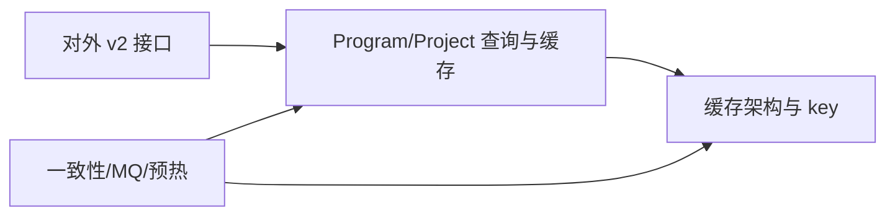

# Resource 接口性能优化技术方案 - 需求-方案映射分析

## 说明

本次评审**未提供独立需求文档或 JIRA 功能清单**作为基线，因此**无法执行完整的正向需求→方案覆盖矩阵**（检查清单 1.1-① 等项标记为「待需求基线」）。

本文件采用：

1. **反向映射**：技术模块（T1–T4）→ 方案内已描述的能力与风险缺口。  
2. **待研发补齐**：关联需求编号、验收口径、发布策略。

---

## 覆盖度映射矩阵（待补充需求后完善）

| 需求点 | 需求描述 | 技术模块 | 覆盖状态 | 备注 |
|--------|---------|---------|---------|------|
| （待填） | （待填） | T1–T4 | ⏸ 待基线 | 请补充正式需求/JIRA 后回填 |

---

## 反向映射：技术模块 → 方案内描述

| 技术模块 | 方案中已覆盖的内容 | 仍缺或待澄清的内容 |
|---------|-------------------|-------------------|
| T1 | 问题背景、性能目标数值、L1/L2/L3、key 形态 | 压测前置条件与验收口径；4.1「整体设计」无实质段落 |
| T2 | Program 聚合、本地+Redis 二级缓存思路、伪代码 | L1 在配置变更后如何失效/覆盖；并发 miss 是否 single-flight；循环内副作用触发时机 |
| T3 | MQ 触发、消费者步骤、TTL、广播、预热名词 | Redis 资源 key 在资源变更后的失效策略；预热对象/频率/限流；MQ 失败重试与幂等 |
| T4 | 列出受影响接口 | 各接口依赖链、回归优先级、兼容性说明 |

---

## 模块依赖关系（Mermaid）

---

## 覆盖缺口（在仅有技术方案前提下的「方案自洽性」缺口）

### 缺口 1：L1 本地缓存在变更后的刷新路径未闭环

- **需求来源**：待关联需求（性能/一致性类非功能需求通常会有「变更生效时效」）。
- **缺失内容**：MQ 消费后若仍命中 L1，如何保证读到新数据。
- **风险等级**：高
- **建议**：在技术方案中明确 invalidate / bypass / 版本 key 等策略之一，并写清最大可见延迟。

### 缺口 2：Redis 缓存失效与重建策略未定义

- **需求来源**：待关联需求。
- **缺失内容**：资源或绑定关系变化时 `basedata:tenantResource...` 系列 key 如何删除或滚动。
- **风险等级**：高
- **建议**：补充失效粒度（project/tenant/program）、失败补偿与观测指标。

### 缺口 3：可验收的性能目标缺少实验设计

- **需求来源**：待关联需求（1.3 非功能）。
- **缺失内容**：数据规模、并发模型、预热、观测工具与通过判据。
- **风险等级**：中
- **建议**：补充标准压测场景与基线对比方法。

---

## 高风险点

### 风险点 1：新旧数据在多节点间可见不一致窗口

- **涉及模块**：T2、T3
- **风险说明**：L1 命中路径与 Redis TTL 兜底组合下，可能出现秒级到分钟级的不一致窗口；若 MQ 或失效失败，窗口拉长。
- **测试关注点**：多节点下配置变更后接口返回一致性、重复消费、乱序消费。

### 风险点 2：高并发冷 key 导致回源放大

- **涉及模块**：T2
- **风险说明**：未见并发合并回源设计时，冷启动或热点 key 可能放大 Redis/Boss 压力。
- **测试关注点**：冷启动、热点 program、并发 miss 压测。
