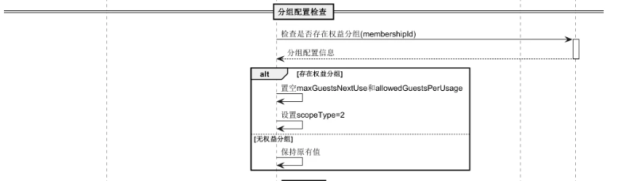
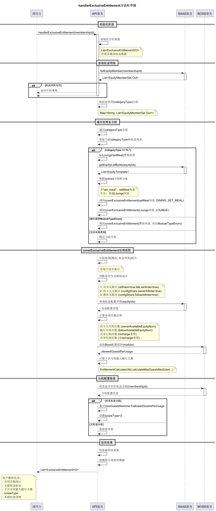
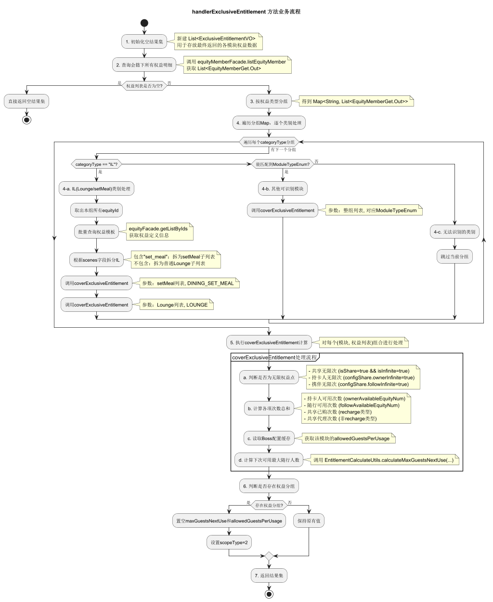
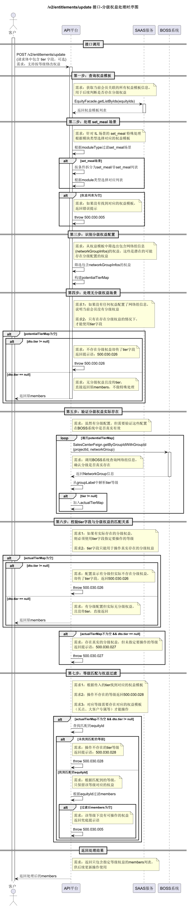
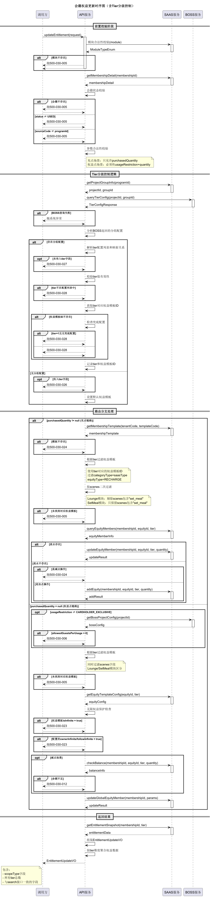
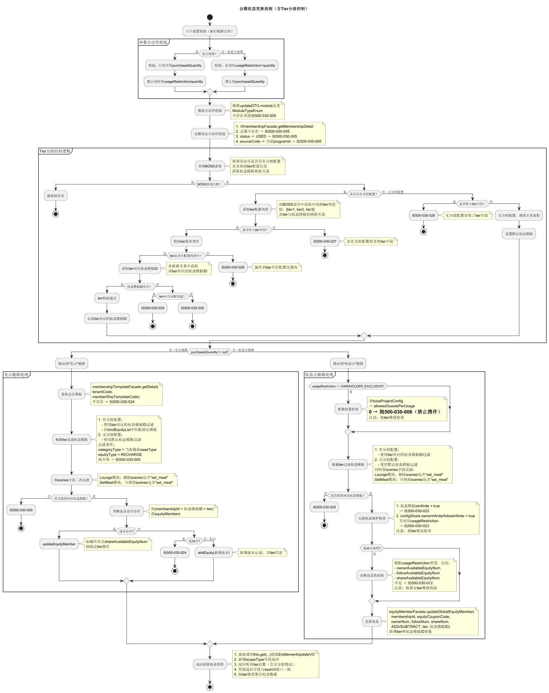
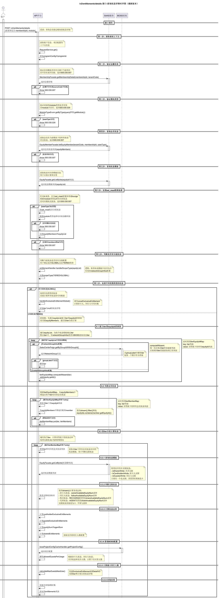
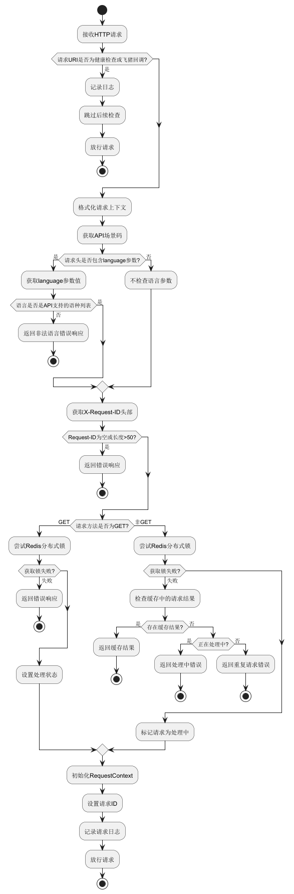

# Q1-SP4 技术方案

> 来源：[Confluence - Q1-SP4 技术方案](https://dragonpass.atlassian.net/wiki/spaces/DGSN/pages/1492779221/Q1-SP4)

---

## 一、需求文档

- [PAPI-2214](https://dragonpass.atlassian.net/browse/PAPI-2214)
- [PAPI-2352](https://dragonpass.atlassian.net/browse/PAPI-2352)

---

## 二、技术方案

### 2.1 会籍注册和权益查询接口的权益查询（通用代码逻辑）

> **查询所有权益模板下面是否设置了等级权益，有则置空 `maxGuestsNextUse` 和 `allowedGuestsPerUsage` 字段，没有则按旧逻辑计算**

#### 2.1.1 时序图

#### 2.1.2 整体流程图

---

### 2.2 权益明细接口

接口路径：`/v2/entitlements/update`

#### 2.2.1 时序图

> **分级权益一句话概括：就是过滤出指定等级的权益，然后进行 update**

**整个接口时序图：**

#### 2.2.2 整体业务图

---

### 2.3 权益明细接口

#### 2.3.1 时序图

---

### 2.4 放开语种限制

#### 2.4.1 全局拦截器时序图

会在全局拦截器中去除权限语种的限制。

#### 2.4.2 影响范围

在全局拦截器中修改，所以调个别场景回归即可。
