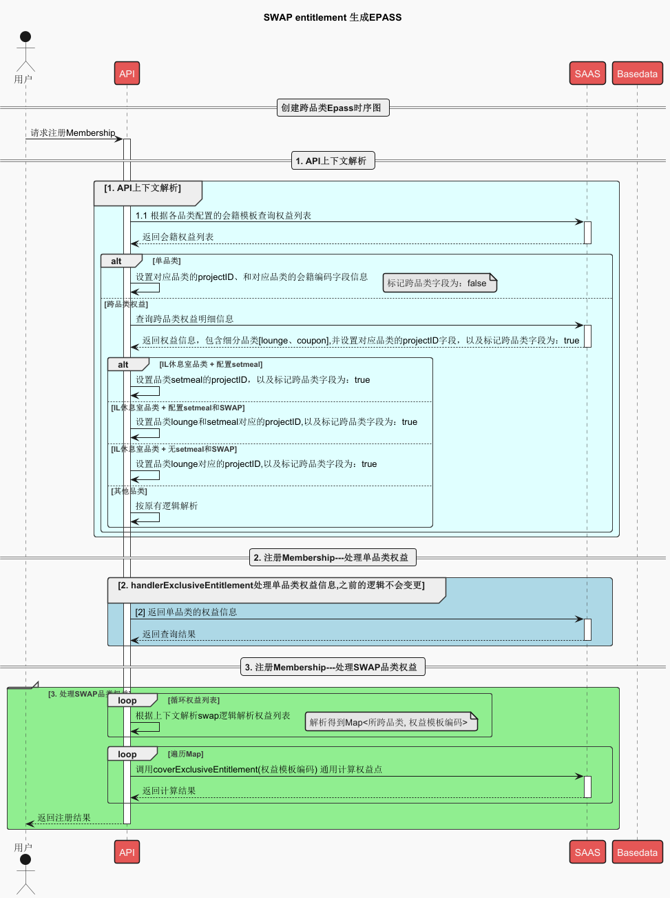
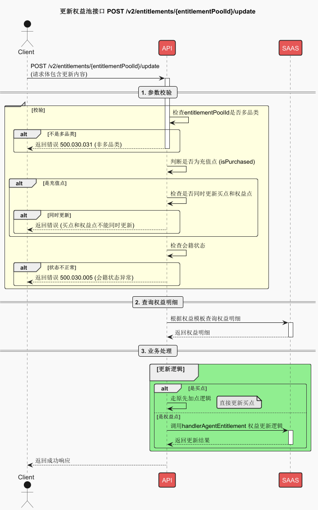
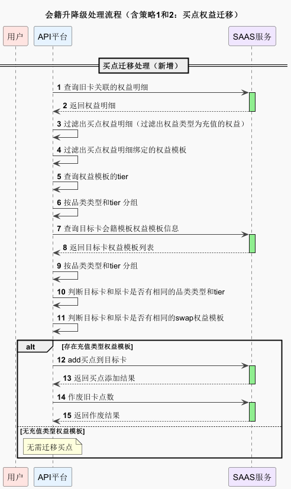
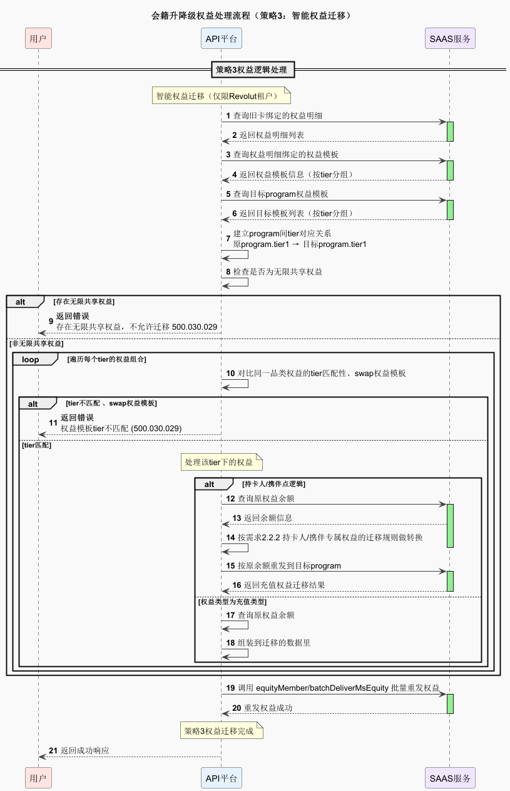
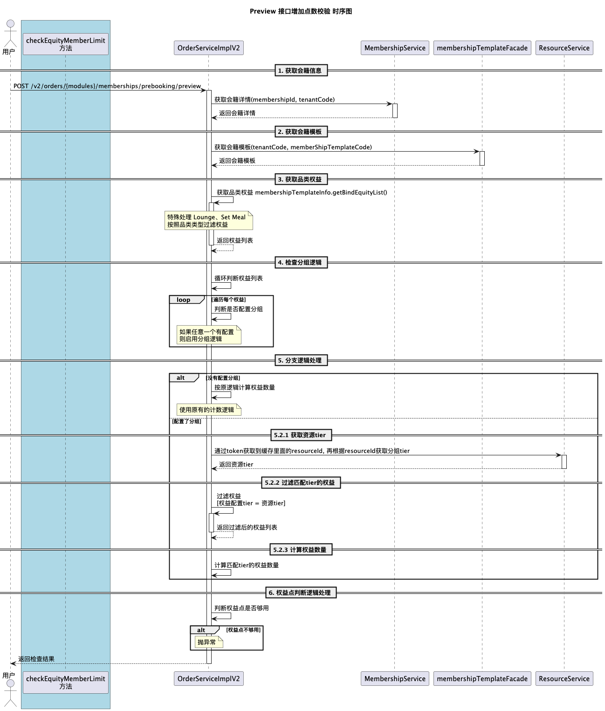
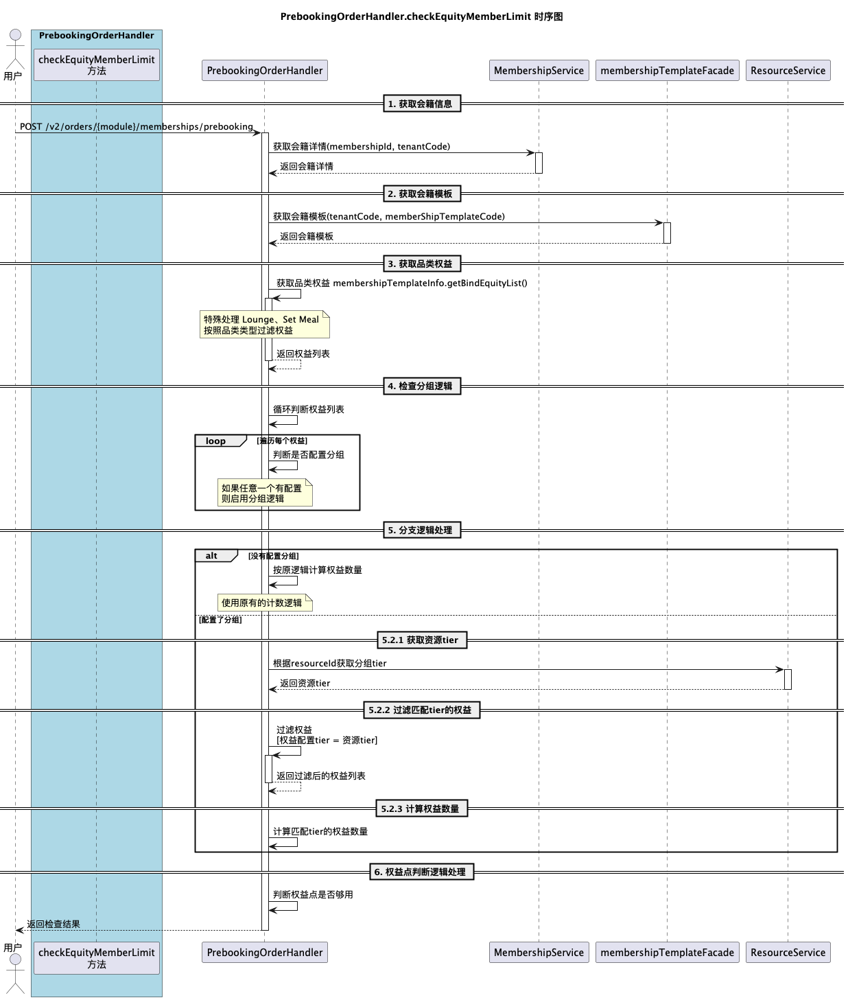

# Q1-SP5 技术方案

> 来源：[Confluence - Q1-SP5 技术方案](https://dragonpass.atlassian.net/wiki/spaces/DGSN/pages/1601208325/Q1-SP5)

---

## 一、需求文档

- [PAPI-2194](https://dragonpass.atlassian.net/browse/PAPI-2194)
- [PAPI-2322](https://dragonpass.atlassian.net/browse/PAPI-2322)
- [PAPI-2401](https://dragonpass.atlassian.net/browse/PAPI-2401)

---

## 二、技术方案

### 2.1 SWAP Entitlement - Membership

#### 2.1.1 注册 Membership 时序图

#### 2.1.2 更新跨品类权益时序图

#### 2.1.3 影响范围

| 序号 | 场景 | 涉及接口 | 备注 |
|------|------|----------|------|
| 1 | 会籍注册 | v2/memberships | 支持跨品类，并且在单品类处理逻辑中剔除跨品类权益 |
| 2 | 权益查询 | /v2/entitlements/search | 支持跨品类权益查询 |
| 3 | 权益更新 | /v2/entitlements/update | 需要校验打标签的跨品类更新，如果传入了则报兜底错误 |
| 4 | 更新明细查询 | /v2/entitlements/details | 需要校验打标签的跨品类更新，如果传入了则报兜底错误 |
| 5 | 跨品类权益更新 | /v2/entitlements/{entitlementPoolId}/update | 新接口 |
| 6 | 资源查询 | /v2/resources、/v2/transportHubs 等相关资源查询 | 支持Membership跨品类权益 |

> // todo: 更新逻辑，跨品类在 boss 存在多个 projectid，取最小值。

---

### 2.2 迁移策略3 - Revolut

> 上一个版本技术方案：Q4-升降级 技术方案

在旧的迁移策略1、2 新增买点迁移：

- 查询旧卡是否有买点，没有则无任何操作
- 有买点，判断目标卡是否有绑定充值类型的权益模板，有则进行充值，并作废旧卡买点
- 判断 tier，单品类（是否共享检验）
  - swap 是否相同，里面的细分品类一致
  - 零点权益明细也要迁移

#### 2.2.1 时序图

#### 2.2.2 影响范围

| 序号 | 场景 | 涉及接口 | 备注 |
|------|------|----------|------|
| 1 | 权益迁移接口 | v2/memberships/programChange | |

---

### 2.3 【Premium Lounges】下单部分

#### 2.3.1 预览接口时序图

- 资源的虚构的 tier 和 SAAS 虚构 tier。真对真，假对假
- 增加一层权益点数校验逻辑

#### 2.3.2 影响范围

| 序号 | 场景 | 涉及接口 | 备注 |
|------|------|----------|------|
| 1 | 预览接口 | /v2/orders/{modules}/memberships/prebooking/preview | |

#### 2.3.3 下单接口时序图

在原有的校验点数方法上增加 tier 等级判断逻辑

#### 2.3.4 影响接口

| 序号 | 场景 | 涉及接口 | 备注 |
|------|------|----------|------|
| 1 | 下单接口 | /v2/orders/lounges/memberships/prebooking | 休息室下单 |
| 2 | 下单接口 | /v2/orders/fastTrack/memberships/prebooking | 速通下单 |
