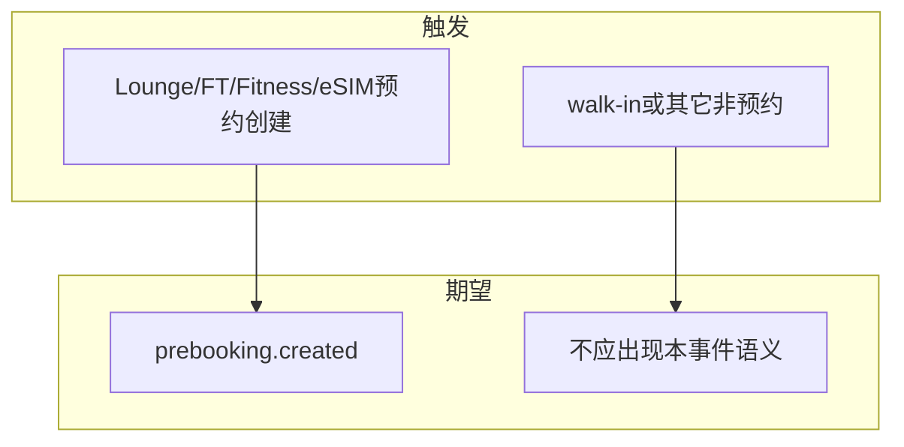

# PAPI-2590prebookingCreated事件测试分析

## 测试范围说明

- rc: 基于 `requirements/Aero Blue/PAPI-2590.md`；监听 SaaS **订单创建 MQ**，事件类型 **`prebooking.created`**；**仅预约单（prebooking）**，**不含 walk-in**；产品线：**Lounge PB、FT PB、Fitness、eSIM**。
- rc: MQ Topic/Exchange、消费者服务名、`module`/`status`/`source` 枚举、与订单创建时刻对齐规则以 **技术方案、Nacos 与 APIFOX/内部文档** 为准；下列 `tc-*` 以 Jira 示例载荷为语义基线。

## 需求语义与验收字段

| 维度 | 要点 |
|------|------|
| 触发 | 预约单创建后可观测到 `prebooking.created` 消息 |
| 排除 | walk-in 等非预约路径不得发送本事件语义 |
| 契约 | `eventType`、`orderId`、`programId`、`dpId`、`module`、`status`、`createdDate`、`source`、`remarks` 与实现类型一致 |

| 字段 | 示例 | 验证点 |
|------|------|--------|
| `eventType` | `prebooking.created` | 固定值、拼写 |
| `orderId` | `PB00000000000001` | 与预约单一致 |
| `programId` | `1888000000000001` | 与项目上下文一致 |
| `dpId` | `8888000066668888` | 与会员标识一致 |
| `module` | `1` | 与产品线枚举表一致 |
| `status` | `0` | 创建时刻状态语义（以状态机文档为准） |
| `createdDate` | `2025-01-01T10:00:00+00:00` | ISO-8601 带偏移 |
| `source` | `H5` | 渠道枚举或文本规则 |
| `remarks` | `null` | 可空；非 null 时类型与长度 |

## 事件契约与载荷共性

### tc-p1: 预约单创建后消息含完整字段且eventType正确

- pc: 任一已覆盖产品线（Lounge PB / FT PB / Fitness / eSIM）具备稳定预约创建与 MQ 或等价观测手段
- 创建一笔预约单并捕获对应消息
  - `eventType` 为 `prebooking.created`；上表所列字段均存在且类型与示例语义一致

### tc-p2: remarks为空或省略时为null或约定等价

- pc: 创建预约单时不传或清空 remarks
- 捕获消息
  - `remarks` 为 `null` 或与产品书面约定等价（非未定义字段随意省略，以实现为准）

### tc-p3: createdDate与订单创建时间语义一致

- pc: 可比对订单库或网关返回的创建时间
- 捕获消息并比对 `createdDate`
  - ISO-8601 带时区偏移；与订单创建语义一致（秒级偏差若有，以技术说明为准）

## 产品线维度LoungePbFtPbFitnessEsim

### tc-p1: LoungePB预约单创建后字段与订单一致

- pc: Lounge PB 预约链路可用
- 创建 Lounge PB 预约单并捕获消息
  - `eventType` 为 `prebooking.created`；`orderId`、`programId`、`dpId`、`module` 与该笔订单事实一致

### tc-p1: FTPB预约单创建后字段与订单一致

- pc: FT PB 预约链路可用
- 创建 FT PB 预约单并捕获消息
  - 同上

### tc-p1: Fitness预约单创建后收到prebooking.created事件

- pc: Fitness 预约创建可用
- 创建成功并捕获消息
  - 事件类型正确；关键 ID 与预约单一致

### tc-p1: eSIM预约单创建后收到prebooking.created事件

- pc: eSIM 预约创建可用
- 创建成功并捕获消息
  - 事件类型正确；关键 ID 与预约单一致

### tc-p2: 四类产品线消息结构一致且module可区分

- pc: 四类各至少一条样本消息
- 比对字段集合与 `module` 取值
  - 结构一致；`module` 能区分产品线且无错发

### tc-p3: 同产品线连续两单消息orderId互不混淆

- pc: 同一产品线连续创建两笔不同预约单
- 分别捕获两条消息
  - 两条 `orderId`（及必要关联键）互不相同、无串单

## 负向Walkin与非预约范围

### tc-p1: Walkin创建不产生prebooking.created语义消息

- pc: walk-in 路径可用且与预约单区分明确
- 仅完成 walk-in 创建（不产生预约单）并观测 MQ
  - 不应出现 `eventType` 为 `prebooking.created` 且指向该 walk-in 订单语义的消息（其它事件若有，以产品清单为准）

### tc-p2: 其它非预约订单类型不误归类为本事件

- pc: 与研发确认订单创建 MQ 上广播的其它类型清单
- 对非预约类型抽样触发并观测
  - 无错误归类为 `prebooking.created`；已知例外须书面记录

## 集成Mq消费与解析

### tc-p2: 标准消费者可解析载荷无静默丢字段

- pc: 存在官方或约定参考消费者
- 使用样例消息执行解析与业务映射
  - 无解析异常；关键字段不被静默丢弃导致误判

## 集成Mq幂等与延迟

### tc-p3: 重复投递幂等与消费延迟符合技术方案

- pc: 技术方案定义幂等键或重试策略；存在约定 SLA 或监控阈值（若无则本步第二项记为待确认）
- 按方案构造重复或重发场景并观测业务侧表现
  - 行为与方案一致（去重、告警或允许重复消费等）
- 测量接口成功返回至消息可消费时间
  - 不超过约定上限或记录结论供产品确认

## 测试域与依赖

| 域 | 关注点 |
|----|--------|
| 契约 | JSON 字段名、类型、`eventType` |
| 范围 | 仅 prebooking；排除 walk-in |
| 一致 | 消息与订单事实对齐 |
| 非功能 | 峰值延迟、堆积、DLQ（若启用） |

| 依赖 | 说明 |
|------|------|
| SaaS 订单创建 MQ | Topic、鉴权、目标环境 |
| 账号与项目 | `programId`、租户、dpId |
| 观测 | MQ 控制台、临时消费者或带 event 的链路日志 |

## 评审检查清单

- [ ] 四类产品线至少各 1 条 P1 正向已覆盖
- [ ] walk-in 负向已覆盖且与产品结论一致
- [ ] 载荷与 Jira 示例及最新技术说明对齐
- [ ] `module`/`status`/`source` 有枚举权威来源
- [ ] 无「仅测一条产品线即代表全部」的未声明省略

## 文档落盘

| 项 | 路径 |
|----|------|
| 需求 | `requirements/Aero Blue/PAPI-2590.md` |
| 本分析 | `testcases/2026Q2_SP2/PAPI-2590-prebooking-created事件-测试分析.md` |
