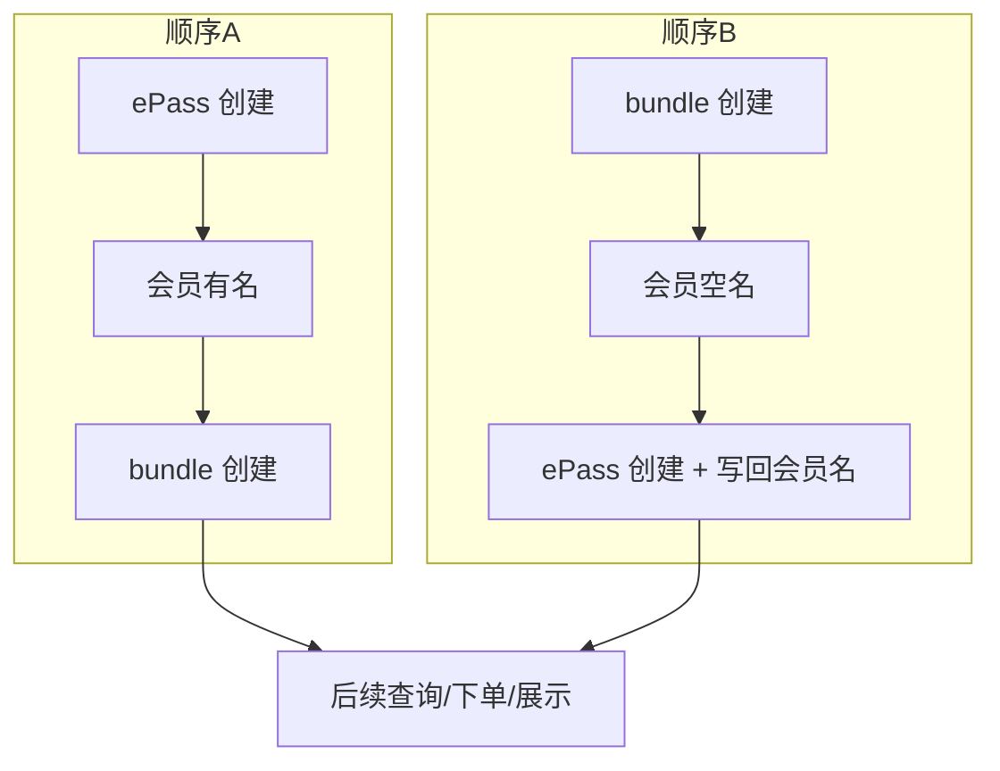

# PAPI-2640 — 测试分析

## 1. 分析范围与依据

| 项 | 内容 |
|----|------|
| 需求编号 | PAPI-2640 |
| 摘要 | 修复 **epass-bundle**、**bundle-epass** 路径下，同一 `clientUserId` 因会员姓名状态导致的注册失败 |
| 本地文档 | [PAPI-2640.md](../../requirements/2026Q2_SP2/PAPI-2640.md) |
| 上游 | [Jira PAPI-2640](https://dragonpass.atlassian.net/browse/PAPI-2640)（无 Confluence 正文，以 Jira 描述与实现为准） |

**说明**：需求仅三条自然语言规则，**未给出接口路径、字段名、错误码与状态机**。下列测试关注点按业务语义归纳；落地执行前须与 **APIFOX / 技术方案** 对齐具体 API 与断言字段。

---

## 2. 需求语义归纳

| 场景顺序 | 会员姓名（创建前） | 调整后预期行为（按需求文字） |
|----------|-------------------|------------------------------|
| 先有 **ePass** 再 **bundle** | 已有名字（非空） | 历史上 bundle 失败；修复后 **bundle 应可直接创建成功** |
| 同上 | 已有名字 | **不得**将 bundle 侧带来的「空名字」**写回**会员（不破坏已有姓名） |
| 先有 **bundle** 再 **ePass** | 空名字 | 创建 ePass 时 **须同时将姓名写入会员**；后续业务 **均以该姓名为准** |

隐含对象：**会员（Member）** 与 **会籍/产品实例（ePass、bundle）** 的创建顺序及 **姓名** 的读写策略一致性问题。

---

## 3. 测试域总览

| 域 | 关注点 |
|----|--------|
| **功能** | 两种创建顺序下成功/失败分支；会员姓名字段与请求体、库表一致性 |
| **集成** | ePass、bundle 与会员域（或 SaaS 会员主数据）的写入顺序；若存在网关与 SaaS 双写，需核对最终一致 |
| **回归** | 与 **仅单产品注册**、**PAPI-2568 等同 clientUserId 策略** 的交叉：不因本次修复改变「重复注册策略」或无关校验 |
| **非功能** | 并发同一 `clientUserId` 双通道创建；幂等与重试下会员名不被错误覆盖 |

---

## 4. 场景与用例设计要点

### 4.1 顺序 A：先 ePass，后 bundle（会员已有名）

| 编号 | 场景 | 前置 | 操作 | 预期 |
|------|------|------|------|------|
| A-P1 | 基线成功 | 同一 `clientUserId` 已成功创建 ePass，会员侧已有非空姓名 | 再发起 bundle 创建（合法报文） | bundle **创建成功**；会员姓名 **仍为原值**（不被清空或覆盖为空） |
| A-P1 | bundle 报文含「空名」 | 同上 | bundle 请求中名字相关字段为空 / 缺省（以产品约定为准） | 仍成功；**验证库表/查询接口** 会员名未被写成空 |
| A-P2 | bundle 报文带新名 | 会员已有「张三」 | bundle 带「李四」 | 与产品确认：是 **保留张三**、**覆盖为李四** 还是 **拒绝冲突**；需求只明确「不 set 空名」，非空覆盖口径需研发确认 |
| A-P3 | 仅 ePass | 无 bundle | 单 ePass 注册 | 与现网一致，防回归 |

### 4.2 顺序 B：先 bundle，后 ePass（会员空名）

| 编号 | 场景 | 前置 | 操作 | 预期 |
|------|------|------|------|------|
| B-P1 | 基线成功 | bundle 已创建且会员姓名为空 | 创建 ePass，且请求携带合法姓名 | ePass 成功；**会员侧姓名** 与请求一致（或产品约定的归一化后一致） |
| B-P1 | 后续只读一致 | 完成 B-P1 | 任意依赖「会员展示名」的查询/列表/下单前校验 | 均使用 **已写入的同一姓名**（需求：后续业务以此为准） |
| B-P2 | ePass 未带名 | 会员仍为空名 | 创建 ePass 不传姓名 | 与 API 校验策略一致：失败须有明确错误；若允许缺省须有文档约定（当前需求倾向「要带名并写入」） |
| B-P3 | 仅 bundle | 无 ePass | 单 bundle 路径 | 会员空名行为与现网一致，防回归 |

### 4.3 边界与异常

| 维度 | 关注点 |
|------|--------|
| **同一 clientUserId** | 标题强调「同一 clientUserId 注册失败」：需在 **两条产品线组合** 下复现旧缺陷用例，并验证修复后通过 |
| **姓名字段** | 仅 first/last、全名、或多语言字段；空格、特殊字符、长度上下限（对齐全局会员名校验） |
| **并发** | 极短时间先调 ePass 与 bundle（顺序不确定）时，会员名终态是否符合规则、无脏写 |
| **幂等/重试** | 创建接口重试不产生重复会员名回滚异常或双写不一致 |

---

## 5. 文档缺口与待澄清（测试前建议关闭）

1. **bundle / ePass** 各自对应的 **HTTP 接口、版本（v2/v3）** 与必填字段表。  
2. 「空名字」的判定：null、空串、仅空格、或未创建会员维度是否都算「空」。  
3. **顺序 A** 下若 bundle 携带 **非空且与会员不一致** 的姓名，产品期望（拒绝 / 忽略 / 覆盖）。  
4. 错误码与 HTTP 状态：旧失败是否统一为某业务码，修复后成功体字段是否有变化。  
5. 与 **租户 / program / Visa 开关**（如 0426）是否相关：若无关，需在非 Visa 租户同样回归抽样。

---

## 6. 优先级建议

| 优先级 | 范围 |
|--------|------|
| **P1** | 顺序 A：会员有名 + bundle 成功 + 不被空名覆盖；顺序 B：会员空名 + ePass 写名成功 + 后续查询一致 |
| **P2** | 顺序 A 非空名冲突策略（与产品确认后）；并发与重试；与 PAPI-2568 同 `clientUserId` 多会籍策略的交叉冒烟 |
| **P3** | 大字段、国际化姓名、审计日志是否记录姓名变更来源 |

---

## 7. 关联回归提示

- [PAPI-2568-AeroBlue注册字段与clientUserId重复注册测试用例-001](./PAPI-2568-AeroBlue注册字段与clientUserId重复注册-测试用例-001.md)：同一 `clientUserId`、注册策略、姓名字段校验；本次需求若只改「bundle/ePass 与会员名」编排，**不应**削弱 2568 已覆盖的重复注册与不一致拒绝场景。  
- 若 bundle/ePass 与 AeroBlue 注册入口共用会员创建链路，建议在 **同迭代** 做一次联合回归清单（勾选即可）。

---

## 8. 交付物建议

正式用例见本目录 **[PAPI-2640-epass-bundle与会员姓名及注册顺序-测试用例-001](./PAPI-2640-epass-bundle与会员姓名及注册顺序-测试用例-001.md)**；已将上表 A-P1/B-P1 等映射为 `tc-p1` / `pc` / 步骤 / 预期；接口与错误码以 APIFOX 为准在步骤中替换执行。
